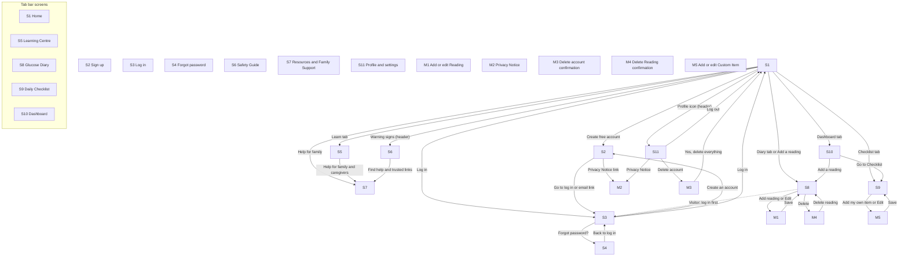

# IMPLEMENTATION\_PLAN.md: Diabetes Companion SA

\---

## 0\. Plan details

|Field|Value|
|-|-|
|App name|Diabetes Companion SA|
|Built from PRD version|v0.4 (the version in `docs/PRD.md`; v0.4 adds the privacy, admin, retention, consent, content-review, language and offline decisions confirmed on 03 Nov 2026)|
|Screen designs|Google Stitch export `stitch\_diabetes\_companion\_style\_guide`, one folder per screen in `docs/designs/` (moved there on 07 Nov 2026 to match the tutor's start prompt, question 27). Where a Stitch screen disagrees with the PRD, the PRD wins: see the correction table in Section 7.3|
|Plan version|v1.8|
|Repository|https://github.com/Ref-DevSa/ (repository name to be added; see Section 18, launch gate L3)|
|Status|Ready to build (Phases 1 to 8 can run on a local Supabase; the hosted Supabase project is set up later, in Phase 9)|
|Last updated|09 Nov 2026|

\---

## 1\. Start here (instructions for the coding agent)

Before writing any code:

1. Read this whole file from top to bottom.
2. Read `docs/PRD.md`.
3. Look at the screen designs listed in Section 7.3.
4. Check Section 18. If any clarification is still **Open**, stop and ask the human. Do not start. (Launch gates in Section 18.2 do not block Phases 1 to 8; they block Phase 9.)
5. Check that the prerequisites in Section 4.2 are installed.
6. Start **Phase 1 only**. Follow Section 2 at all times.

\---

## 2\. Rules for the coding agent (copy word for word, do not edit)

1. **One phase at a time.** Only work on the phase the human asked for. When that phase's Definition of Done is complete, stop and wait for the human to say "Start Phase <number>".
2. **Test-driven development (TDD) for every task.** Follow the cycle in Section 12.1:

   * Write the test.
   * Run it and see it fail for the right reason.
   * Write the smallest code that makes it pass.
   * Run all tests.
   * Refactor while all tests still pass.
3. **Never cheat a test.** Never delete, skip, weaken or change a test just to make it pass. If you believe a test is wrong, stop and explain why to the human.
4. **Never break earlier work.** Every test from earlier phases must still pass before a phase is done.
5. **Build only what is planned.** Build only what is in this file and `docs/PRD.md`. Never build anything in Section 3.3 (Deferred).
6. **Ask, don't guess.** If anything is missing, unclear or contradictory, stop, add it to Section 18, and ask the human.
7. **Match the designs.** Every screen must match its design in Section 7.3: layout, order, labels, text, colours and spacing. Use the design tokens in Section 7.1. Never hard-code colours, font sizes or spacing.
8. **Every state, every screen.** Each screen must handle every state listed for it in Section 7.3 (chosen from normal, empty, loading, error, offline, success, plus any screen-specific states).
9. **Exact wording.** Use the exact labels and messages from the PRD. Never invent wording.
10. **Security first.**

    * Never put secret keys in app code, logs, test files or Git.
    * Every permission rule in Section 9 must be enforced on the server or database, never only in the app.
    * Every permission rule must have a test.
11. **Full check before "done".** Run the full check command (Section 4.3) before saying a phase is done, then add a short summary of the results to the Progress log (Section 17).
12. **Record your progress.** After each phase:

    * tick the checkboxes for that phase in this file;
    * add a row to the Progress log;
    * commit using the commit message given in the phase.
13. **No surprise libraries.** Do not add, remove or upgrade any library or tool not listed in Section 4.1 without asking the human first.
14. **Stuck rule.** If the same problem is still failing after 3 attempts, stop and report:

    * what you tried;
    * the exact error;
    * what you need from the human.
15. **Clean code.** Follow the folder structure in Section 5. Use the PRD's key terms (Section 3.4) for names in code. Keep files small and focused.

\---

## 3\. Project summary and scope

### 3.1 Summary

Diabetes Companion SA is a free web app that helps South African adults with Type 2 diabetes learn about diabetes, save glucose Readings in mmol/L in a Diary, and tick a daily care Checklist. Visitors and family members can read the Learning Centre, the Safety Guide and trusted South African Resources without an account. The app informs and records only: it gives no diagnosis, treatment or medication advice.

**Platform:** Web app, mobile-first for Android phones (360 px wide), also working on tablets and computers. Hosted on Vercel; data in Supabase (PostgreSQL, Auth, Row-Level Security), region Central EU (Frankfurt).

### 3.2 Features in scope

|ID|Feature|Priority|Built in phase|
|-|-|-|-|
|F1|Account and sign-in|Must|3 (S1 in Phase 1)|
|F2|Glucose Diary|Must|5|
|F3|Daily Care Checklist|Must|6|
|F4|Learning Centre|Must|4|
|F5|Dashboard|Should|7|
|F6|Safety Guide|Must|4|
|F7|Resources and Family Support|Should|7|

### 3.3 Deferred: do NOT build

* Diagnosis or treatment advice of any kind (non-goal 1).
* Medication dosing or reminders (non-goal 2).
* Under-18 users or parental-consent flows (non-goal 3).
* Caregiver or family accounts, shared Diaries, any family access to readings (non-goal 4; also confirmed for v1 privacy).
* Connections to glucose meters, doctors or clinics (non-goal 5).
* A personal target range for each User (PRD 4.3).
* The other 8 official South African languages (PRD 4.3).
* "Did you know?" cards and Quick Check quizzes (PRD 4.3).
* Export of the Diary as a PDF (PRD 4.3).
* Admin screens, an admin role in the app, or any Admin user interface (PRD 2.5: admin work is done in the Supabase dashboard).
* Push notifications, SMS, reminders, or any email other than the two system emails in PRD 4.5.
* Dark mode, analytics, advertising, selling or sharing data, payments, maps, AI services, file uploads, profile pictures.
* Offline mode that stores or queues data on the phone (PRD 12.1: no offline mode in v1). Do not use a service worker, IndexedDB or localStorage for health data.
* Changing email address or phone number (PRD Section 5).
* Automatic deletion of inactive accounts (decision in Section 18, question 9).
* Self-service data export (handled by email request in v1; Section 18, question 8).
* Responsive layouts beyond what PRD 9.3 states (there are no tablet or desktop designs: build the phone design in one centred column).

### 3.4 Key terms (use these names in code)

|Term (PRD 1.7)|Name in code|Meaning|
|-|-|-|
|Reading|`Reading`, table `readings`|One blood glucose measurement a User saves, in mmol/L, with a date, a time and a "When" choice|
|Diary|`Diary` (screen `GlucoseDiary`)|The list of all of a User's Readings (S8)|
|Checklist|`Checklist` (screen `DailyChecklist`)|The daily list of care Items a User ticks (S9)|
|Item|`ChecklistItem`, table `checklist\_items`|One line on the Checklist. A Standard Item is built in (`is\_standard = true`); a Custom Item is added by the User|
|Tick|`ChecklistTick`, table `checklist\_ticks`|One Item ticked on one day|
|Flag|`Flag` (`'low' \| 'very\_high' \| null`), `FlagBadge`|The colour, icon and word ("Low" or "Very high") shown on a Reading outside the safety thresholds in BR5. Worked out in code from value and When; never stored|
|Topic|`Topic`, table `topics`|One short educational article in the Learning Centre|
|Safety Guide|`SafetyGuide`, table `safety\_items`|The screen (S6) that explains warning signs and when to get urgent medical help|
|Family tip|`FamilyTip`, table `family\_tips`|One tip for family and caregivers on S7|
|Resource|`Resource`, table `resources`|A link to a trusted South African health organisation|
|User|`User`, table `users`|A person with an account (profile row; email and password are held by Supabase Auth)|
|Visitor|`Visitor` (no session)|Anyone who is not logged in|
|Login attempt|`LoginAttempt`, table `login\_attempts`|A wrong-password try, used for the 15-minute wait|
|When|`ReadingWhen` (`'fasting' \| 'before\_meal' \| 'after\_meal' \| 'bedtime' \| 'other'`), column `reading\_when`|The moment of day a Reading was taken|

\---

## 4\. Tech stack, prerequisites and commands

### 4.1 Stack

> Versions marked "latest stable at setup" are installed in Phase 1; the agent records exact versions in Section 17.

|Layer|Tool|Version|Used for|
|-|-|-|-|
|Frontend|React with React Router|React 19, React Router 7|Screens, routes (PRD 7.2)|
|Language|TypeScript|5|Type safety in the app, tests and shared types|
|Build tool|Vite|7|Dev server and production build|
|Styling|Tailwind CSS (with `@tailwindcss/vite`)|4|Design tokens become the Tailwind theme (Section 7.1)|
|Icons|lucide-react|latest stable at setup|Lucide outline icons (PRD 9.1)|
|Font|Inter (self-hosted via `@fontsource-variable/inter` or `@fontsource/inter`, weights 400, 600, 700)|latest stable at setup|Text. Self-hosting means no request to Google Fonts and works on slow data|
|Translations|react-i18next with i18next|latest stable at setup|`en`, `zu`, `tn` JSON files (BR17)|
|Backend and database|Supabase (hosted): PostgreSQL, Auth, Row-Level Security, with `@supabase/supabase-js`|supabase-js 2; Supabase CLI latest stable at setup|Accounts, data, permission rules. No MongoDB, no Express, no Node server|
|Server functions|None. Small SQL functions in the database (Section 10)|PostgreSQL as provided by Supabase|Login lockout, account deletion|
|Data fetching and caching|None (plain `async` functions in `src/data/` called from screens)|n/a|Keeps the stack small|
|Unit and component tests|Vitest + React Testing Library (`@testing-library/react`, `@testing-library/user-event`, `@testing-library/jest-dom`, `jsdom`)|latest stable at setup|Business rules; components and screens with fake data|
|Test coverage|`@vitest/coverage-v8`|same as Vitest|Section 12.5 coverage rule|
|Database and permission tests|pgTAP through `supabase test db`|Supabase CLI|Constraints, triggers, RLS allow and deny|
|Integration tests|Vitest + supabase-js against the local Supabase|same as Vitest|Backend operations against the real local backend|
|End-to-end tests|Playwright + `@axe-core/playwright`|latest stable at setup|Whole flows and accessibility checks|
|Lint and type check|ESLint (with `typescript-eslint`, `eslint-plugin-react-hooks`) and the TypeScript compiler (`tsc --noEmit`)|latest stable at setup|Code quality|
|Local Supabase|Docker Desktop + `supabase start`|Supabase CLI|Local database, Auth and email catcher|
|Scripts runtime|Node.js 22 or 24 LTS + npm|22 or 24 LTS (decision of 07 Nov 2026, question 23)|Vite, tests and `scripts/\*.mjs` (plain JavaScript)|
|Email (production)|Brevo free plan, custom SMTP|n/a|The two system emails (PRD 4.5). Set up in Phase 9|
|Build and hosting|Vercel (free plan), deploys from GitHub|n/a|The website|
|Version control|Git + GitHub|n/a|Source and history|

Note on supporting packages (07 Nov 2026): the listed tools need `@vitejs/plugin-react` (major 5, the last one that supports Vite 7), `@types/react`, `@types/react-dom`, `@types/node` and `@eslint/js`; they are part of the React, TypeScript and ESLint entries above and are on the T-SETUP-1 list. Nothing else was added.

Note on the language choice: the PRD (11.1) says TypeScript, so the app and tests are TypeScript. The helper scripts in `scripts/` are plain JavaScript (Node.js).

### 4.2 Prerequisites on the computer

* \[x] Node.js 22 or 24 LTS and npm (`node -v` shows v22 or v24; this computer has v24.14.0)
* \[x] Git, with a GitHub account (https://github.com/Ref-DevSa/)
* \[x] Docker Desktop, running (needed for the local Supabase)
* \[x] Supabase CLI (installed as a dev dependency in Phase 1, or globally; `npx supabase --version` works)
* \[x] Playwright browsers (`npx playwright install chromium`, run in Phase 1)
* \[x] Claude Code (VS Code extension), with this repository opened as the workspace (replaces Google Antigravity; question 28)
* \[ ] Accounts needed later (Phase 9, not before): Supabase (Frankfurt region), Vercel, Brevo. **Not needed for Phases 1 to 8.**

### 4.3 Commands

Everything in Phases 1 to 8 runs on the **local** Supabase. Before the full check, Docker must be running and the local backend must be started (`npm run db:start`) and reset (`npm run db:reset`).

|Purpose|Command|
|-|-|
|Install dependencies|`npm install`|
|Start the local backend|`npm run db:start` (runs `supabase start`)|
|Stop the local backend|`npm run db:stop`|
|Reset the database (migrations + seed data)|`npm run db:reset` (runs `supabase db reset`, then `node scripts/seed-users.mjs` to create the test accounts and their sample data)|
|Start the app|`npm run dev`|
|Unit tests|`npm run test:unit` (Vitest, `tests/unit`)|
|Component tests|`npm run test:component` (Vitest, `tests/component`)|
|Database and permission tests|`npm run test:db` (runs `supabase test db`)|
|Integration tests|`npm run test:int` (Vitest, `tests/integration`)|
|End-to-end tests|`npm run test:e2e` (Playwright, `tests/e2e`; it starts the app itself)|
|Lint|`npm run lint`|
|Type check|`npm run typecheck`|
|Secret scan|`npm run scan:secrets` (runs `node scripts/scan-secrets.mjs`)|
|Coverage for business-rule code|`npm run test:coverage`|
|**Full check (run before every "done")**|`npm run check` (runs lint, type check, secret scan, unit, component, database, integration and end-to-end tests, in that order, and stops at the first failure)|
|Build for release|`npm run build`|

\---

## 5\. Folder structure

```
diabetes-companion-sa/                (repository root; the repository name is still to be added)
  AGENTS.md                           short pointer file for Antigravity (Section 18.3, item 4)
  IMPLEMENTATION\_PLAN.md
  MASTER.md                           created from the PRD later (milestone M3); not used by this plan
  README.md                           setup, commands, test accounts, how to run tests
  .env.example                        every variable, placeholder values only
  .gitignore                          includes .env, .env.\*, node\_modules, dist, supabase/.temp
  package.json, package-lock.json
  index.html
  vite.config.ts, tsconfig.json, eslint.config.js, playwright.config.ts, vitest.config.ts
  docs/
    PRD.md                            the PRD (v0.4)
    designs/                          the screen designs: one folder per screen or pop-up (code.html and screen.png)
    PRIVACY\_AND\_ADMIN.md              admin access rules, deletion, retention, backups (Section 9.2)
    ADMIN\_ACCESS\_LOG.md               one row each time the admin opens a User's personal data
    CONTENT\_REVIEW\_LOG.md             who reviewed what and when (health content and translations)
    LAUNCH\_GATES.md                   copy of Section 18.2, ticked off before release
  supabase/
    config.toml                       local Supabase settings (Auth, email, ports)
    migrations/                       tables, constraints, triggers, RLS, functions (Section 8.6)
    seed.sql                          reference content and Standard Items (loaded by db reset)
    templates/                        confirm.html and recover.html (exact text from PRD 4.5)
    tests/database/                   pgTAP tests (\*.test.sql)
  scripts/
    seed-users.mjs                    creates the 3 test accounts and sample data (local only)
    scan-secrets.mjs                  fails if a key or password-like secret is in the repository
  src/
    main.tsx, App.tsx                 app start, router (PRD 7.2), providers
    screens/                          S1 to S11, one file each (Home.tsx, SignUp.tsx, LogIn.tsx, ForgotPassword.tsx, LearningCentre.tsx, SafetyGuide.tsx, Resources.tsx, GlucoseDiary.tsx, DailyChecklist.tsx, Dashboard.tsx, Profile.tsx)
    modals/                           M1 to M5 (ReadingSheet.tsx, PrivacyNotice.tsx, DeleteAccountDialog.tsx, DeleteReadingDialog.tsx, CustomItemSheet.tsx)
    components/                       shared components (Section 7.2)
    auth/                             AuthProvider, route guards (RequireUser, RequireVisitor), session-age check
    data/                             one file per area; each exported function is one backend operation (Section 10)
    lib/                              Supabase client, business rules (flag.ts, readingRules.ts, checklistRules.ts), SAST date helpers, error mapping
    hooks/                            small React hooks (online status, async loading)
    i18n/                             en.json, zu.json, tn.json, index.ts, languages.ts (enabled languages)
    styles/                           index.css with the Tailwind theme (design tokens)
    assets/                           logo and flat illustrations (SVG, each under 50 KB)
    types/                            shared TypeScript types
  tests/
    unit/                             business rules and helpers (Vitest)
    component/                        components and screens with fake data (Vitest + Testing Library)
    integration/                      backend operations against the local Supabase (Vitest)
    e2e/                              user flows and accessibility (Playwright)
    helpers/                          test clients, fake data from PRD 8.4, email-catcher reader
```

Screen to file map: S1 `src/screens/Home.tsx`, S2 `SignUp.tsx`, S3 `LogIn.tsx`, S4 `ForgotPassword.tsx`, S5 `LearningCentre.tsx`, S6 `SafetyGuide.tsx`, S7 `Resources.tsx`, S8 `GlucoseDiary.tsx`, S9 `DailyChecklist.tsx`, S10 `Dashboard.tsx`, S11 `Profile.tsx`. Modals: M1 `src/modals/ReadingSheet.tsx`, M2 `PrivacyNotice.tsx`, M3 `DeleteAccountDialog.tsx`, M4 `DeleteReadingDialog.tsx`, M5 `CustomItemSheet.tsx`.

**Rule:** a new folder may only be created if it is added to this section first.

\---

## 6\. Environment variables and secrets

|Name|What it is|Where to get it|Public or secret|Used by|
|-|-|-|-|-|
|`VITE\_SUPABASE\_URL`|The Supabase project address|Local: `npx supabase status` (API URL). Hosted: Supabase dashboard, Project settings, API|Public|App|
|`VITE\_SUPABASE\_PUBLISHABLE\_KEY`|The public (publishable, formerly "anon") key|Local: `npx supabase status`. Hosted: same dashboard page|Public|App, integration tests, end-to-end tests|
|`SUPABASE\_SERVICE\_ROLE\_KEY`|Local service key, used only to create test accounts|Local only: `npx supabase status` (secret key). **Never the hosted project's key**|Secret|`scripts/seed-users.mjs` and test helpers only. Never the app|
|`TEST\_USER\_PASSWORD`|The shared test-only password for the test accounts|PRD 10.4 (the value is written there, not here)|Secret (test-only)|`scripts/seed-users.mjs`, integration tests, end-to-end tests|
|`E2E\_BASE\_URL`|Address Playwright opens (default `http://localhost:5173`)|You choose|Public|End-to-end tests|
|`BREVO\_SMTP\_KEY`|Brevo SMTP key for the two system emails|Brevo dashboard, SMTP keys (Phase 9)|Secret|**Not in `.env`, not in the repository.** Typed only into the Supabase dashboard (Authentication, SMTP settings)|

`.env.example` (committed to Git, placeholder values only):

```
VITE\_SUPABASE\_URL=http://127.0.0.1:54321
VITE\_SUPABASE\_PUBLISHABLE\_KEY=paste-local-publishable-key-here
SUPABASE\_SERVICE\_ROLE\_KEY=paste-local-secret-key-here
TEST\_USER\_PASSWORD=paste-test-only-password-here
E2E\_BASE\_URL=http://localhost:5173
# BREVO\_SMTP\_KEY is NOT stored here. It is typed into the Supabase dashboard only.
```

Rules:

* Real values go in `.env`, which is listed in `.gitignore` and never committed.
* This is a web app, so `127.0.0.1` in `VITE\_SUPABASE\_URL` is correct for the computer running the app. To test on a real phone, use the computer's Wi-Fi IP address for **both** the dev server (`npm run dev -- --host`) and `VITE\_SUPABASE\_URL`, and add that address to `additional\_redirect\_urls` in `supabase/config.toml`.
* Secret values are never used in app code. `SUPABASE\_SERVICE\_ROLE\_KEY` is read only by `scripts/seed-users.mjs` and test helpers, and `scripts/seed-users.mjs` must refuse to run unless the URL is `localhost` or `127.0.0.1`.
* The hosted project's service key is never put in any file in this repository.
* If a new variable is needed, add it here and to `.env.example` first.

\---

## 7\. Design system and screens

### 7.1 Design tokens

All tokens live in `src/styles/index.css` (Tailwind 4 `@theme`) and are mirrored in `src/lib/tokens.ts` for tests. Screens use tokens only.

|Token|Value|From PRD|
|-|-|-|
|`color.primary`|#1A6BD1|9.1 Primary colour (white text on it: 5.16:1)|
|`color.primaryDark`|#1565C0|9.1 Secondary colour (headings, pressed buttons, focus outline, secondary-button text and border)|
|`color.primaryTint`|#E7F0FD|9.1 Highlight panels|
|`color.background`|#F0F2F5|9.1 Page|
|`color.card`|#FFFFFF|9.1 Cards|
|`color.text`|#1C1E21|9.1 Main text (also toast and offline-banner fill)|
|`color.textSecondary`|#65676B|9.1 Secondary text|
|`color.error`|#B91C1C|9.1 Error, Very high Flag, danger button, Warning signs button|
|`color.success`|#15803D|9.1 Success|
|`color.warning`|#B45309|9.1 Warning (Low Flag)|
|`color.disabled`|#D0D5DD|9.3 / 8.3 Disabled button fill|
|`color.placeholder`|#E4E6EB|8.3 Loading placeholder|
|`font.family`|Inter (400, 600, 700)|9.1|
|`font.size.title`|24 px bold|9.1 Text sizes|
|`font.size.heading`|20 px bold|9.1|
|`font.size.body`|16 px regular (button text 16 px semi-bold)|9.1, 8.3|
|`font.size.small`|12 px regular|9.1|
|`space.1` / `space.2` / `space.3` / `space.4` / `space.5`|4 / 8 / 16 / 24 / 32 px (unit 8)|9.1 Spacing unit|
|`space.margin`|16 px (screen side margin)|9.1|
|`radius.card` / `radius.input` / `radius.button`|12 px each|9.1|
|`shadow.card`|Soft shadow, cards only|9.1|
|`size.button`|48 px|9.1, 8.3|
|`size.touchMin`|44 px|9.4|
|`size.header` / `size.tabBar`|56 px / 56 px|8.3|
|`size.ring`|64 px|8.3 Progress ring|
|`size.dialogMax`|328 px|8.3 Confirmation pop-up|
|`focus.outline`|2 px #1565C0 with 2 px gap|9.3|
|`motion.ring` / `motion.toast`|300 ms / 3000 ms|8.3|
|`breakpoint.tablet` / `breakpoint.desktop`|640 px / 1024 px|9.3|
|`layout.maxWidth.tablet` / `layout.maxWidth.desktop`|720 px / 1200 px|9.3|

Contrast pairs that must be checked by a unit test (T-NFR-7): text on page, secondary text on page, #1565C0 on white, #B45309 on white, #B91C1C on white, #15803D on white, white on #1A6BD1 (see PRD 9.1 for the ratios).

### 7.2 Shared components

|Component|File|Variants and states|Used on|Tests|
|-|-|-|-|-|
|Header|`src/components/Header.tsx`|Visitor (Log in button), User (profile icon), Log in hidden on S2, S3 and S4; wordmark hidden below 400 px; 56 px, fixed|All|T-C-1|
|Language selector|`src/components/LanguageSelector.tsx`|Globe + EN/ZU/TN; menu lists only the enabled languages (`src/i18n/languages.ts`); keyboard operable|Header|T-C-2|
|Warning signs button|`src/components/WarningSignsButton.tsx`|Red #B91C1C, white text, triangle-alert icon, at least 44 px; opens S6|Header|T-C-3|
|Tab bar|`src/components/TabBar.tsx`|5 tabs, active blue, Visitor tapping Diary, Checklist or Dashboard goes to S3; becomes a top menu from 640 px|S1, S5 to S11|T-C-4|
|Button|`src/components/Button.tsx`|primary, secondary, danger; default, pressed, disabled, loading (label changes, disabled); 48 px|All|T-C-5|
|Text field|`src/components/TextField.tsx`|Label, input, message; focus outline; error (red border + icon + message); 48 px|S2, S3, S4, M1, M5|T-C-6|
|Password field|`src/components/PasswordField.tsx`|Text field with show/hide toggle (icon button with text label for screen readers)|S2, S3, S4|T-C-7|
|Checkbox|`src/components/Checkbox.tsx`|Unticked, ticked, error; 44 px target; label can contain a link|S2, S9|T-C-8|
|Card|`src/components/Card.tsx`|White, 16 px padding, 12 px radius, soft shadow; optional coloured border|Most|T-C-9|
|Notice card|`src/components/NoticeCard.tsx`|Short notice text on a card (used for the disclaimer and the S7 and S9 notes)|S1, S5, S6, S7, S9|T-C-10|
|Toast|`src/components/Toast.tsx`|Success (green tick), neutral; 3 seconds; above the tab bar; `role="status"`|Most|T-C-11|
|Offline banner|`src/components/OfflineBanner.tsx`|Shown under the header while offline|All|T-C-12|
|Loading placeholder|`src/components/LoadingPlaceholder.tsx`|Grey #E4E6EB blocks; after 3 seconds the screen shows its error state|Data screens|T-C-13|
|Error state|`src/components/ErrorState.tsx`|Message + "Try again" button|Data screens|T-C-14|
|Empty-state block|`src/components/EmptyState.tsx`|Icon or flat illustration, message, optional button|S5, S7, S8, S10|T-C-15|
|Confirmation pop-up|`src/components/ConfirmDialog.tsx`|Title, text, danger + Cancel; up to 328 px; focus trapped; Escape cancels; loading and error states|M3, M4|T-C-16|
|Bottom sheet|`src/components/BottomSheet.tsx`|Slides up, dimmed page, focus trapped, Cancel closes|M1, M5|T-C-17|
|Topic card|`src/components/TopicCard.tsx`|Icon, title, summary, reading time; opens in place with Close|S5|T-C-18|
|Reading card|`src/components/ReadingCard.tsx`|Value, When, date and time, Flag badge, note, Edit and Delete (disabled while offline)|S8|T-C-19|
|Flag badge|`src/components/FlagBadge.tsx`|Low (down-arrow icon, #B45309), Very high (up-arrow icon, #B91C1C); icon + word + colour, on white|S8, S10, M1|T-C-20|
|Progress ring|`src/components/ProgressRing.tsx`|64 px, "X of Y" in the middle; fills in 300 ms; no animation when reduce-motion is on|S9, S10|T-C-21|
|Logo|`src/components/Logo.tsx`|Rounded-square blue icon with white water-drop and tick; wordmark "Diabetes Companion" + blue "SA"; no blue circle|Header|T-C-22|

### 7.3 Screens

**Design folders** are inside `docs/designs/` (one folder per design, named as in the table below). Each folder has `code.html` and a `screen.png` picture of every state (checked 07 Nov 2026: the pictures are real; an earlier listing misread their size, see Section 18, question 12). Phone only (360 px); there are no tablet or desktop designs.

|ID|Screen|Route / file|Design (folder)|Who can open it (else redirect to)|Tab bar|Required states|Phase|
|-|-|-|-|-|-|-|-|
|S1|Home|`/` · `Home.tsx`|`screen\_s1\_home\_all\_states\_360px\_mobile`|Everyone|Yes|Normal (Visitor and User), Loading, Error, Offline|1|
|S2|Sign up|`/sign-up` · `SignUp.tsx`|`screen\_s2\_sign\_up\_all\_states\_360px\_mobile`|Logged out (User → S1)|No|Normal, Loading, Error, Offline, Success|3|
|S3|Log in|`/log-in` · `LogIn.tsx`|`screen\_s3\_log\_in\_all\_states\_360px\_mobile`|Logged out (User → S1)|No|Normal (with BR16 banner), Loading, Error (3 kinds + ended-session banner), Offline|3|
|S4|Forgot password|`/forgot-password` · `ForgotPassword.tsx`|`screen\_s4\_forgot\_password\_all\_states\_360px\_mobile`|Logged out (User → S1)|No|Normal (step 1, step 2), Loading, Error (expired link), Offline, Success (both steps)|3|
|S5|Learning Centre|`/learn` · `LearningCentre.tsx`|`screen\_s5\_learning\_centre\_all\_states\_360px\_mobile`|Everyone|Yes|Normal, Empty, Loading, Error, Offline|4|
|S6|Safety Guide|`/safety` · `SafetyGuide.tsx`|`screen\_s6\_safety\_guide\_all\_states\_360px\_mobile`|Everyone|Yes|Normal, Empty, Loading, Error, Offline|4|
|S7|Resources and Family Support|`/help` · `Resources.tsx`|`screen\_s7\_resources\_and\_family\_support\_all\_states\_360px\_mobile`|Everyone|Yes|Normal, Empty, Loading, Error, Offline|7|
|S8|Glucose Diary|`/diary` · `GlucoseDiary.tsx`|`screen\_s8\_glucose\_diary\_all\_states\_360px\_mobile`|User (Visitor → S3)|Yes|Normal, Empty, Loading, Error, Offline, Success (toasts)|5|
|S9|Daily Checklist|`/checklist` · `DailyChecklist.tsx`|`screen\_s9\_daily\_checklist\_all\_states\_360px\_mobile`|User (Visitor → S3)|Yes|Normal, Loading, Error, Offline, Success|6|
|S10|Dashboard|`/dashboard` · `Dashboard.tsx`|`screen\_s10\_dashboard\_all\_states\_360px\_mobile`|User (Visitor → S3)|Yes|Normal, Empty, Loading, Error, Offline|7|
|S11|Profile and settings|`/profile` · `Profile.tsx`|`screen\_s11\_profile\_and\_settings\_all\_states\_360px\_mobile`|User (Visitor → S3)|Yes|Normal, Loading, Error, Offline, Success|3|
|M1|Add or edit Reading|bottom sheet over S8 · `ReadingSheet.tsx`|`pop\_up\_m1\_add\_or\_edit\_reading\_all\_states\_360px\_mobile`|User|No|Normal, Loading, Error, Offline, Success|5|
|M2|Privacy Notice|modal · `PrivacyNotice.tsx`|`pop\_up\_m2\_privacy\_notice\_all\_states\_360px\_mobile`|Everyone|No|Normal, Offline (works as normal)|3|
|M3|Delete account confirmation|centred pop-up · `DeleteAccountDialog.tsx`|`pop\_up\_m3\_delete\_account\_confirmation\_all\_states\_360px\_mobile`|User|No|Normal, Loading, Error/Offline|3|
|M4|Delete Reading confirmation|centred pop-up · `DeleteReadingDialog.tsx`|`pop\_up\_m4\_delete\_reading\_confirmation\_all\_states\_360px\_mobile`|User|No|Normal, Loading, Error/Offline|5|
|M5|Add or edit Custom Item|bottom sheet over S9 · `CustomItemSheet.tsx`|`pop\_up\_m5\_add\_or\_edit\_custom\_item\_all\_states\_360px\_mobile`|User|No|Normal, Loading, Error, Offline|6|

Style guide design: `diabetes\_companion\_sa\_mobile\_style\_guide\_component\_set`.

**Routing note.** In Phases 3 and 4, links to S7 (`/help`) point to a temporary development-only placeholder route that is removed in Phase 7 (test T-NAV-9 checks it is gone). The placeholder shows no user-facing wording from the PRD; it exists only so the links do not break.

**Design corrections: the PRD wins over the Stitch export.** The agent builds each screen from the PRD text (Section 8.2) and uses the Stitch design for layout, spacing and look only. Where the export differs, apply these corrections:

|#|What the Stitch export has|What to build instead|Why|
|-|-|-|-|
|D1|Invented badges such as "In range", and invented limits or target-range text (S8, S10, M1)|Only the Flags "Low" and "Very high" per BR5. Never a "normal", "in range" or target text|PRD 4.4 BR5; "no personal target range" in v1|
|D2|"Undo" on the S9 toast; "%" on the progress ring|Toast text only; ring shows "X of Y"|PRD 8.3|
|D3|"Cached from your device", "Available offline", "Emergency clinic numbers" tags|Remove. The only offline wording is the PRD's. The emergency box is built in, not "cached"|PRD 12.1, S6|
|D4|Claims like "reviewed by healthcare teams", "Protected by …" footers|Remove. Make no claim about reviewers or protection that the PRD does not make|PRD BR19, BR22|
|D5|Invented or inconsistent content on M3 and M4 (extra frames, extra buttons or text); "Return to Diary" on the M1 conflict state; an extra urgent-advice box|Use the exact text, buttons and errors in PRD M1, M3 and M4. M1's conflict state shows "This reading no longer exists." and closes|PRD 8.2|
|D6|M5 offline text such as "save your ticks"|M5 offline: "You're offline. Reconnect and try again." with Save disabled|PRD M5|
|D7|Invented Topic body text|Topic text is loaded from the database. In development use the placeholder text in `supabase/seed.sql`, marked `DRAFT: NOT REVIEWED`, with `is\_published = false` in the hosted project until reviewed (BR22)|Health content needs qualified review|
|D8|Emoji used as icons|Lucide outline icons|PRD 9.1|
|D9|Colours outside the palette, and tinted fills for Flags and errors|Palette tokens only. Flags, errors and success sit on white cards with a coloured border and icon|PRD 9.1|
|D10|Header differs by screen ("Log in" shown on sign-up, log-in and forgot-password screens; no profile icon for Users; touch targets under 44 px)|One Header component (7.2): Visitor "Log in" button except on S2, S3, S4; User profile icon; every control at least 44 px|PRD 8.3, 9.4|
|D11|Error and empty texts written differently from the PRD|The exact PRD text for every message (Section 2, rule 9)|PRD 6.2, 8.2, 12.2|
|D12|S5 and S6 have no disclaimer|Add the notice card "This app gives general information only. It does not diagnose or replace your clinic." to S5 and S6 (as on S1)|Decision of 03 Nov 2026 (PRD v0.4)|
|D13|Device chrome in the pictures (status bar "09:41", battery "98%") and state captions|Ignore. Not part of the app|Mock-up decoration|
|D14|(Withdrawn 07 Nov 2026) The `screen.png` pictures were thought to be empty placeholders; they are real pictures|Use `screen.png` and `code.html` together for layout and look; the PRD text still wins (D1 to D13)|Corrected in Section 18, question 12|
|D15|Pages load Tailwind from an online CDN|Do not copy the CDN script. Use the installed Tailwind with the tokens in 7.1|Rule 13 and offline builds|

\---

## 8\. Data model and database

All tables are in the `public` schema. Time zone for dates: `Africa/Johannesburg` (SAST, UTC+2, no daylight saving). Every table has Row-Level Security switched on (Section 9).

### 8.1 Tables

**Table: `users`**: one row per person with an account (profile). Email and password are held by Supabase Auth (`auth.users`).

|Column|Type|Null?|Default|Constraints|Notes|
|-|-|-|-|-|-|
|id|uuid|No|none|primary key; foreign key → `auth.users(id)` on delete cascade|Same id as the Auth account|
|email|text|No|none|unique; check `length(email) between 3 and 254`|Copy set by the sign-up trigger; the app cannot change it|
|language|text|No|`'en'`|check `language in ('en','zu','tn')`|BR17. The only column the app may update (SEC2)|
|age\_confirmed\_at|timestamptz|No|now()||BR18. Set by the sign-up trigger|
|privacy\_agreed\_at|timestamptz|No|now()||Set by the sign-up trigger|
|privacy\_notice\_version|text|No|none|check `length(privacy\_notice\_version) between 1 and 20`|Version of the Privacy Notice agreed to (for example `v0.4`). Set by the trigger from sign-up metadata|
|created\_at|timestamptz|No|now()|||

**Table: `readings`**: one glucose measurement. The Flag is never stored (BR5).

|Column|Type|Null?|Default|Constraints|Notes|
|-|-|-|-|-|-|
|id|uuid|No|`gen\_random\_uuid()`|primary key||
|user\_id|uuid|No|none|foreign key → `users(id)` on delete cascade|BR20|
|value|numeric (no size limit, so PostgreSQL never rounds it)|No|none|check `value = round(value, 1) and value between 1.0 and 40.0`|BR1. A value with two decimals such as 6.85 is rejected, not rounded to 6.9 (T-BR1-3)|
|taken\_at|timestamptz|No|now()|trigger `readings\_validate` (below)|BR2|
|reading\_when|text|No|none (no default)|check `reading\_when in ('fasting','before\_meal','after\_meal','bedtime','other')`|BR3|
|note|text|Yes|null|check `note is null or char\_length(note) <= 200`|BR4|
|created\_at|timestamptz|No|now()||Used for the daily limit (BR9)|
|updated\_at|timestamptz|No|now()|maintained by trigger `set\_updated\_at`||

**Table: `checklist\_items`**: the 4 Standard Items (no owner) and each User's Custom Items.

|Column|Type|Null?|Default|Constraints|Notes|
|-|-|-|-|-|-|
|id|uuid|No|`gen\_random\_uuid()`|primary key||
|user\_id|uuid|Yes|null|foreign key → `users(id)` on delete cascade|Null for Standard Items|
|is\_standard|boolean|No|false||BR10|
|standard\_key|text|Yes|null|unique; check `standard\_key in ('medication','glucose\_check','water','activity')`|Finds the translated name|
|name|text|No|none|check `char\_length(btrim(name)) between 1 and 60`|BR10, BR11|
|sort\_order|integer|No|trigger sets next number|check `sort\_order >= 1`|Standard 1 to 4, then Custom in order added|
|created\_at|timestamptz|No|now()|||

Table-level checks: `(is\_standard and user\_id is null and standard\_key is not null) or (not is\_standard and user\_id is not null and standard\_key is null)`. Unique index `checklist\_items\_user\_name\_uq` on `(user\_id, lower(btrim(name))) where not is\_standard` (BR11).

**Table: `checklist\_ticks`**: one row means one Item was ticked on one day.

|Column|Type|Null?|Default|Constraints|Notes|
|-|-|-|-|-|-|
|id|uuid|No|`gen\_random\_uuid()`|primary key||
|user\_id|uuid|No|none|foreign key → `users(id)` on delete cascade||
|item\_id|uuid|No|none|foreign key → `checklist\_items(id)` on delete cascade|BR11|
|tick\_date|date|No|`(now() at time zone 'Africa/Johannesburg')::date`|unique `(user\_id, item\_id, tick\_date)`|BR12|
|created\_at|timestamptz|No|now()|||

**Table: `topics`**: a Learning Centre article. Text exists in English (required) and optionally isiZulu and Setswana.

|Column|Type|Null?|Default|Constraints|Notes|
|-|-|-|-|-|-|
|id|uuid|No|`gen\_random\_uuid()`|primary key||
|slug|text|No|none|unique; check `char\_length(slug) between 1 and 60`|e.g. `what-is-diabetes`|
|title\_en / title\_zu / title\_tn|text|en: No; zu, tn: Yes|null|check length ≤ 100|A missing translation shows English (BR17)|
|summary\_en / summary\_zu / summary\_tn|text|en: No; zu, tn: Yes|null|check length ≤ 160||
|body\_en / body\_zu / body\_tn|text|en: No; zu, tn: Yes|null|check length ≤ 5000||
|reading\_minutes|integer|No|none|check `between 1 and 15`||
|sort\_order|integer|No|none||Lowest first|
|is\_published|boolean|No|false|check `content\_review\_ok` (below)|BR19, BR22|
|reviewed\_at|date|Yes|null||Date the English text was reviewed by a qualified person (BR22)|
|reviewed\_by|text|Yes|null||Name and role of the reviewer. Not readable by the app (SEC16)|
|review\_due|date|Yes|null||Next review date. Set to 12 months after `reviewed\_at`|
|zu\_reviewed\_at / tn\_reviewed\_at|date|Yes|null||Date the translation was reviewed by a qualified translator (BR21)|
|updated\_at|timestamptz|No|now()|||

**Table: `safety\_items`**: one line in a Safety Guide list.

|Column|Type|Null?|Default|Constraints|Notes|
|-|-|-|-|-|-|
|id|uuid|No|`gen\_random\_uuid()`|primary key||
|section|text|No|none|check `section in ('low','high','urgent')`|Which list on S6|
|text\_en / text\_zu / text\_tn|text|en: No; zu, tn: Yes|null|check length ≤ 200||
|sort\_order|integer|No|none|||
|is\_published|boolean|No|false|check `content\_review\_ok`|BR19, BR22|
|reviewed\_at, reviewed\_by, review\_due, zu\_reviewed\_at, tn\_reviewed\_at|as in `topics`|||||

**Table: `family\_tips`**: one tip on S7.

|Column|Type|Null?|Default|Constraints|Notes|
|-|-|-|-|-|-|
|id|uuid|No|`gen\_random\_uuid()`|primary key||
|text\_en / text\_zu / text\_tn|text|en: No; zu, tn: Yes|null|check length ≤ 200||
|sort\_order|integer|No|none|||
|is\_published|boolean|No|false|check `content\_review\_ok`|BR19, BR22|
|reviewed\_at, reviewed\_by, review\_due, zu\_reviewed\_at, tn\_reviewed\_at|as in `topics`|||||

**Table: `resources`**: a trusted organisation on S7.

|Column|Type|Null?|Default|Constraints|Notes|
|-|-|-|-|-|-|
|id|uuid|No|`gen\_random\_uuid()`|primary key||
|name|text|No|none|unique; check `char\_length(name) between 1 and 80`||
|description\_en / description\_zu / description\_tn|text|en: No; zu, tn: Yes|null|check length ≤ 200||
|url|text|No|none|check `url \~ '^https://' and char\_length(url) <= 300`||
|sort\_order|integer|No|none|||
|is\_published|boolean|No|false|check `content\_review\_ok`|BR19, BR22|
|reviewed\_at, reviewed\_by, review\_due, zu\_reviewed\_at, tn\_reviewed\_at|as in `topics`|||||

**Content check `content\_review\_ok`** (on each of the four content tables):

* `not is\_published or (reviewed\_at is not null and reviewed\_by is not null and btrim(reviewed\_by) <> '')`: nothing can be published without a recorded review (BR22).
* For isiZulu: `(all \*\_zu columns are null) or zu\_reviewed\_at is not null`. The same for Setswana with `\*\_tn` and `tn\_reviewed\_at` (BR21).

**Table: `login\_attempts`**: supports the 15-minute wait after 5 wrong tries (Section 5 of the PRD). The `succeeded` column in PRD v0.3 is dropped in v0.4: only failures are stored, and a successful log-in clears them.

|Column|Type|Null?|Default|Constraints|Notes|
|-|-|-|-|-|-|
|id|uuid|No|`gen\_random\_uuid()`|primary key||
|email|text|No|none|check `email = lower(btrim(email))` and `char\_length(email) <= 254`|Not linked to a User, so unknown emails behave the same|
|attempted\_at|timestamptz|No|now()||Only rows from the last 15 minutes count|

### 8.2 Relationships and delete behaviour

* `users.id` → `auth.users.id`, on delete cascade.
* `readings.user\_id` → `users.id`, on delete cascade (BR20).
* `checklist\_items.user\_id` → `users.id`, on delete cascade (Custom Items only; Standard Items have no owner).
* `checklist\_ticks.user\_id` → `users.id`, on delete cascade.
* `checklist\_ticks.item\_id` → `checklist\_items.id`, on delete cascade (BR11).
* `topics`, `safety\_items`, `family\_tips`, `resources` belong to no User. `login\_attempts` stands alone.
* **Deleting an account** (BR20, OP10): the function `delete\_my\_account()` deletes the row in `auth.users` for `auth.uid()`; the cascades remove the profile, Readings, Custom Items and ticks in the same transaction, and the function also deletes that email's `login\_attempts` rows. Nothing may remain (test T-BR20-2).

### 8.3 Status changes

None in v1 (PRD 10.3). `is\_published` on the four content tables is changed only by the admin in the Supabase dashboard, and the database refuses `true` without a recorded review (`content\_review\_ok`).

### 8.4 Indexes

* `readings (user\_id, taken\_at desc)`: the Diary order and the Dashboard (BR7).
* `readings (user\_id, created\_at)`: the daily-limit count (BR9).
* `checklist\_items (user\_id, sort\_order)`: the Checklist order.
* `checklist\_items\_user\_name\_uq`: unique `(user\_id, lower(btrim(name))) where not is\_standard` (BR11).
* `checklist\_ticks (user\_id, tick\_date)`: today's ticks; the unique constraint `(user\_id, item\_id, tick\_date)` also serves lookups.
* `topics (is\_published, sort\_order)`, `safety\_items (is\_published, section, sort\_order)`, `family\_tips (is\_published, sort\_order)`, `resources (is\_published, sort\_order)`.
* `login\_attempts (email, attempted\_at)`: the lockout check.

### 8.5 Automatic jobs and triggers

|Name|Runs when|What it does|BR#|Test|
|-|-|-|-|-|
|`handle\_new\_user` (function; trigger on `auth.users` after insert)|A person signs up|Reads `raw\_user\_meta\_data`: `age\_confirmed` and `privacy\_agreed` must both be the text `true`, and `privacy\_notice\_version` must be present; otherwise raises error `consent\_required` and the sign-up fails. Inserts the `users` row with the consent times|BR18|T-BR18-2, T-DB-1|
|`readings\_validate` (before insert or update on `readings`)|A Reading is saved|Rejects `taken\_at` more than 5 minutes in the future (error `reading\_future`) and, on insert or when `taken\_at` changes, more than 30 days in the past (error `reading\_too\_old`)|BR2|T-BR2-1 to T-BR2-5|
|`readings\_daily\_limit` (before insert on `readings`)|A Reading is inserted|Takes `pg\_advisory\_xact\_lock(hashtext(user\_id::text))`, counts that User's rows whose `created\_at` falls on today's SAST date; if 30 or more, raises `daily\_limit`|BR9|T-BR9-1 to T-BR9-3|
|`set\_updated\_at` (before update on `readings`, `topics`)|A row is updated|Sets `updated\_at = now()`|n/a|T-DB-2|
|`checklist\_items\_custom\_limit` (before insert on `checklist\_items`)|A Custom Item is inserted|Locks per User; if the User already has 6 Custom Items, raises `custom\_item\_limit`; sets `sort\_order` to the next number|BR11|T-BR11-2, T-BR11-3|
|`checklist\_items\_protect\_standard` (before update or delete on `checklist\_items`)|Any change to a Standard Item|Raises an error (Standard Items cannot be renamed or deleted by anyone using the app)|BR10|T-BR10-2|
|`login\_attempts\_cleanup` (inside `record\_failed\_login`)|A failed log-in is recorded|Deletes rows older than 24 hours, so the table stays small without a scheduled job|n/a|T-DB-3|
|Scheduled jobs|None (PRD 11.1). The daily reset works because ticks are stored by date (BR12)||||

### 8.6 Migrations (in order)

Timestamps use the form `YYYYMMDDHHMMSS`; the agent creates them with `npx supabase migration new <name>`.

1. `<ts>\_create\_users\_and\_signup\_trigger.sql`: table `users`, function `handle\_new\_user`, trigger on `auth.users`.
2. `<ts>\_create\_readings.sql`: table `readings`, indexes, triggers `readings\_validate`, `readings\_daily\_limit`, `set\_updated\_at`.
3. `<ts>\_create\_checklist.sql`: tables `checklist\_items` and `checklist\_ticks`, indexes, triggers, the four Standard Items (fixed ids), `tick\_date` default.
4. `<ts>\_create\_content\_tables.sql`: tables `topics`, `safety\_items`, `family\_tips`, `resources`, the `content\_review\_ok` checks and indexes.
5. `<ts>\_create\_login\_attempts\_and\_functions.sql`: table `login\_attempts`; functions `check\_login\_allowed`, `record\_failed\_login`, `clear\_my\_login\_attempts`, `delete\_my\_account`.
6. `<ts>\_enable\_rls\_and\_policies.sql`: `enable row level security` on all 9 tables; every policy in Section 9; column grants (`users`: update only on `language`; content tables: no select on `reviewed\_by`); `revoke all` on every table from `anon` and `authenticated` first, then grant only what is needed; `revoke execute` on the functions from `public`, then grant to the roles named in Section 10.

**Function rules** (all `security definer` with `set search\_path = ''`, fully qualified names inside):

* `check\_login\_allowed(p\_email text) returns boolean`: lower-cases and trims the email; returns `false` when there are 5 or more rows for it in the last 15 minutes. Granted to `anon` and `authenticated`.
* `record\_failed\_login(p\_email text) returns void`: inserts one row for the lower-cased email and runs the cleanup. Granted to `anon` and `authenticated`. It can only **add** failures, so a stranger cannot reset a counter.
* `clear\_my\_login\_attempts() returns void`: deletes rows for the email of `auth.uid()` (read from `auth.users`). Granted to `authenticated` only.
* `delete\_my\_account() returns void`: requires `auth.uid()` not null (else raises `not\_authenticated`); deletes that email's `login\_attempts` rows, then deletes the `auth.users` row for `auth.uid()`. Granted to `authenticated` only; revoked from `anon` and `public`.

### 8.7 Seed data and test accounts

* **Seed file:** `supabase/seed.sql`. It loads the four Standard Items (fixed ids), the six Topics, the Safety Guide items (PRD S6 lists), the five Family tips and the three Resources (PRD 8.4). In the **local** database the content is inserted with `is\_published = true` and `reviewed\_by = 'TEST DATA (not reviewed)'` so that screens can be built and tested. Topic bodies are the placeholder text `DRAFT: NOT REVIEWED` plus a short neutral sentence (design correction D7). **The hosted project never receives this seed's test review stamps**: real content is entered and reviewed under launch gates L1 and L2 (Section 18.2).
* **Test accounts** (created by `scripts/seed-users.mjs` with the local service key; refuses to run against anything but localhost): `thabo.test@example.co.za` (Setswana; has the five sample Readings and the Checklist state from PRD 8.4, using dates relative to today so the 30-day rule is never broken: 0, 1, 1, 1 and 2 days ago at the PRD times), `nomsa.test@example.co.za` (isiZulu; no Readings), `sipho.test@example.co.za` (English; no Readings; stays unconfirmed-capable for reset tests). Sipho is created confirmed. Passwords come from `TEST\_USER\_PASSWORD` (value in PRD 10.4). Never write them in this file.
* A test-only unconfirmed account for T-US2-4 is created inside that test, not in the seed.

\---

## 9\. Security and permissions

### 9.1 Rules

|ID|Table / resource|Action|Who is allowed|Rule|Enforced by|Tests (allow / deny)|
|-|-|-|-|-|-|-|
|SEC1|`users`|read|That User only|`id = auth.uid()`|Policy `users\_select\_own`|T-SEC-1a / T-SEC-1b|
|SEC2|`users`|update|That User only, only `language`|`id = auth.uid()`; column grant on `language` only; check `language in ('en','zu','tn')`|Policy `users\_update\_own\_language` + column grant|T-SEC-2a / T-SEC-2b|
|SEC3|`users`|create / delete|Nobody directly|Rows are created by `handle\_new\_user` and removed by `delete\_my\_account`|No insert or delete policy; table grants revoked|T-SEC-3a (trigger creates the row) / T-SEC-3b (direct insert and delete refused)|
|SEC4|`readings`|read|Owner only|`user\_id = auth.uid()`|Policy `readings\_select\_own`|T-SEC-4a / T-SEC-4b|
|SEC5|`readings`|create|Owner only|`user\_id = auth.uid()`; BR1 to BR4, BR9 checked again in the database|Policy `readings\_insert\_own` + checks + triggers|T-SEC-5a / T-SEC-5b|
|SEC6|`readings`|update|Owner only|`user\_id = auth.uid()` before and after; `user\_id` cannot be changed|Policy `readings\_update\_own`|T-SEC-6a / T-SEC-6b|
|SEC7|`readings`|delete|Owner only|`user\_id = auth.uid()`|Policy `readings\_delete\_own`|T-SEC-7a / T-SEC-7b|
|SEC8|`checklist\_items`|read|A logged-in User: Standard Items and own Custom Items|`is\_standard or user\_id = auth.uid()`; Visitors see none|Policy `items\_select`|T-SEC-8a / T-SEC-8b|
|SEC9|`checklist\_items`|create|Owner only, Custom Items only, up to 6|`user\_id = auth.uid() and not is\_standard`; limit by trigger|Policy `items\_insert\_own\_custom` + trigger|T-SEC-9a / T-SEC-9b|
|SEC10|`checklist\_items`|update|Owner only, own Custom Items only|`user\_id = auth.uid() and not is\_standard`|Policy `items\_update\_own\_custom` + trigger|T-SEC-10a / T-SEC-10b|
|SEC11|`checklist\_items`|delete|Owner only, own Custom Items only|Same condition|Policy `items\_delete\_own\_custom` + trigger|T-SEC-11a / T-SEC-11b|
|SEC12|`checklist\_ticks`|read|Owner only|`user\_id = auth.uid()`|Policy `ticks\_select\_own`|T-SEC-12a / T-SEC-12b|
|SEC13|`checklist\_ticks`|create|Owner only, for an Item they can read, for today (SAST) only|`user\_id = auth.uid()`; item is Standard or own; `tick\_date` = today SAST|Policy `ticks\_insert\_own\_today`|T-SEC-13a / T-SEC-13b|
|SEC14|`checklist\_ticks`|update|Nobody (a tick is created or deleted)|No update policy|Policy absence + grant revoked|T-SEC-14a (create and delete still work) / T-SEC-14b (update refused)|
|SEC15|`checklist\_ticks`|delete|Owner only, today's ticks only|`user\_id = auth.uid()` and `tick\_date` = today SAST|Policy `ticks\_delete\_own\_today`|T-SEC-15a / T-SEC-15b|
|SEC16|`topics`|read|Everyone including Visitors, published rows only, never `reviewed\_by`|`is\_published = true`; column grant excludes `reviewed\_by`|Policy `topics\_select\_published` + column grant|T-SEC-16a / T-SEC-16b|
|SEC17|`safety\_items`|read|Everyone, published rows only|as SEC16|Policy `safety\_select\_published`|T-SEC-17a / T-SEC-17b|
|SEC18|`family\_tips`|read|Everyone, published rows only|as SEC16|Policy `tips\_select\_published`|T-SEC-18a / T-SEC-18b|
|SEC19|`resources`|read|Everyone, published rows only|as SEC16|Policy `resources\_select\_published`|T-SEC-19a / T-SEC-19b|
|SEC20|The four content tables|create / update / delete|Admin only, in the Supabase dashboard (database owner role)|No insert, update or delete policy or grant for `anon` or `authenticated`|Grants revoked + no policies|T-SEC-20a (the admin role can) / T-SEC-20b (anon and authenticated cannot)|
|SEC21|`login\_attempts`|any direct access|Nobody from the app|No grant and no policy; reached only through the functions|Grants revoked + RLS on|T-SEC-21a (functions work) / T-SEC-21b (direct select, insert, update, delete refused)|
|SEC22|`delete\_my\_account()`, `clear\_my\_login\_attempts()`|execute|Logged-in User, own data only|Uses `auth.uid()`; never takes a user id as input; revoked from `anon` and `public`|Function body + `revoke`/`grant execute`|T-SEC-22a / T-SEC-22b|

### 9.2 Privacy, admin access, deletion and retention (confirmed decisions, 03 Nov 2026)

These are written into the PRD (BR24, BR25, 12.4) and the Privacy Notice (M2) and recorded in `docs/PRIVACY\_AND\_ADMIN.md`. The agent creates that file in Phase 2 from this text.

* **Who can see readings.** Only the User. The admin can see a User's data in the Supabase dashboard only when it is strictly necessary to fix a fault. **No family or caregiver access in v1** (non-goal 4). No selling of data and no advertising (BR24).
* **Admin accounts.** v1 has exactly one admin: the Information Officer (Refilwe Segoe). The Supabase organisation has no other members. The admin's Supabase account uses a strong password and two-step sign-in (PRD 12.3). Content work (Topics, Safety Guide, tips, Resources) never needs personal data: the admin uses the Table Editor on the four content tables only.
* **Admin access log.** Each time the admin opens a table that holds personal data (`users`, `readings`, `checklist\_\*`, `auth.users`), they add one row to `docs/ADMIN\_ACCESS\_LOG.md`: date, time, reason, table, what was done. No access without a reason. (This is a manual record in v1; no admin screens.)
* **Deletion.** The User deletes one Reading (S8, M4), one Custom Item (S9) or everything (S11, M3 → `delete\_my\_account`). Deletion is immediate and permanent in the live database (BR20).
* **Backups.** Deleted data can remain in Supabase's own backups until they expire. The free plan does not give the admin access to backups; the number of days is checked when the hosted project is created (launch gate L6) and stated in the Privacy Notice.
* **Retention.** Personal data is kept until the User deletes it or deletes the account. `login\_attempts` rows are removed after 24 hours. No automatic deletion of inactive accounts in v1 (Section 18, question 9); the decision is reviewed 12 months after launch.
* **Consent.** Sign-up needs both tick boxes (BR18, Privacy Notice). The database stores the times and the Privacy Notice version (`users` columns above) and refuses an account without them (`handle\_new\_user`).
* **Access to your own data.** A User can ask for a copy of their data by emailing the Information Officer (contact email to be added: launch gate L5). The admin exports that User's rows from the dashboard and logs it in `ADMIN\_ACCESS\_LOG.md`.
* **Region.** Supabase Central EU (Frankfurt). Data is stored outside South Africa; M2 says so in plain words.

**Always-on security checks** (tested in the hardening phase):

* \[x] Every table has permission rules switched on (RLS enabled). A pgTAP test (T-SEC-23) fails if any table in `public` has RLS off.
* \[ ] Input is checked in the app **and** in the database (BR1 to BR4, BR9, BR11, password length).
* \[ ] Rate limits from the PRD are enforced in the database: BR9 (30 Readings a day), BR11 (6 Custom Items), the 5-tries rule (functions `check\_login\_allowed` and `record\_failed\_login`). The 15-minute wait is a best-effort protection (Section 18, question 17).
* \[ ] File uploads: none exist in v1. A test (T-NFR-9) checks there is no upload input in the app.
* \[ ] No passwords, tokens, emails or glucose values are written to logs, URLs or error messages (PRD 12.3). A test (T-NFR-10) searches the source for `console.log` of such values and checks no route contains them.
* \[ ] A secret scan of the repository finds no keys (`npm run scan:secrets`).
* \[ ] The built app contains the publishable key only, never the service key (T-NFR-11).
* \[ ] External links use `target="\_blank" rel="noopener noreferrer"`.

\---

## 10\. Backend operations

All operations are plain `async` functions in `src/data/`, calling supabase-js. Error codes come from the database (`RAISE EXCEPTION ... USING MESSAGE = '<code>'`) and are mapped in `src/lib/errors.ts` to the exact texts below. "No internet" is detected when the call fails with a network error or `navigator.onLine` is false before the call (rule BR23): the text is "You're offline. Reconnect and try again." and nothing is reported as saved.

|ID|Operation|Who can call it|Input|Output|Rules|Errors (exact message)|Built as|Tests|
|-|-|-|-|-|-|-|-|-|
|OP1|Sign up|Visitor|email, password, age confirmed, privacy agreed (sent as sign-up metadata with the notice version)|"Check your email" state; confirmation email sent|BR18, BR24; PRD Section 5|Invalid email "Enter a valid email address."; email taken (Auth returns a user with no identities) "This email is already registered. Try logging in."; bad password "Password must be at least 8 characters and include a number."; boxes "Please confirm you are 18 or older." / "Please agree to the Privacy Notice to continue."; server "Something went wrong on our side. Please try again."|`supabase.auth.signUp` + trigger `handle\_new\_user`|T-US1-1 to T-US1-4, T-BR18-1, T-BR18-2|
|OP2|Send the confirmation email again|Visitor|email|Toast "We've sent a new email."|PRD S3|Offline / server as above|`supabase.auth.resend({type:'signup'})`|T-US2-4, T-INT-1|
|OP3|Check log-in allowed|Visitor|email|allowed (true or false)|PRD Section 5, SEC21|Not allowed → "Too many tries. Please wait 15 minutes and try again."|Database function `check\_login\_allowed`|T-US2-3, T-INT-2|
|OP4|Log in|Visitor|email, password|Session; goes to S1 "Welcome back!" or the wanted screen (BR16)|PRD Section 5, SEC22|Wrong password "Email or password is incorrect." (and `record\_failed\_login` is called); unconfirmed "Please confirm your email first. Check your inbox."; too many "Too many tries. Please wait 15 minutes and try again."|`supabase.auth.signInWithPassword` + functions `record\_failed\_login` / `clear\_my\_login\_attempts`|T-US2-1 to T-US2-4|
|OP5|Ask for a reset link|Visitor|email|"If this email is registered, we've sent a reset link." (always, whether or not the email exists)|PRD 4.5|Offline / server as above|`supabase.auth.resetPasswordForEmail` (redirect to `/forgot-password`)|T-US3-1|
|OP6|Save a new password|Visitor with a valid reset link|new password, confirmation|"Password changed. Please log in." then S3; the recovery session is signed out|PRD Section 5|Expired link "This link has expired. Ask for a new one."; mismatch "Passwords don't match."; weak "Password must be at least 8 characters and include a number."|`supabase.auth.updateUser({password})` then `signOut`|T-US3-2 to T-US3-4|
|OP7|Log out|User|none|Goes to S1 as Visitor|PRD Section 5|none|`supabase.auth.signOut`|T-US5-1|
|OP8|Get my profile|User|none|email, language|SEC1|"We couldn't load your profile. Please try again."|`select` on `users`|T-INT-3|
|OP9|Change language|User|`en`, `zu` or `tn`|Toast "Language changed."|BR17, SEC2|Offline: "You're offline. Reconnect and try again."|`update users set language`|T-US4-1, T-US4-2|
|OP10|Delete my account|User|none|Account and all data deleted; S1 with "Your account and data have been deleted."|BR20, SEC22|"Couldn't delete your account. Check your connection and try again."|Database function `delete\_my\_account`|T-US5-2 to T-US5-4, T-BR20-1, T-BR20-2|
|OP11|List Topics|Everyone|language|Published Topics (text in the chosen language, English where missing)|BR17, BR19, SEC16|"We couldn't load the Topics. Please try again."; offline "You're offline. Reconnect to read Topics."|`select` explicit columns on `topics`|T-US11-1 to T-US11-4|
|OP12|List Safety Guide items|Everyone|language|Published items grouped by section|BR17, BR19, SEC17|"We couldn't load the lists. Please try again."; offline "You're offline. The emergency numbers above still work."|`select` on `safety\_items`|T-US13-1 to T-US13-4|
|OP13|List Family tips|Everyone|language|Published tips|BR17, SEC18|"We couldn't load this page. Please try again."|`select` on `family\_tips`|T-US14-2|
|OP14|List Resources|Everyone|language|Published Resources|BR17, SEC19|"We couldn't load this page. Please try again."|`select` on `resources`|T-US14-1|
|OP15|List Readings|User|page (20 at a time)|Readings newest first by `taken\_at`|BR7, SEC4|"We couldn't load your Diary. Please try again."|`select ... order by taken\_at desc range`|T-US8-1, T-BR7-1|
|OP16|Add a Reading|User|value, when, date, time, note|New Reading; Flag worked out in code; toast from BR14 or BR6|BR1 to BR6, BR9, BR14, SEC5|"Enter a number from 1.0 to 40.0."; "Choose when you took this reading."; "The date and time can't be in the future."; "You can only add readings from the last 30 days."; "Notes can be up to 200 characters."; "You've reached today's limit of 30 readings. You can add more tomorrow."|`insert` on `readings`; triggers|T-US6-1 to T-US6-4, T-US7-1 to T-US7-3|
|OP17|Edit a Reading|User|id and fields|Updated Reading; toast "Reading updated."; Flag recalculated|BR5, BR8, SEC6|As OP16; if the Reading no longer exists "This reading no longer exists."|`update` on `readings`|T-US7-4, T-US8-2, T-EDGE-4|
|OP18|Delete a Reading|User|id|Toast "Reading deleted."|BR8, SEC7|"Couldn't delete this reading. Check your connection and try again."|`delete` on `readings`|T-US8-3|
|OP19|Get Dashboard data|User|none|7 newest Readings and today's "X of Y done"|BR13, F5|"We couldn't load your Dashboard. Please try again."|Two `select`s (readings limit 7; items and today's ticks)|T-US12-1 to T-US12-3|
|OP20|Get today's Checklist|User|none|Standard Items then Custom Items (oldest first) with today's ticks|BR10, BR12, SEC8, SEC12|"We couldn't load your Checklist. Please try again."|`select` on `checklist\_items` and `checklist\_ticks`|T-US9-1, T-US9-4|
|OP21|Tick an Item|User|item id|Tick saved; "X of Y done"|BR12, BR13, SEC13|Offline: "You're offline. Reconnect to save your ticks." (the tick is undone on screen)|`insert` on `checklist\_ticks`|T-US9-1 to T-US9-3|
|OP22|Untick an Item|User|item id|Tick removed|BR12, SEC15|As OP21|`delete` on `checklist\_ticks`|T-INT-4|
|OP23|Add a Custom Item|User|name|New Item after the others; toast "Item saved."|BR11, SEC9|"Enter a name for your item."; "Item names can be up to 60 characters."; "You already have an item with this name."; "You can add up to 6 of your own items."|`insert` on `checklist\_items`; trigger and unique index|T-US10-1 to T-US10-3|
|OP24|Rename a Custom Item|User|id, name|Updated Item; toast "Item saved."|BR11, SEC10|As OP23|`update` on `checklist\_items`|T-US10-4|
|OP25|Delete a Custom Item|User|id|Item and its ticks deleted; toast "Item deleted."|BR11, SEC11|"Something went wrong on our side. Please try again."|`delete` on `checklist\_items` (ticks cascade)|T-US10-4|

**Session rule (PRD Section 5, "Stay logged in 30 days").** On app start and on every return to the tab, `src/auth/sessionAge.ts` compares now with the session user's `last\_sign\_in\_at`; if more than 30 days, it signs out and shows "Your session has ended. Please log in again." on S3 (T-EDGE-3). A request that fails because the account no longer exists (deleted on another phone) does the same (T-EDGE-9). Supabase's own session-length settings need a paid plan, so this check is in the app (Section 18, question 16).

\---

## 11\. Navigation rules

* **Logged out (Visitor):** can open S1, S2, S3, S4, S5, S6, S7 and M2. Opening S8, S9, S10 or S11 → S3 with the banner "Log in to use this part of the app."; after logging in, the User goes to the wanted screen (BR16).
* **Logged in, setup not finished:** there is no setup step in v1 (PRD 8.1). Before the email is confirmed, a person cannot log in and can use only the Visitor screens.
* **Logged in:** opening S2, S3 or S4 → S1.
* **Tabs:** Home (S1), Learn (S5), Diary (S8), Checklist (S9), Dashboard (S10). Tapping the active tab scrolls to the top. A Visitor tapping Diary, Checklist or Dashboard → S3 (BR16). On tablets and computers (640 px and up) the tab bar becomes a top menu.
* **Header on every screen:** the red "Warning signs" button → S6; the language selector; "Log in" for a Visitor (hidden on S2, S3, S4) or the profile icon (→ S11) for a User.
* **Back button:** modals and bottom sheets close and return to the screen that opened them (every "Cancel" and "Close" does the same). On S1 the browser's back button leaves the app.
* **Unknown address:** shows S1.
* **Navigation map** (copied from PRD 7.2):



\---

## 12\. Testing strategy

### 12.1 The TDD cycle (every task, every phase)

1. **Red:** write one test for the behaviour, using the acceptance criterion or rule. Run it. It must **fail**, and fail for the expected reason (e.g. "screen not found", not "syntax error").
2. **Green:** write the **smallest** amount of code that makes that test pass. Run **all** tests.
3. **Refactor:** clean up names, remove duplication, move code to the right folder. Run all tests again. They must still pass.
4. Repeat for the next test.

### 12.2 Test levels

Every level has at least one passing example test at the end of Phase 1 (T-SETUP-4 to T-SETUP-8).

|Level|What it proves|Tool|Folder|Command|
|-|-|-|-|-|
|Unit|Business rules and helper functions give the right answers|Vitest|`tests/unit/`|`npm run test:unit`|
|Component|Each component and screen shows the right things in every state, with fake data from PRD 8.4|Vitest + React Testing Library|`tests/component/`|`npm run test:component`|
|Database and permissions|Constraints, triggers and permission rules allow and deny the right people|pgTAP via Supabase CLI|`supabase/tests/database/`|`npm run test:db`|
|Integration|Each backend operation works against the real local Supabase|Vitest + supabase-js|`tests/integration/`|`npm run test:int`|
|End-to-end|Whole user flows work in a real browser against the real local Supabase; accessibility checks|Playwright + axe-core|`tests/e2e/`|`npm run test:e2e`|
|Manual|Screens match the designs; real-device checks (Android phone, Chrome and Samsung Internet)|Human|Checklists in each phase|n/a|

### 12.3 Test IDs

Every automated test name starts with its ID, so a single test can be found and run on its own (for example `npx vitest run -t "T-US6-2"`).

|Prefix|Comes from|Example|
|-|-|-|
|T-SETUP-#|Phase 1 tool and setup checks|T-SETUP-1|
|T-US#-#|PRD acceptance criteria (Section 6.1): 53 tests, US1 to US14|T-US1-2|
|T-AUTH-#|Account rules (PRD Section 5)|T-AUTH-3|
|T-BR#-#|Business rules (PRD 4.4, BR1 to BR25)|T-BR5-3|
|T-SEC-#a / b|Permission rules (Section 9), allow / deny; T-SEC-23 is the "RLS on every table" check|T-SEC-3b|
|T-DB-#|Database constraints and triggers not covered by a BR|T-DB-2|
|T-INT-#|Backend operations not covered by a T-US test (Section 10)|T-INT-1|
|T-C-#|Shared components (Section 7.2)|T-C-4|
|T-S#-# / T-M#-#|Extra states or behaviour of one screen or modal|T-S6-1|
|T-NAV-#|Navigation rules (Section 11)|T-NAV-1|
|T-EDGE-#|Edge cases (PRD 6.2, in table order: 1 to 10)|T-EDGE-2|
|T-E2E-#|User flows (PRD 7.1, Flow 1 to Flow 8)|T-E2E-1|
|T-NFR-#|Quality requirements (PRD 12.1)|T-NFR-3|
|T-REL-#|Release checks (release phase)|T-REL-1|

The same ID may be used at two levels when both prove the same criterion, e.g. T-US1-1 as a component test and as an integration test.

### 12.4 Test data rules

* Tests never depend on each other or on the order they run in.
* Database tests start from a fresh reset (migrations + seed); each pgTAP file runs in a transaction that is rolled back.
* Integration and end-to-end tests create their own throw-away accounts (unique emails such as `it-<random>@example.co.za`) through the local service key in `tests/helpers/`, and delete them afterwards; they do not change the three named test accounts.
* Component tests use fake data from the PRD sample data set (8.4), never real network calls.
* Tests never use real personal data or real passwords. `TEST\_USER\_PASSWORD` is test-only.
* Time-dependent tests (SAST midnight, 30 days, 5 minutes, 15 minutes) use a fake clock (`vi.useFakeTimers`) in unit and component tests, and `now()` offsets in pgTAP.
* Confirmation and reset emails are read from the local email catcher (its address is shown by `npx supabase status`).

### 12.5 Coverage rules

* 100% of PRD acceptance criteria (T-US…, 53) have an automated test, or a manual check where automation is not possible (marked "manual" in Section 15).
* 100% of business rules (BR1 to BR25) have unit or database tests.
* 100% of permission rules (SEC1 to SEC22) have an allow test and a deny test.
* 100% of PRD edge cases (10) have a test.
* At least 80% line coverage for business-rule code (`src/lib/`), checked with `npm run test:coverage`.

\---

## 13\. Phases

### 13.0 Phase overview

|Phase|Name|Features|Screens|Main tests|
|-|-|-|-|-|
|1|Foundation|none (S1 built)|S1|T-SETUP-1 to T-SETUP-10, T-C-1 to T-C-15, T-C-22, T-S1-1 to T-S1-5, T-BR17-1, T-BR21-1|
|2|Data and security|none|none|T-SEC-1a to T-SEC-22b, T-SEC-23, T-DB-1 to T-DB-8, T-BR1 to T-BR3, T-BR9 to T-BR11 (database parts), T-BR18-2, T-BR19-1, T-BR22-1, T-BR25-1|
|3|Account and sign-in|F1|S2, S3, S4, S11, M2, M3|T-US1-x to T-US5-x, T-AUTH-1 to T-AUTH-9, T-BR16-x, T-BR18-1, T-BR20-x, T-BR24-x, T-NAV-1 to T-NAV-4, T-C-16|
|4|Safety Guide and Learning Centre|F6, F4|S5, S6|T-US11-x, T-US13-x, T-BR19-2, T-BR21-2, T-BR22-2, T-BR22-3, T-C-18|
|5|Glucose Diary|F2|S8, M1, M4|T-US6-x to T-US8-x, T-BR1 to T-BR9, T-BR14, T-C-17, T-C-19, T-C-20|
|6|Daily Checklist|F3|S9, M5|T-US9-x, T-US10-x, T-BR10 to T-BR13, T-C-21|
|7|Dashboard, Resources and Family Support|F5, F7|S10, S7|T-US12-x, T-US14-x, T-NAV-9|
|8|Hardening|none|All|T-EDGE-1 to T-EDGE-10, T-NFR-x, T-NAV-5 to T-NAV-8, T-E2E-1 to T-E2E-8, T-BR15, T-BR23, T-BR25-2|
|9|Release|none|All|T-REL-x, full suite|

> \*\*Order check:\*\* all Must features (F1, F2, F3, F4, F6) come before any Should feature (F5, F7). The PRD (R6) requires the Safety Guide to work from the first release because the "Warning signs" button is in every header: it is built in Phase 4.

\---

### Phase 1: Foundation

**Goal:** the human can run the app and see S1 Home built to its design in English, with the Visitor and User views, the header, tab bar and offline banner working, and every test level proven with one passing example.

**Covers:** Features F1 (S1 only) · Stories US4 (language selector only, not saving to account yet) · Screens S1 · Rules BR17 (Visitor choice on device), BR21 · Operations none · Permissions none

**Starts when:** the human says "Start Phase 1" (all Section 18 rows are Answered).

**Step 1: Write the failing tests first (Red)**

|Test ID|Level|File|What it checks|
|-|-|-|-|
|T-SETUP-1|Unit|`tests/unit/setup.test.ts`|Given the project, then Node is 22 or 24 and `package.json` lists only libraries named in Section 4.1|
|T-SETUP-2|Unit|`tests/unit/tokens.test.ts`|Given `src/lib/tokens.ts`, then every token in Section 7.1 exists with the exact value|
|T-SETUP-3|Unit|`tests/unit/env.test.ts`|Given `.env.example`, then it lists every variable in Section 6 and `.gitignore` contains `.env`|
|T-SETUP-4|Unit|`tests/unit/example.test.ts`|Given a trivial function, then it returns the right answer (proves Vitest runs)|
|T-SETUP-5|Component|`tests/component/example.test.tsx`|Given a rendered component, then Testing Library finds its text (proves jsdom runs)|
|T-SETUP-6|Database|`supabase/tests/database/000\_example.test.sql`|Given the local database, then `select ok(true)` passes (proves pgTAP runs)|
|T-SETUP-7|Integration|`tests/integration/example.test.ts`|Given the local Supabase is running, then the Auth health endpoint answers and `getSession()` returns no session|
|T-SETUP-8|End-to-end|`tests/e2e/example.spec.ts`|Given the dev server, then the page loads with the title "Diabetes Companion SA" and axe finds no serious violation|
|T-SETUP-9|Unit|`tests/unit/secretScan.test.ts`|Given a file containing a fake key, then `scripts/scan-secrets.mjs` fails; given the clean repository, it passes|
|T-SETUP-10|Unit|`tests/unit/fonts.test.ts`|Given the built CSS, then Inter is loaded from the app itself, not from a web address|
|T-C-1|Component|`tests/component/Header.test.tsx`|Visitor header shows logo, language selector, "Warning signs" and "Log in"; User header shows the profile icon instead; "Log in" hidden on S2, S3, S4 routes|
|T-C-2|Component|`tests/component/LanguageSelector.test.tsx`|Menu lists only the languages in `languages.ts` (English only until zu and tn are enabled); choosing one changes the text and is saved on the device for a Visitor|
|T-C-3|Component|`tests/component/WarningSignsButton.test.tsx`|Red, white text, triangle-alert icon, at least 44 px high, link to `/safety`|
|T-C-4|Component|`tests/component/TabBar.test.tsx`|Five tabs with icon and label; the active tab is blue; tapping Diary, Checklist or Dashboard as a Visitor goes to S3|
|T-C-5|Component|`tests/component/Button.test.tsx`|Primary, secondary, danger; 48 px; disabled colours #D0D5DD; loading shows the given label and is disabled|
|T-C-6|Component|`tests/component/TextField.test.tsx`|Label above, message below; focus outline; error shows red border, icon and message and keeps the typed text|
|T-C-7|Component|`tests/component/PasswordField.test.tsx`|Show/hide toggle works and has an accessible text label|
|T-C-8|Component|`tests/component/Checkbox.test.tsx`|Starts unticked; 44 px target; label link is clickable separately; error state|
|T-C-9|Component|`tests/component/Card.test.tsx`|White, 16 px padding, 12 px radius|
|T-C-10|Component|`tests/component/NoticeCard.test.tsx`|Shows the given notice text|
|T-C-11|Component|`tests/component/Toast.test.tsx`|Shows for 3 seconds then disappears (fake timers); success toast has a green tick; `role="status"`|
|T-C-12|Component|`tests/component/OfflineBanner.test.tsx`|When the browser goes offline it shows "You're offline. Some things may not work until you reconnect." and hides when back online|
|T-C-13|Component|`tests/component/LoadingPlaceholder.test.tsx`|Grey #E4E6EB blocks; after 3 seconds the parent receives the timeout callback|
|T-C-14|Component|`tests/component/ErrorState.test.tsx`|Shows the message and a "Try again" button that calls retry|
|T-C-15|Component|`tests/component/EmptyState.test.tsx`|Shows message and optional button|
|T-C-22|Component|`tests/component/Logo.test.tsx`|Icon + wordmark; wordmark hidden below 400 px; no blue circle|
|T-S1-1|Component|`tests/component/Home.test.tsx`|Visitor: hero text "Understand diabetes. Track your day.", "Create free account", "Log in", four feature cards with the PRD titles and lines, the notice "This app gives general information only. It does not diagnose or replace your clinic."|
|T-S1-2|Component|`tests/component/Home.test.tsx`|User: "Welcome back!" and "Add a reading" instead of the two Visitor buttons|
|T-S1-3|Component|`tests/component/Home.test.tsx`|Loading: grey placeholders for hero and four cards|
|T-S1-4|Component|`tests/component/Home.test.tsx`|Error: "Something went wrong on our side. Please try again." with "Try again"|
|T-S1-5|Component|`tests/component/Home.test.tsx`|Offline: the offline banner shows|
|T-BR17-1|Unit|`tests/unit/i18n.test.ts`|Given a key missing in `zu.json`, then the English text is returned|
|T-BR21-1|Unit|`tests/unit/languages.test.ts`|Given `languages.ts`, then `enabledLanguages` is `\['en']` at the start and lists a language only after its review is recorded in `CONTENT\_REVIEW\_LOG.md` (the test reads a `reviewed` flag in `languages.ts`)|

* \[x] All tests above are written, run, and fail for the expected reason.

**Step 2: Backend (Green)**

* \[x] `npm install`; create the project files and folders in Section 5 (only the ones this phase needs, plus empty folders marked in Section 5).
* \[x] `npx supabase init`; edit `supabase/config.toml`: Auth `enable\_confirmations = true`, `minimum\_password\_length = 8`, `otp\_expiry = 3600`, `site\_url = "http://localhost:5173"`, `additional\_redirect\_urls` including `http://localhost:5173/\*\*`; email templates pointing to `supabase/templates/confirm.html` and `recover.html` with the **exact** PRD 4.5 subject and body text; sign-ups enabled; no other login methods.
* \[x] `supabase/tests/database/000\_example.test.sql` (pgTAP) and `scripts/scan-secrets.mjs`.
* \[x] `src/lib/supabase.ts` creates the client from `VITE\_SUPABASE\_URL` and `VITE\_SUPABASE\_PUBLISHABLE\_KEY`; `.env.example` as in Section 6.
* \[x] `package.json` scripts exactly as in Section 4.3, including `check`.

**Step 3: Frontend (Green)**

* \[x] Tailwind 4 theme from Section 7.1 in `src/styles/index.css`; `src/lib/tokens.ts`; self-hosted Inter.
* \[x] `src/i18n/` with `en.json` (all S1 text and shared strings), `zu.json` and `tn.json` as empty files that fall back to English, `languages.ts` with `enabledLanguages = \['en']` and the `reviewed` flags (Section 18, question 6).
* \[x] Components T-C-1 to T-C-15 and T-C-22 (Section 7.2), built to the design in `components` of the style guide folder with the corrections in 7.3.
* \[x] `AuthProvider` that exposes the session (no login screens yet), and `useOnline()`.
* \[x] Router with all routes in Section 7.3; screens not yet built render the development-only placeholder (removed in Phase 7 for S7; others are replaced in their phase).
* \[x] S1 Home to its design (Visitor and User views; Loading; Error; Offline).
* \[x] `docs/PRD.md` and the screen designs (now in `docs/designs/`, question 27) copied into the repository; `README.md` with setup and commands; `AGENTS.md` as described in Section 18.3, item 4; `docs/PRIVACY\_AND\_ADMIN.md`, `docs/ADMIN\_ACCESS\_LOG.md`, `docs/CONTENT\_REVIEW\_LOG.md` and `docs/LAUNCH\_GATES.md` created from Sections 9.2, 18.2 and the templates they describe.

**Step 4: Refactor and full check**

* \[x] Code cleaned up; no duplicated logic; names use PRD key terms.
* \[x] Local backend running; `npm run check` passes (lint, type check, secret scan, every automated test from every phase so far).
* \[x] Exact installed versions recorded in the Progress log (Section 17).

**Step 5: Manual checks (human)**

* \[x] `npm run dev` opens S1 in Chrome; narrow the window to 360 px.
* \[x] On a real Android phone (computer's Wi-Fi address, see Section 6), S1 looks right and the "Warning signs" button is easy to tap.
* \[x] S1 matches its design side by side: layout, text, colours, spacing (with the corrections in 7.3).

**Definition of Done**

* \[x] Every test in Step 1 passes.
* \[x] All earlier tests still pass.
* \[x] S1 shows all its required states.
* \[x] Manual checks are ticked by the human.
* \[x] Progress log updated (Section 17).

**Commit message:** `Phase 1: Foundation`

**STOP.** Wait for the human to say "Start Phase 2".

\---

### Phase 2: Data and security

**Goal:** the local database has all 9 tables, every rule enforced by the database, permission rules proven for the owner and for strangers, and the sample data loaded. No screens change.

**Covers:** Features all (data layer) · Stories none (permission tests only) · Screens none · Rules BR1 to BR5, BR9 to BR12, BR18, BR19, BR20, BR22, BR25 (database parts) · Operations OP10, OP3 (functions) · Permissions SEC1 to SEC22, SEC23

**Starts when:** Phase 1 is complete and the human says "Start Phase 2".

**Step 1: Write the failing tests first (Red)**

|Test ID|Level|File|What it checks|
|-|-|-|-|
|T-DB-1|Database|`supabase/tests/database/010\_users.test.sql`|Given a sign-up with both consent flags, then a `users` row exists with consent times; without either flag, the sign-up fails with `consent\_required`|
|T-DB-2|Database|`…/020\_readings.test.sql`|Given an update, then `updated\_at` changes|
|T-DB-3|Database|`…/050\_login\_attempts.test.sql`|Given rows older than 24 hours, when `record\_failed\_login` runs, then they are deleted|
|T-DB-4|Database|`…/060\_cascades.test.sql`|Deleting the Auth account deletes the profile, Readings, Custom Items and ticks; deleting a Custom Item deletes its ticks|
|T-DB-5|Database|`…/040\_content.test.sql`|`is\_published = true` without `reviewed\_at` and `reviewed\_by` fails; zu or tn text without its review date fails|
|T-DB-6|Database|`…/040\_content.test.sql`|A Resource `url` not starting with `https://` fails|
|T-DB-7|Database|`…/030\_checklist.test.sql`|The four Standard Items exist, in the PRD order and names, with keys medication, glucose\_check, water, activity|
|T-DB-8|Database|`…/030\_checklist.test.sql`|A Standard Item with an owner, or a Custom Item with a standard key, fails|
|T-BR1-3|Database|`…/020\_readings.test.sql`|0.9, 40.1 and 6.85 are rejected; 1.0, 40.0 and 6.8 are accepted|
|T-BR2-3|Database|`…/020\_readings.test.sql`|A time 6 minutes ahead is rejected (`reading\_future`); 4 minutes ahead is accepted; 30 days and 1 minute ago is rejected (`reading\_too\_old`); 29 days 23 hours ago is accepted|
|T-BR3-2|Database|`…/020\_readings.test.sql`|A missing or invalid `reading\_when` is rejected|
|T-BR4-2|Database|`…/020\_readings.test.sql`|A 200-character note is accepted; 201 is rejected|
|T-BR9-3|Database|`…/020\_readings.test.sql`|The 31st Reading saved on one SAST day is rejected (`daily\_limit`); a Reading saved on another SAST day (clock-shifted) is accepted; deleting one frees one place|
|T-BR10-2|Database|`…/030\_checklist.test.sql`|Renaming or deleting a Standard Item fails for every role used by the app|
|T-BR11-3|Database|`…/030\_checklist.test.sql`|The 7th Custom Item fails (`custom\_item\_limit`); "Evening walk" and "evening walk" for one User fails; two different Users may use the same name; a 61-character name fails|
|T-BR12-3|Database|`…/030\_checklist.test.sql`|`tick\_date` defaults to today in SAST; the same Item, User and date twice fails|
|T-BR18-2|Database|`…/010\_users.test.sql`|(same as T-DB-1 deny case) account without age confirmation is refused|
|T-BR19-1|Database|`…/040\_content.test.sql`|Content tables cannot be changed by `anon` or `authenticated` (also SEC20)|
|T-BR20-2|Database|`…/060\_cascades.test.sql`|After `delete\_my\_account()`, no row for that User remains in any table, including `login\_attempts` for their email|
|T-BR22-1|Database|`…/040\_content.test.sql`|A published row always has a recorded review date and reviewer|
|T-BR25-1|Database|`…/050\_login\_attempts.test.sql`|Failed attempts older than 15 minutes do not count; `check\_login\_allowed` is false at 5 recent failures and true at 4|
|T-SEC-1a to T-SEC-3b (users)|Database|`supabase/tests/database/070\_security\_users.test.sql`|T-SEC-1a/1b: a User reads only their own row, a stranger and anon read none; T-SEC-2a/2b: a User changes only their own language, not email or consent dates; T-SEC-3a/3b: the sign-up trigger creates the row, direct insert and delete are refused|
|T-SEC-4a to T-SEC-7b (readings)|Database|`supabase/tests/database/070\_security\_readings.test.sql`|T-SEC-4a/4b read, T-SEC-5a/5b create, T-SEC-6a/6b update, T-SEC-7a/7b delete: owner allowed; another User and anon refused (including changing user\_id)|
|T-SEC-8a to T-SEC-11b (checklist\_items)|Database|`supabase/tests/database/070\_security\_items.test.sql`|T-SEC-8a/8b to T-SEC-11a/11b: Standard Items readable by any logged-in User and nobody can change them; own Custom Items readable, creatable (to 6), editable and deletable by the owner only|
|T-SEC-12a to T-SEC-15b (checklist\_ticks)|Database|`supabase/tests/database/070\_security\_ticks.test.sql`|T-SEC-12a/12b read, T-SEC-13a/13b create (own, readable Item, today only), T-SEC-14a/14b update refused, T-SEC-15a/15b delete (own, today only)|
|T-SEC-16a to T-SEC-20b (content tables)|Database|`supabase/tests/database/070\_security\_content.test.sql`|T-SEC-16a/16b to T-SEC-19a/19b: Visitors and Users read published rows only and never reviewed\_by; T-SEC-20a/20b: only the admin role can create, update or delete|
|T-SEC-21a to T-SEC-22b (login\_attempts and functions)|Database|`supabase/tests/database/070\_security\_functions.test.sql`|T-SEC-21a/21b: no direct access, functions work; T-SEC-22a/22b: delete\_my\_account and clear\_my\_login\_attempts act on the caller only and refuse anon|
|T-SEC-23|Database|`…/079\_rls\_enabled.test.sql`|Every table in `public` has RLS enabled; the test fails if any has none|

* \[x] All tests above are written, run, and fail for the expected reason.

**Step 2: Backend (Green)**

* \[x] Migrations 1 to 6 in Section 8.6, in order.
* \[x] `supabase/seed.sql` (Section 8.7) and `scripts/seed-users.mjs`; `npm run db:reset` works from a clean database.
* \[x] `docs/PRIVACY\_AND\_ADMIN.md` filled from Section 9.2.

**Step 3: Frontend (Green)**

* \[x] Generate TypeScript types for the tables into `src/types/database.ts` (`npx supabase gen types typescript --local`) and add `npm run types` to regenerate them. No screen changes.

**Step 4: Refactor and full check**

* \[x] Migrations tidy; no duplicated SQL; policy and function names match Section 9.1.
* \[x] `npm run db:reset` then `npm run check` passes.

**Step 5: Manual checks (human)**

* \[x] In the local Supabase Studio, open each table: RLS is shown as enabled on all 9.
* \[x] Open `docs/PRIVACY\_AND\_ADMIN.md` and confirm it says what Section 9.2 says.

**Definition of Done**

* \[x] Every test in Step 1 passes.
* \[x] All earlier tests still pass.
* \[x] Manual checks are ticked by the human.
* \[x] Progress log updated (Section 17).

**Commit message:** `Phase 2: Data and security`

**STOP.** Wait for the human to say "Start Phase 3".

\---

### Phase 3: Account and sign-in (F1)

**Goal:** a person can sign up (with age and privacy consent), confirm their email, log in, reset a forgotten password, change language, read the Privacy Notice, log out and delete their account.

**Covers:** Features F1 · Stories US1, US2, US3, US4, US5 · Screens S2, S3, S4, S11, M2, M3 · Rules BR16, BR17, BR18, BR20, BR24 · Operations OP1 to OP10 · Permissions SEC1 to SEC3, SEC21, SEC22

**Starts when:** Phase 2 is complete and the human says "Start Phase 3".

**Step 1: Write the failing tests first (Red)**

|Test ID|Level|File|What it checks|
|-|-|-|-|
|T-US1-1|Component + Integration|`tests/component/SignUp.test.tsx`, `tests/integration/signUp.test.ts`|Given I am on S2, when I enter a valid email and a password of 8 or more characters with a number, tick both boxes and tap “Create account”, then I see “Check your email to confirm your account.” and I receive the email in 4.5.|
|T-US1-2|Component + Integration|`tests/component/SignUp.test.tsx`, `tests/integration/signUp.test.ts`|Given I am on S2, when I leave “I confirm I am 18 or older” unticked and tap “Create account”, then I see “Please confirm you are 18 or older.” under the box and no account is created.|
|T-US1-3|Component + Integration|`tests/component/SignUp.test.tsx`, `tests/integration/signUp.test.ts`|Given my email is already registered, when I tap “Create account”, then I see “This email is already registered. Try logging in.” under the email field.|
|T-US1-4|Component + Integration|`tests/component/SignUp.test.tsx`, `tests/integration/signUp.test.ts`|Given I type the password “abc”, when I tap “Create account”, then I see “Password must be at least 8 characters and include a number.” and my typed text stays.|
|T-US2-1|Component + Integration|`tests/component/LogIn.test.tsx`, `tests/integration/logIn.test.ts`|Given I have a confirmed account, when I enter the correct email and password on S3 and tap “Log in”, then I go to S1 and see “Welcome back!”.|
|T-US2-2|Component + Integration|`tests/component/LogIn.test.tsx`, `tests/integration/logIn.test.ts`|Given I enter a wrong password, when I tap “Log in”, then I see “Email or password is incorrect.” and my email stays in the field.|
|T-US2-3|Component + Integration|`tests/component/LogIn.test.tsx`, `tests/integration/logIn.test.ts`|Given I have entered a wrong password 5 times, when I try a 6th time within 15 minutes, then I see “Too many tries. Please wait 15 minutes and try again.” and the “Log in” button is disabled.|
|T-US2-4|Component + Integration|`tests/component/LogIn.test.tsx`, `tests/integration/logIn.test.ts`|Given I have not confirmed my email, when I tap “Log in”, then I see “Please confirm your email first. Check your inbox.” and a link “Send the email again” appears.|
|T-US3-1|Component + Integration|`tests/component/ForgotPassword.test.tsx`, `tests/integration/reset.test.ts`|Given I am on S4, when I enter my registered email and tap “Send reset link”, then I see “If this email is registered, we’ve sent a reset link.” and I receive the email in 4.5.|
|T-US3-2|Component + Integration|`tests/component/ForgotPassword.test.tsx`, `tests/integration/reset.test.ts`|Given I open the reset link within 1 hour, when I enter the same new password twice and tap “Save new password”, then I see “Password changed. Please log in.” and go to S3.|
|T-US3-3|Component + Integration|`tests/component/ForgotPassword.test.tsx`, `tests/integration/reset.test.ts`|Given I open a reset link older than 1 hour, then I see “This link has expired. Ask for a new one.” and a button “Send a new link”.|
|T-US3-4|Component + Integration|`tests/component/ForgotPassword.test.tsx`, `tests/integration/reset.test.ts`|Given the two passwords differ, when I tap “Save new password”, then I see “Passwords don’t match.” under the second field.|
|T-US4-1|Component + Integration|`tests/component/Profile.test.tsx`, `tests/integration/language.test.ts`|Given I am on any screen, when I open the language selector in the header and choose “isiZulu”, then all screen text changes to isiZulu and my choice is saved to my account. (run with all three languages enabled in the test configuration)|
|T-US4-2|Component + Integration|`tests/component/Profile.test.tsx`, `tests/integration/language.test.ts`|Given I chose Setswana, when I log in on another phone, then the app opens in Setswana. (run with all three languages enabled in the test configuration)|
|T-US4-3|Component + Integration|`tests/component/Profile.test.tsx`, `tests/integration/language.test.ts`|Given a Topic has no isiZulu text yet, when I open it, then I see the English text.|
|T-US5-1|Component + Integration|`tests/component/Profile.test.tsx`, `tests/component/DeleteAccountDialog.test.tsx`, `tests/integration/deleteAccount.test.ts`|Given I am on S11, when I tap “Log out”, then I go to S1 as a Visitor.|
|T-US5-2|Component + Integration|`tests/component/Profile.test.tsx`, `tests/component/DeleteAccountDialog.test.tsx`, `tests/integration/deleteAccount.test.ts`|Given I am on S11, when I tap “Delete account” and then “Yes, delete everything” in M3, then my account, Readings and Items are deleted and I see “Your account and data have been deleted.” on S1.|
|T-US5-3|Component + Integration|`tests/component/Profile.test.tsx`, `tests/component/DeleteAccountDialog.test.tsx`, `tests/integration/deleteAccount.test.ts`|Given M3 is open, when I tap “Cancel”, then nothing is deleted and I stay on S11.|
|T-US5-4|Component + Integration|`tests/component/Profile.test.tsx`, `tests/component/DeleteAccountDialog.test.tsx`, `tests/integration/deleteAccount.test.ts`|Given I am offline, when I tap “Yes, delete everything”, then I see “Couldn’t delete your account. Check your connection and try again.” and nothing is deleted.|
|T-AUTH-1|Component|`tests/component/SignUp.test.tsx`|Only email and password sign-up exists (no social or phone options)|
|T-AUTH-2|Integration|`tests/integration/logIn.test.ts`|Before confirming, the account cannot log in|
|T-AUTH-3|Unit|`tests/unit/password.test.ts`|Accepts "abcdefg1", rejects "abcdefgh", "abc1", "1234567" and ""|
|T-AUTH-4|Unit|`tests/unit/config.test.ts`|`supabase/config.toml` has `otp\_expiry = 3600` and `enable\_confirmations = true`; the email templates contain the PRD 4.5 subject and body text|
|T-AUTH-5|Integration|`tests/integration/lockout.test.ts`|Five wrong passwords, then `check\_login\_allowed` is false; a correct login clears the count; an anonymous caller cannot reset another email's count (T-SEC-21b/22b)|
|T-AUTH-6|Unit|`tests/unit/sessionAge.test.ts`|A session whose `last\_sign\_in\_at` is 29 days old stays; 31 days old is signed out|
|T-AUTH-7|Component|`tests/component/Profile.test.tsx`|"Log out" works without a confirmation step|
|T-AUTH-8|Component|`tests/component/Profile.test.tsx`|The email is read-only; there is no change-email control|
|T-AUTH-9|Integration|`tests/integration/emails.test.ts`|The confirmation and reset emails contain the exact PRD 4.5 subject and body wording|
|T-BR16-1|Component|`tests/component/guards.test.tsx`|A Visitor opening S8, S9, S10 or S11 is sent to S3 with "Log in to use this part of the app."|
|T-BR16-2|Integration|`tests/integration/guards.test.ts`|After logging in, the User lands on the screen they wanted|
|T-BR18-1|Component|`tests/component/SignUp.test.tsx`|The age box starts unticked and the sign-up cannot proceed without it|
|T-BR20-1|Integration|`tests/integration/deleteAccount.test.ts`|After deletion, logging in with the old details fails and no rows remain (service-key check)|
|T-BR24-1|Unit|`tests/unit/privacy.test.ts`|The built app contains no analytics, advertising or third-party tracking script, and makes no request to any host other than Supabase and the page's own host (and the Resource links when the User taps them)|
|T-BR24-2|Database|`supabase/tests/database/075\_no\_family\_access.test.sql`|No policy gives one User (or anon) access to another User's `readings`, `checklist\_\*` or `users` rows (covered by SEC deny tests; this test lists all policies and fails on any unexpected one)|
|T-M2-1|Component|`tests/component/PrivacyNotice.test.tsx`|M2 shows every heading and text in PRD M2 (as updated in v0.4), opens from S2 and S11, and closes with "Close"|
|T-S2-1 to T-S2-4|Component|`tests/component/SignUp.test.tsx`|Loading ("Creating your account…"), Offline (banner, disabled button), Error (server message), Success card with "Go to log in"|
|T-S3-1 to T-S3-3|Component|`tests/component/LogIn.test.tsx`|BR16 banner; ended-session banner "Your session has ended. Please log in again."; Loading "Logging in…"; Offline|
|T-S4-1 to T-S4-3|Component|`tests/component/ForgotPassword.test.tsx`|Step 2 layout; expired link shows "This link has expired. Ask for a new one." and "Send a new link"; Loading and Offline|
|T-S11-1 to T-S11-3|Component|`tests/component/Profile.test.tsx`|Normal layout; Loading and Error states; Offline: saving a language shows "You're offline. Reconnect and try again."|
|T-M3-1|Component|`tests/component/DeleteAccountDialog.test.tsx`|Title, text, buttons exactly as PRD M3; Loading "Deleting…"; focus stays inside|
|T-C-16|Component|`tests/component/ConfirmDialog.test.tsx`|Up to 328 px wide; focus trapped; Escape cancels; shows loading and error|
|T-NAV-1 to T-NAV-4|Component|`tests/component/navigation.test.tsx`|Visitor can open S1 to S7 and M2; Visitor on protected screens goes to S3; User opening S2, S3 or S4 goes to S1; unknown address shows S1|
|T-INT-1|Integration|`tests/integration/logIn.test.ts`|"Send the email again" sends a new email|
|T-INT-2|Integration|`tests/integration/lockout.test.ts`|`check\_login\_allowed` and `record\_failed\_login` behave as in Section 8.6 for an unknown email too|
|T-INT-3|Integration|`tests/integration/profile.test.ts`|A User reads only their own profile|
|T-INT-5|Integration|`tests/integration/deleteAccount.test.ts`|A Visitor (no session) cannot call `delete\_my\_account`|

* \[x] All tests above are written, run, and fail for the expected reason.

**Step 2: Backend (Green)**

* \[x] No new tables. Confirm the functions from Phase 2 behave as the tests expect; fix only by a new migration if a test shows a gap.
* \[x] `src/data/auth.ts` (OP1 to OP7), `src/data/profile.ts` (OP8 to OP10); `src/lib/errors.ts` mapping codes to PRD texts; `src/lib/password.ts`.
* \[x] `src/auth/sessionAge.ts` (Section 10 session rule).

**Step 3: Frontend (Green)**

* \[x] `AuthProvider` completes sign-in state; route guards `RequireUser` and `RequireVisitor`; BR16 "return to wanted screen".
* \[x] S2, S3, S4 (both steps; reset link opens `/forgot-password` in recovery mode), S11, M2 (text per PRD M2 v0.4, built into the app), M3, with all states in Section 7.3. Header hides "Log in" on S2 to S4.
* \[x] Components `ConfirmDialog` (T-C-16) and the language list wired to the account (Visitor: device).
* \[x] The consent boxes send `age\_confirmed`, `privacy\_agreed` and `privacy\_notice\_version` as sign-up metadata (Section 8.5).

**Step 4: Refactor and full check**

* \[x] Code cleaned up; no duplicated logic; names use PRD key terms.
* \[x] Full check passes (lint, type check, every automated test from every phase so far).

**Step 5: Manual checks (human)**

* \[x] Sign up with a real email address against the **local** Supabase and read the email in the email catcher; it has the PRD wording.
* \[x] On a real phone: sign up, log in, wrong password five times, log out, delete the account.
* \[x] Each screen in this phase matches its design side by side: layout, text, colours, spacing.

**Definition of Done**

* \[x] Every test in Step 1 passes.
* \[x] All earlier tests still pass.
* \[x] Every screen in this phase shows all its required states.
* \[x] Manual checks are ticked by the human.
* \[x] Progress log updated (Section 17).

**Commit message:** `Phase 3: Account and sign-in`

**STOP.** Wait for the human to say "Start Phase 4".

\---

### Phase 4: Safety Guide and Learning Centre (F6, F4)

**Goal:** anyone can tap "Warning signs" on any screen to reach the Safety Guide with the built-in emergency box, and can read the Topics in the Learning Centre, in their language where a reviewed translation exists.

**Covers:** Features F6, F4 · Stories US13, US11 · Screens S6, S5 · Rules BR15 (no playful wording here), BR17, BR19, BR21, BR22 · Operations OP11, OP12 · Permissions SEC16, SEC17

**Starts when:** Phase 3 is complete and the human says "Start Phase 4".

**Step 1: Write the failing tests first (Red)**

|Test ID|Level|File|What it checks|
|-|-|-|-|
|T-US11-1|Component + Integration|`tests/component/LearningCentre.test.tsx`, `tests/integration/topics.test.ts`|Given I am on S5, when I tap the Topic “What is diabetes?”, then the full Topic opens in place and “Close” closes it.|
|T-US11-2|Component + Integration|`tests/component/LearningCentre.test.tsx`, `tests/integration/topics.test.ts`|Given my language is Setswana, when I open S5, then the Topic titles and text show in Setswana.|
|T-US11-3|Component + Integration|`tests/component/LearningCentre.test.tsx`, `tests/integration/topics.test.ts`|Given I am offline and no Topics were loaded, when I open S5, then I see “You’re offline. Reconnect to read Topics.”|
|T-US11-4|Component + Integration|`tests/component/LearningCentre.test.tsx`, `tests/integration/topics.test.ts`|Given the server fails, when I open S5, then I see “We couldn’t load the Topics. Please try again.” and a “Try again” button.|
|T-US13-1|Component + E2E|`tests/component/SafetyGuide.test.tsx`, `tests/e2e/safety.spec.ts`|Given I am on any screen, when I tap the red “Warning signs” button in the header, then S6 opens with the emergency box at the top.|
|T-US13-2|Component + E2E|`tests/component/SafetyGuide.test.tsx`, `tests/e2e/safety.spec.ts`|Given I am on S6, then I see “Call 112 from a cell phone or 10177 for an ambulance, or go to the nearest hospital. Do not wait for this app.”|
|T-US13-3|Component + E2E|`tests/component/SafetyGuide.test.tsx`, `tests/e2e/safety.spec.ts`|Given I am offline, when I open S6, then the emergency box and the offline banner show, and any list not loaded earlier is replaced by “You’re offline. The emergency numbers above still work.”|
|T-US13-4|Component + E2E|`tests/component/SafetyGuide.test.tsx`, `tests/e2e/safety.spec.ts`|Given I am on S6, then I see “Symptoms alone cannot confirm diabetes. Only a test at a clinic can.”|
|T-S5-1 to T-S5-5|Component|`tests/component/LearningCentre.test.tsx`|Six Topic cards; Empty "No topics yet. Please check back soon."; Loading three placeholders; link card "Help for family and caregivers"; the disclaimer notice (design correction D12)|
|T-S6-1 to T-S6-5|Component|`tests/component/SafetyGuide.test.tsx`|Layout order per PRD S6; the three lists; Empty "Safety information is being updated. If you are worried, call 112 or 10177."; Loading: emergency box shows at once; Error "We couldn't load the lists. Please try again."; the disclaimer notice (D12)|
|T-S6-6|Unit|`tests/unit/emergencyBox.test.ts`|The emergency text is a constant in the app, not loaded from the database (BR19)|
|T-BR19-2|Component|`tests/component/SafetyGuide.test.tsx`|With the network blocked, the emergency box still renders|
|T-BR21-2|Component|`tests/component/LearningCentre.test.tsx`|A Topic with reviewed Setswana text shows it; one without shows English; the language menu lists only enabled languages|
|T-BR22-2|Integration|`tests/integration/topics.test.ts`|Unpublished rows are never returned to a Visitor; `reviewed\_by` is never returned|
|T-BR22-3|Component|`tests/component/LearningCentre.test.tsx`|An open Topic and S6 show "Content last reviewed: <date>" taken from `reviewed\_at` (format DD Mon YYYY) (PRD v0.4)|
|T-BR15-2|Component|`tests/component/SafetyGuide.test.tsx`|No playful wording on S6|
|T-INT-6|Integration|`tests/integration/topics.test.ts`|Content lists fall back to English per field when the chosen language is missing|
|T-C-18|Component|`tests/component/TopicCard.test.tsx`|Icon, title (20 px bold), summary, reading time like "3 min read"; opens in place|

* \[x] All tests above are written, run, and fail for the expected reason.

**Step 2: Backend (Green)**

* \[x] `src/data/content.ts` (OP11, OP12): explicit column lists (never `\*`, never `reviewed\_by`); `src/lib/pickText.ts` for English fallback.
* \[x] No new migrations unless a test shows a gap.

**Step 3: Frontend (Green)**

* \[x] S5 and S6 to their designs with all states; the built-in emergency box component with fixed text; Topic opening in place; `TopicCard`, `EmptyState` used.
* \[x] The "Warning signs" button already in the header opens S6 from every screen.
* \[x] The S6 button "Find help and trusted links" and the S5 link card go to `/help` (development-only placeholder until Phase 7).

**Step 4: Refactor and full check**

* \[x] Code cleaned up; no duplicated logic; names use PRD key terms.
* \[x] Full check passes.

**Step 5: Manual checks (human)**

* \[x] Time the route Home → S6 on a phone: under 30 seconds (G2 pre-check).
* \[x] Turn on airplane mode on S6: the emergency box and banner show.
* \[x] Remember: the Topic and Safety Guide text in the local seed is **placeholder, not reviewed** (D7). Do not treat it as real content.
* \[x] Each screen in this phase matches its design side by side.

**Definition of Done**

* \[x] Every test in Step 1 passes.
* \[x] All earlier tests still pass.
* \[x] Every screen in this phase shows all its required states.
* \[x] Manual checks are ticked by the human.
* \[x] Progress log updated (Section 17).

**Commit message:** `Phase 4: Safety Guide and Learning Centre`

**STOP.** Wait for the human to say "Start Phase 5".

\---

### Phase 5: Glucose Diary (F2)

**Goal:** a User can save, see, edit and delete glucose Readings, with Flags and the right messages.

**Covers:** Features F2 · Stories US6, US7, US8 · Screens S8, M1, M4 · Rules BR1 to BR9, BR14, BR15 · Operations OP15 to OP18 · Permissions SEC4 to SEC7

**Starts when:** Phase 4 is complete and the human says "Start Phase 5".

**Step 1: Write the failing tests first (Red)**

|Test ID|Level|File|What it checks|
|-|-|-|-|
|T-US6-1|Component + Integration|`tests/component/ReadingSheet.test.tsx`, `tests/integration/readings.test.ts`|Given I am on S8, when I tap “Add reading”, enter 6.8, choose “Fasting”, keep the date and time, and tap “Save”, then M1 closes, the Reading appears at the top of the Diary, and I see one of the messages in BR14.|
|T-US6-2|Component + Integration|`tests/component/ReadingSheet.test.tsx`, `tests/integration/readings.test.ts`|Given M1 is open, when I enter 45 and tap “Save”, then I see “Enter a number from 1.0 to 40.0.” under the field and nothing is saved.|
|T-US6-3|Component + Integration|`tests/component/ReadingSheet.test.tsx`, `tests/integration/readings.test.ts`|Given M1 is open, when I do not choose “When” and tap “Save”, then I see “Choose when you took this reading.”|
|T-US6-4|Component + Integration|`tests/component/ReadingSheet.test.tsx`, `tests/integration/readings.test.ts`|Given M1 is open, when I set a time in the future and tap “Save”, then I see “The date and time can’t be in the future.”|
|T-US7-1|Component + Integration|`tests/component/GlucoseDiary.test.tsx`, `tests/integration/readings.test.ts`|Given I save 3.6 with “Bedtime”, then the Reading shows an orange “Low” badge with an icon and the message “Your reading is low. Follow your care plan and talk to your clinic.”, and no friendly message.|
|T-US7-2|Component + Integration|`tests/component/GlucoseDiary.test.tsx`, `tests/integration/readings.test.ts`|Given I save 14.6 with “Fasting”, then the Reading shows a red “Very high” badge and the message “Your reading is very high. Talk to your clinic today.”|
|T-US7-3|Component + Integration|`tests/component/GlucoseDiary.test.tsx`, `tests/integration/readings.test.ts`|Given I save 14.6 with “After a meal”, then no badge appears, because the fasting limit does not apply.|
|T-US7-4|Component + Integration|`tests/component/GlucoseDiary.test.tsx`, `tests/integration/readings.test.ts`|Given I edit a Reading from 3.6 to 5.2, then the badge disappears.|
|T-US8-1|Component + Integration|`tests/component/GlucoseDiary.test.tsx`, `tests/integration/readings.test.ts`|Given I have 25 Readings, when I open S8, then I see the newest 20 first and a “Load more” button that shows the rest.|
|T-US8-2|Component + Integration|`tests/component/GlucoseDiary.test.tsx`, `tests/integration/readings.test.ts`|Given I tap “Edit” on a Reading, change the value and tap “Save”, then the Diary shows the new value and I see “Reading updated.”|
|T-US8-3|Component + Integration|`tests/component/GlucoseDiary.test.tsx`, `tests/integration/readings.test.ts`|Given I tap “Delete” and then “Delete reading” in M4, then the Reading disappears and I see “Reading deleted.”|
|T-US8-4|Component + Integration|`tests/component/GlucoseDiary.test.tsx`, `tests/integration/readings.test.ts`|Given I have no Readings, when I open S8, then I see “No readings yet. Tap “Add reading” to save your first one.” and the “Add reading” button.|
|T-BR1-1 / T-BR1-2|Unit|`tests/unit/readingRules.test.ts`|1.0 and 40.0 valid; 0.9, 40.1, 6.85 and non-numbers invalid; "6,8" is rejected with the same message|
|T-BR2-1 / T-BR2-2|Unit|`tests/unit/readingRules.test.ts`|Default date and time are now in SAST; 5-minute tolerance; 30-day limit (boundaries)|
|T-BR2-4 / T-BR2-5|Integration|`tests/integration/readings.test.ts`|Future and too-old Readings are refused by the database with the PRD texts|
|T-BR3-1|Unit|`tests/unit/readingRules.test.ts`|Only the five When values are valid; none is the default|
|T-BR4-1|Unit|`tests/unit/readingRules.test.ts`|200 characters valid; 201 invalid; counter text "0/200"|
|T-BR5-1 to T-BR5-8|Unit|`tests/unit/flag.test.ts`|Flag at every edge: 3.8 Low; 3.9 none; 14.0 Fasting none; 14.1 Fasting Very high; 14.1 After a meal none; 16.5 none; 16.6 Very high (any When); Low wins at 3.8 for any When|
|T-BR6-1 / T-BR6-2|Component|`tests/component/FlagMessage.test.tsx`|Exact Low and Very high messages; no friendly message with a Flag|
|T-BR7-1|Integration|`tests/integration/readings.test.ts`|Newest first by `taken\_at`; pages of 20|
|T-BR8-1|Integration|`tests/integration/readings.test.ts`|A User can edit and delete their own old Readings at any time|
|T-BR9-1 / T-BR9-2|Unit + Integration|`tests/unit/readingRules.test.ts`, `tests/integration/readings.test.ts`|Message "You've reached today's limit of 30 readings. You can add more tomorrow." at the 31st; the day is the day it is saved|
|T-BR14-1 / T-BR14-2|Unit|`tests/unit/friendlyMessage.test.ts`|Exactly the five messages; never the same one twice in a row over 100 picks|
|T-BR23-1|Component|`tests/component/ReadingSheet.test.tsx`|A "saved" toast appears only after the database confirms the write; on failure the sheet stays open, typed text stays, and the error shows (Section 18, question 13)|
|T-S8-1 to T-S8-4|Component|`tests/component/GlucoseDiary.test.tsx`|Loading placeholders; Error with "Try again"; Offline: Add, Edit and Delete disabled; Reading card content per PRD S8|
|T-M1-1 to T-M1-4|Component|`tests/component/ReadingSheet.test.tsx`|All five fields; every error text; "Saving…"; Offline text and disabled Save; conflict "This reading no longer exists."|
|T-M4-1|Component|`tests/component/DeleteReadingDialog.test.tsx`|Text shows the Reading e.g. "26 Oct 2026, 21:30 · 3.6 mmol/L (Bedtime). This cannot be undone."; Loading; Error|
|T-INT-7|Integration|`tests/integration/readings.test.ts`|Another User's Reading id cannot be read, edited or deleted through the operations|
|T-C-17 / T-C-19 / T-C-20|Component|`tests/component/BottomSheet.test.tsx`, `ReadingCard.test.tsx`, `FlagBadge.test.tsx`|Sheet behaviour; Reading card content; badge shows icon + word + colour, never colour alone|

* \[x] All tests above are written, run, and fail for the expected reason.

**Step 2: Backend (Green)**

* \[x] `src/lib/flag.ts`, `src/lib/readingRules.ts`, `src/lib/friendlyMessage.ts` (pure functions); `src/lib/dates.ts` (SAST helpers).
* \[x] `src/data/readings.ts` (OP15 to OP18) with error mapping for `daily\_limit`, `reading\_future`, `reading\_too\_old`, check violations, missing row.

**Step 3: Frontend (Green)**

* \[x] `BottomSheet`, `ReadingCard`, `FlagBadge`; S8, M1, M4 to their designs with all states (Section 7.3 corrections D1, D5).
* \[x] Sticky "Add reading" button above the tab bar; "Load more".

**Step 4: Refactor and full check**

* \[x] Code cleaned up; no duplicated logic; names use PRD key terms.
* \[x] Full check passes; `npm run test:coverage` shows at least 80% for `src/lib/`.

**Step 5: Manual checks (human)**

* \[x] On a real phone: save 6.8 Fasting, 3.6 Bedtime, 14.6 Fasting; see the badges and messages; edit and delete one.
* \[x] Turn on airplane mode, tap Save: the message is "You're offline. Reconnect and try again." and nothing says "saved".
* \[x] Each screen in this phase matches its design side by side.

**Definition of Done**

* \[x] Every test in Step 1 passes.
* \[x] All earlier tests still pass.
* \[x] Every screen in this phase shows all its required states.
* \[x] Manual checks are ticked by the human.
* \[x] Progress log updated (Section 17).

**Commit message:** `Phase 5: Glucose Diary`

**STOP.** Wait for the human to say "Start Phase 6".

\---

### Phase 6: Daily Checklist (F3)

**Goal:** a User can tick today's care Items, see progress, and add, rename and delete up to 6 Custom Items.

**Covers:** Features F3 · Stories US9, US10 · Screens S9, M5 · Rules BR10 to BR13, BR15 · Operations OP20 to OP25 · Permissions SEC8 to SEC15

**Starts when:** Phase 5 is complete and the human says "Start Phase 6".

**Step 1: Write the failing tests first (Red)**

|Test ID|Level|File|What it checks|
|-|-|-|-|
|T-US9-1|Component + Integration|`tests/component/DailyChecklist.test.tsx`, `tests/integration/checklist.test.ts`|Given I open S9 and nothing is ticked, when I tick “Drink water”, then the Item shows ticked, the ring fills and I see “1 of 4 done”.|
|T-US9-2|Component + Integration|`tests/component/DailyChecklist.test.tsx`, `tests/integration/checklist.test.ts`|Given 3 of 4 Items are ticked, when I tick the last one, then I see “All done today. Nice work!”|
|T-US9-3|Component + Integration|`tests/component/DailyChecklist.test.tsx`, `tests/integration/checklist.test.ts`|Given I am offline, when I tick an Item, then the tick is undone and I see “You’re offline. Reconnect to save your ticks.”|
|T-US9-4|Component + Integration|`tests/component/DailyChecklist.test.tsx`, `tests/integration/checklist.test.ts`|Given it is after 00:00 SAST on a new day, when I open S9, then every Item shows unticked.|
|T-US10-1|Component + Integration|`tests/component/CustomItemSheet.test.tsx`, `tests/integration/checklist.test.ts`|Given I am on S9, when I tap “Add my own item”, type “Evening walk” and tap “Save”, then it appears after the four Standard Items and the progress shows “0 of 5 done”.|
|T-US10-2|Component + Integration|`tests/component/CustomItemSheet.test.tsx`, `tests/integration/checklist.test.ts`|Given I already have “Evening walk”, when I add “evening walk”, then I see “You already have an item with this name.”|
|T-US10-3|Component + Integration|`tests/component/CustomItemSheet.test.tsx`, `tests/integration/checklist.test.ts`|Given I already have 6 Custom Items, when I tap “Add my own item”, then I see “You can add up to 6 of your own items.” and M5 does not open.|
|T-US10-4|Component + Integration|`tests/component/CustomItemSheet.test.tsx`, `tests/integration/checklist.test.ts`|Given a Custom Item, when I rename or delete it, then S9 shows the change and, after a delete, “Item deleted.”|
|T-BR10-1|Unit + Component|`tests/unit/checklistRules.test.ts`|Four Standard Items in the PRD order and names (names translated by `standard\_key`)|
|T-BR11-1 / T-BR11-2 / T-BR11-4|Unit + Integration|`tests/unit/checklistRules.test.ts`, `tests/integration/checklist.test.ts`|Name 1 to 60 characters; duplicate ignoring capitals; 6 Custom Items limit message; deleting an Item deletes its ticks|
|T-BR12-1 / T-BR12-2|Unit|`tests/unit/dates.test.ts`|SAST day boundary at 00:00 (23:59 and 00:00 with a fake clock); older ticks are kept but not shown|
|T-BR13-1 / T-BR13-2|Unit|`tests/unit/checklistRules.test.ts`|"X of Y done" where Y counts all Items today; "All done today. Nice work!" when X = Y|
|T-BR23-2|Component|`tests/component/DailyChecklist.test.tsx`|The tick shows as saved only after the database confirms; on failure it is undone and the error shows|
|T-S9-1 to T-S9-4|Component|`tests/component/DailyChecklist.test.tsx`|Title "Today" and the date; progress card; Loading; Error; Offline; the note "This is your own routine. Always follow the care plan from your clinic."; no "Undo", no percentage (D2)|
|T-M5-1 to T-M5-3|Component|`tests/component/CustomItemSheet.test.tsx`|Field, errors, "Saving…", Offline text (D6)|
|T-EDGE-7|Component|`tests/component/DailyChecklist.test.tsx`|When the clock passes 00:00 SAST while S9 is open, the toast "It's a new day! Your checklist has been reset." shows and all Items reload unticked|
|T-INT-4|Integration|`tests/integration/checklist.test.ts`|Unticking removes the tick; yesterday's ticks cannot be changed (SEC13, SEC15)|
|T-C-21|Component|`tests/component/ProgressRing.test.tsx`|64 px; "X of Y"; fills in 300 ms; no animation when reduce-motion is on|

* \[x] All tests above are written, run, and fail for the expected reason.

**Step 2: Backend (Green)**

* \[x] `src/lib/checklistRules.ts`; `src/data/checklist.ts` (OP20 to OP25); error mapping for `custom\_item\_limit` and the unique index.

**Step 3: Frontend (Green)**

* \[x] `ProgressRing`; S9 and M5 to their designs with all states (corrections D2, D6); 44 px checkboxes; midnight watcher.

**Step 4: Refactor and full check**

* \[x] Code cleaned up; no duplicated logic; names use PRD key terms.
* \[x] Full check passes.

**Step 5: Manual checks (human)**

* \[x] On a real phone: tick Items, add "Evening walk", rename it, delete it; reach "All done today. Nice work!".
* \[x] Each screen in this phase matches its design side by side.

**Definition of Done**

* \[x] Every test in Step 1 passes.
* \[x] All earlier tests still pass.
* \[x] Every screen in this phase shows all its required states.
* \[x] Manual checks are ticked by the human.
* \[x] Progress log updated (Section 17).

**Commit message:** `Phase 6: Daily Checklist`

**STOP.** Wait for the human to say "Start Phase 7".

\---

### Phase 7: Dashboard, Resources and Family Support (F5, F7)

**Goal:** a User sees their last 7 Readings and today's progress at a glance, and anyone can open trusted South African links and read family tips.

**Covers:** Features F5, F7 · Stories US12, US14 · Screens S10, S7 · Rules BR5, BR13, BR17, BR19 · Operations OP13, OP14, OP19 · Permissions SEC18, SEC19

**Starts when:** Phase 6 is complete and the human says "Start Phase 7".

**Step 1: Write the failing tests first (Red)**

|Test ID|Level|File|What it checks|
|-|-|-|-|
|T-US12-1|Component + Integration|`tests/component/Dashboard.test.tsx`, `tests/integration/dashboard.test.ts`|Given I have 10 Readings and have ticked 3 of 4 Items, when I open S10, then I see my 7 newest Readings with their badges and “3 of 4 done”.|
|T-US12-2|Component + Integration|`tests/component/Dashboard.test.tsx`, `tests/integration/dashboard.test.ts`|Given I have no Readings, when I open S10, then I see “No readings yet. Add your first one in the Diary.” and a button “Add a reading”.|
|T-US12-3|Component + Integration|`tests/component/Dashboard.test.tsx`, `tests/integration/dashboard.test.ts`|Given the server fails, when I open S10, then I see “We couldn’t load your Dashboard. Please try again.” and a “Try again” button.|
|T-US14-1|Component|`tests/component/Resources.test.tsx`|Given I am on S7, when I tap “Open website” on “Diabetes South Africa”, then its website opens in a new tab.|
|T-US14-2|Component|`tests/component/Resources.test.tsx`|Given I am on S7, then I see 5 tips for family and caregivers.|
|T-US14-3|Component|`tests/component/Resources.test.tsx`|Given I am offline, when I tap “Open website”, then I see “You’re offline. Reconnect to open this link.”|
|T-S7-1 to T-S7-4|Component|`tests/component/Resources.test.tsx`|Three Resource cards; Empty "No resources yet. Please check back soon."; Loading; Error "We couldn't load this page. Please try again."; notice "Always follow the advice of your own doctor or clinic."|
|T-S10-1 to T-S10-4|Component|`tests/component/Dashboard.test.tsx`|Both cards; badges as in the Diary; Loading; Error; Offline keeps the last loaded data|
|T-NAV-9|Component|`tests/component/navigation.test.tsx`|The development-only placeholder route for `/help` no longer exists; S6 and S5 links open S7|
|T-INT-8|Integration|`tests/integration/dashboard.test.ts`|The Dashboard returns only the caller's 7 newest Readings and today's progress|

* \[ ] All tests above are written, run, and fail for the expected reason.

**Step 2: Backend (Green)**

* \[ ] `src/data/content.ts` additions (OP13, OP14); `src/data/dashboard.ts` (OP19).

**Step 3: Frontend (Green)**

* \[ ] S10 and S7 to their designs with all states; remove the development-only placeholder.

**Step 4: Refactor and full check**

* \[ ] Code cleaned up; no duplicated logic; names use PRD key terms.
* \[ ] Full check passes.

**Step 5: Manual checks (human)**

* \[ ] On a real phone: S10 as thabo.test; S7 opens each link (when online).
* \[ ] Each screen in this phase matches its design side by side.

**Definition of Done**

* \[ ] Every test in Step 1 passes.
* \[ ] All earlier tests still pass.
* \[ ] Every screen in this phase shows all its required states.
* \[ ] Manual checks are ticked by the human.
* \[ ] Progress log updated (Section 17).

**Commit message:** `Phase 7: Dashboard, Resources and Family Support`

**STOP.** Wait for the human to say "Start Phase 8".

\---

### Phase 8: Hardening

**Goal:** the app is honest when offline, handles every edge case and error, meets the quality requirements, and passes the full end-to-end suite and accessibility checks.

**Covers:** All features · All edge cases · PRD 12.1 to 12.4 · Rules BR15, BR23, BR24, BR25 · Permissions SEC23

**Starts when:** Phase 7 is complete and the human says "Start Phase 8".

**Step 1: Write the failing tests first (Red)**

|Test ID|Level|File|What it checks|
|-|-|-|-|
|T-EDGE-1|Component|`tests/component/edgeCases.test.tsx`|No internet while saving anything: "You're offline. Reconnect and try again."; save buttons disabled; typed text stays|
|T-EDGE-2|Component|`tests/component/edgeCases.test.tsx`|Server or unknown error: "Something went wrong on our side. Please try again." with "Try again"; nothing half-saved|
|T-EDGE-3|Unit + E2E|`tests/unit/sessionAge.test.ts`, `tests/e2e/session.spec.ts`|Session older than 30 days or ended → "Your session has ended. Please log in again." on S3|
|T-EDGE-4|Integration|`tests/integration/readings.test.ts`|A Reading deleted on another phone: "This reading no longer exists."; M1 closes and the Diary refreshes|
|T-EDGE-5|Unit|`tests/unit/readingRules.test.ts`|Wrong phone clock (time in the future): "The date and time can't be in the future."; nothing saved; values kept|
|T-EDGE-6|Unit|`tests/unit/readingRules.test.ts`|Reading older than 30 days: "You can only add readings from the last 30 days."|
|T-EDGE-7|Component|(Phase 6 test, re-run)|Midnight passes while S9 is open|
|T-EDGE-8|E2E|`tests/e2e/guards.spec.ts`|A Visitor opening a saved link to S8, S9, S10 or S11 → S3 → the wanted screen after login|
|T-EDGE-9|E2E|`tests/e2e/session.spec.ts`|Account deleted on one phone (second browser context): the other is signed out with "Your session has ended. Please log in again."|
|T-EDGE-10|Component|`tests/component/LearningCentre.test.tsx`|A Topic with no text in the chosen language shows English with no message|
|T-BR15-1|Component|`tests/component/playful.test.tsx`|Playful wording appears only for saved Readings, ticks and learning; never with Flags, on S6, in errors or when deleting|
|T-BR23-3|E2E|`tests/e2e/offline.spec.ts`|With the network cut: banner shows; Save buttons disabled; nothing is reported as saved; after reconnecting, "Try again" works|
|T-BR25-2|Unit|`tests/unit/retention.test.ts`|The app contains no code that deletes or hides accounts for inactivity|
|T-NFR-1|E2E|`tests/e2e/speed.spec.ts`|A data screen shows content or placeholders at once and the error state after 3 seconds if the server does not answer|
|T-NFR-2|Unit|`tests/unit/bundle.test.ts`|First page load (built `dist`, gzip) under 500 KB; every SVG under 50 KB; no video or photo files|
|T-NFR-3|E2E|`tests/e2e/offline.spec.ts`|Offline banner on every screen; S6 emergency box still shows|
|T-NFR-4|E2E|`tests/e2e/browsers.spec.ts`|Key flows pass in a Pixel 5 profile (Chromium), desktop Chromium, Firefox and WebKit. Samsung Internet is a manual check|
|T-NFR-5|Component|`tests/component/languages.test.tsx`|English, isiZulu and Setswana files have the same keys (missing ones fall back to English)|
|T-NFR-6|Unit|`tests/unit/dates.test.ts`|Dates like "27 Oct 2026", 24-hour clock, SAST; glucose with a full stop and one decimal|
|T-NFR-7|Unit|`tests/unit/contrast.test.ts`|Every text and background pair in 7.1 meets 4.5:1|
|T-NFR-8|E2E|`tests/e2e/a11y.spec.ts`|axe-core finds no serious or critical violation on S1 to S11 and M1 to M5 in every state that can be reached|
|T-NFR-9|Unit|`tests/unit/noUploads.test.ts`|No file input or upload code exists|
|T-NFR-10|Unit|`tests/unit/noLeaks.test.ts`|No glucose value, email or password is logged, put in a URL or shown in an error message|
|T-NFR-11|Unit|`tests/unit/bundle.test.ts`|The built files do not contain `SUPABASE\_SERVICE\_ROLE\_KEY` or any secret key|
|T-NFR-12|E2E|`tests/e2e/a11y.spec.ts`|Every tappable thing is at least 44 × 44 px; every icon-only button has a text label|
|T-NFR-13|Component|`tests/component/ProgressRing.test.tsx`|Reduce-motion is respected|
|T-NAV-5 to T-NAV-8|E2E|`tests/e2e/navigation.spec.ts`|Tapping the active tab scrolls to the top; a Visitor tapping Diary, Checklist or Dashboard goes to S3; the "Warning signs" button opens S6 from every screen S1 to S11; every "Cancel" and "Close" returns to the screen that opened the pop-up|
|T-E2E-1 to T-E2E-8|E2E|`tests/e2e/flow1.spec.ts` … `flow8.spec.ts`|Flows 1 to 8 in PRD 7.1, step by step, including the unhappy branches|
|T-SEC-23|Database|(Phase 2 test, re-run)|RLS enabled on every table|

* \[ ] All tests above are written, run, and fail (or are confirmed passing) for the expected reason.

**Step 2: Backend (Green)**

* \[ ] Fix any gap found by the tests above with a new migration, never by editing an old one.
* \[ ] `scripts/scan-secrets.mjs` also scans git history.

**Step 3: Frontend (Green)**

* \[ ] Central handling of offline and errors in `src/lib/errors.ts` and `src/hooks/`; focus management and keyboard use on sheets and dialogs; reduced motion; 3-second loading limit; session ended handling.
* \[ ] Fix every accessibility finding.

**Step 4: Refactor and full check**

* \[ ] Code cleaned up; no duplicated logic.
* \[ ] Full check passes; coverage for `src/lib/` at least 80%.

**Step 5: Manual checks (human)**

* \[ ] Walk through every screen on a real Android phone in Chrome and in Samsung Internet.
* \[ ] Walk through the five-minute demo script (PRD 11.7) on the local app.
* \[ ] Test with a screen reader on one screen (TalkBack).

**Definition of Done**

* \[ ] Every test in Step 1 passes.
* \[ ] All earlier tests still pass.
* \[ ] Every screen shows all its required states.
* \[ ] Manual checks are ticked by the human.
* \[ ] Progress log updated (Section 17).

**Commit message:** `Phase 8: Hardening`

**STOP.** Wait for the human to say "Start Phase 9".

\---

### Phase 9: Release

**Goal:** the app runs on a live Vercel link with a hosted Supabase project in Frankfurt, real email, reviewed content, and every launch gate closed.

**Covers:** All features · Launch gates L1 to L10 (Section 18.2) · PRD 11.2, 11.7, 12.4

**Starts when:** Phase 8 is complete and the human says "Start Phase 9".

**Step 1: Write the failing tests first (Red)**

|Test ID|Level|File|What it checks|
|-|-|-|-|
|T-REL-1|Unit|`tests/unit/release.test.ts`|`docs/LAUNCH\_GATES.md` has every gate L1 to L10 ticked (the test fails until the human ticks them)|
|T-REL-2|E2E|`tests/e2e/live.spec.ts`|Against the live URL (`E2E\_BASE\_URL`): a Visitor can open S1, S5, S6, S7; Topics and Safety items load; no test content ("DRAFT: NOT REVIEWED") is shown|
|T-REL-3|E2E|`tests/e2e/live.spec.ts`|Against the live URL with a real new email address supplied by the human: sign up, receive the real email (sent through Brevo), confirm, log in, save a Reading, log out, delete the account|
|T-REL-4|Unit|`tests/unit/release.test.ts`|Production build succeeds; the build contains only the publishable key|
|T-REL-5|Database|run by the human in the hosted SQL editor: a read-only query|Every table in the hosted `public` schema has RLS on; a Visitor request to `readings` returns no rows|
|T-REL-6|Unit|`tests/unit/release.test.ts`|Every language listed in `enabledLanguages` has a `reviewed` entry in `docs/CONTENT\_REVIEW\_LOG.md`|

* \[ ] All tests above are written, run, and fail for the expected reason.

**Step 2: Backend (Green) — hosted Supabase (done by the human with the agent's help)**

* \[ ] Create the Supabase project in region **Central EU (Frankfurt)**; strong database password; the admin account has two-step sign-in. Check the region list again for a South African region (assumption A7).
* \[ ] Link the project (`npx supabase link`) and push the migrations (`npx supabase db push`). **Do not run `seed.sql` or `seed-users.mjs` on the hosted project.**
* \[ ] Authentication settings in the dashboard: email confirmation on; minimum password length 8; email OTP expiry 3600 seconds; site URL = the Vercel address; redirect URLs; the two email templates with the exact PRD 4.5 text; disable every other sign-in method.
* \[ ] Create a Brevo account; type the SMTP details and `BREVO\_SMTP\_KEY` into Supabase (Authentication, SMTP). Send a test to a real address and check it is not in spam (risk R3). Check the free plan's daily limit (A6).
* \[ ] Enter the real content (Standard Items come from the migration): Topics, Safety Guide items, Family tips, Resources, in English, through the Table Editor. Set `is\_published = true` only after the qualified reviewer has approved each row and `reviewed\_at`, `reviewed\_by` and `review\_due` are filled in (BR22). Add isiZulu and Setswana text only after qualified translators have reviewed it, and fill `zu\_reviewed\_at` / `tn\_reviewed\_at` (BR21).
* \[ ] Record each review in `docs/CONTENT\_REVIEW\_LOG.md` (date, what, reviewer, outcome).
* \[ ] Check the hosted backup period and update M2 and `PRIVACY\_AND\_ADMIN.md` with the real number of days (L6).

**Step 3: Frontend (Green)**

* \[ ] Vercel project connected to the GitHub repository; environment variables `VITE\_SUPABASE\_URL` and `VITE\_SUPABASE\_PUBLISHABLE\_KEY` set (the hosted values); deploy.
* \[ ] Update M2 with the confirmed Information Officer contact email (L5) and any change from the legal review (L4).
* \[ ] Switch on a language in `src/i18n/languages.ts` only after its review is recorded.
* \[ ] README finished: setup, every command, test accounts, how to run tests, how to run the live checks.

**Step 4: Refactor and full check**

* \[ ] Clean install check: fresh clone → `npm install` → `npm run db:start` → `npm run db:reset` → `npm run check` passes.
* \[ ] `npm run scan:secrets` (including history) finds nothing.

**Step 5: Manual checks (human)**

* \[ ] Open the live link on a real Android phone; run the five-minute demo script (PRD 11.7).
* \[ ] Open each Resource link (A9).
* \[ ] Time test (G2) and the 10-person test are scheduled (M5 in the PRD milestones).
* \[ ] Tick every gate in `docs/LAUNCH\_GATES.md`.

**Definition of Done**

* \[ ] Every test in Step 1 passes.
* \[ ] All earlier tests still pass.
* \[ ] Manual checks are ticked by the human.
* \[ ] Progress log updated (Section 17).

**Commit message:** `Phase 9: Release`

**STOP.** The plan is complete when Section 16 is fully ticked.

\---

## 14\. Traceability matrix

|Feature|Stories|Acceptance tests|Rule tests|Screens|Operations|Phase|
|-|-|-|-|-|-|-|
|F1 Account and sign-in|US1, US2, US3, US4, US5|T-US1-1 to T-US5-4 (19 tests); T-AUTH-1 to T-AUTH-9|T-BR16, T-BR17-1, T-BR18, T-BR20, T-BR24, T-BR25-1|S1 (Phase 1), S2, S3, S4, S11, M2, M3|OP1 to OP10|1 and 3 (data: 2)|
|F2 Glucose Diary|US6, US7, US8|T-US6-1 to T-US8-4 (12 tests)|T-BR1 to T-BR9, T-BR14, T-BR23-1|S8, M1, M4|OP15 to OP18|5 (data: 2)|
|F3 Daily Care Checklist|US9, US10|T-US9-1 to T-US10-4 (8 tests)|T-BR10 to T-BR13, T-BR23-2|S9, M5|OP20 to OP25|6 (data: 2)|
|F4 Learning Centre|US11|T-US11-1 to T-US11-4|T-BR17, T-BR19, T-BR21, T-BR22|S5|OP11|4|
|F5 Dashboard|US12|T-US12-1 to T-US12-3|T-BR5, T-BR13|S10|OP19|7|
|F6 Safety Guide|US13|T-US13-1 to T-US13-4|T-BR15-2, T-BR19, T-BR22|S6|OP12|4|
|F7 Resources and Family Support|US14|T-US14-1 to T-US14-3|T-BR17, T-BR19|S7|OP13, OP14|7|

Cross-cutting: permissions SEC1 to SEC23 (Phase 2, re-run in Phase 8); edge cases T-EDGE-1 to T-EDGE-10, flows T-E2E-1 to T-E2E-8 and quality tests T-NFR-1 to T-NFR-13 (Phase 8); release checks T-REL-1 to T-REL-6 (Phase 9).

Check: 4 + 4 + 4 + 3 + 4 + 4 + 4 + 4 + 4 + 4 + 4 + 3 + 4 + 3 = 53 acceptance criteria in 14 stories, all assigned.

\---

## 15\. Acceptance test checklist

The agent ticks each item only when its test passes. The human ticks the ones marked manual.

### 15.1 Acceptance criteria (PRD 6.1): 53 tests

* \[x] T-US1-1: Sign up with valid details shows 'Check your email to confirm your account.' and the email arrives (automated; also checked by hand on an Android phone)
* \[x] T-US1-2: Unticked age box blocks sign-up (automated; also checked by hand on an Android phone)
* \[x] T-US1-3: Already-registered email shows the message under the email field (automated; also checked by hand on an Android phone)
* \[x] T-US1-4: Weak password shows the message and keeps typed text (automated; also checked by hand on an Android phone)
* \[x] T-US2-1: Log in with correct details goes to S1 'Welcome back!' (automated; also checked by hand on an Android phone)
* \[x] T-US2-2: Wrong password shows the message and keeps the email (automated; also checked by hand on an Android phone)
* \[x] T-US2-3: 6th try within 15 minutes shows the wait message and disables the button (automated; also checked by hand on an Android phone)
* \[x] T-US2-4: Unconfirmed email shows the message and 'Send the email again' (automated; also checked by hand on an Android phone)
* \[x] T-US3-1: Reset link request shows the neutral message and the email arrives (automated; also checked by hand on an Android phone)
* \[x] T-US3-2: New password saved, then 'Password changed. Please log in.' and S3 (automated; also checked by hand on an Android phone)
* \[x] T-US3-3: Expired link shows the message and 'Send a new link' (automated; also checked by hand on an Android phone)
* \[x] T-US3-4: Mismatched passwords show 'Passwords don’t match.' (automated; also checked by hand on an Android phone)
* \[x] T-US4-1: Choosing isiZulu changes all text and saves to the account (automated; also checked by hand on an Android phone)
* \[x] T-US4-2: Setswana choice follows the User to another phone (automated; also checked by hand on an Android phone)
* \[x] T-US4-3: Missing translation shows English (automated; also checked by hand on an Android phone)
* \[x] T-US5-1: Log out goes to S1 as a Visitor (automated; also checked by hand on an Android phone)
* \[x] T-US5-2: Delete account via M3 deletes everything and shows the message (automated; also checked by hand on an Android phone)
* \[x] T-US5-3: Cancel in M3 deletes nothing (automated; also checked by hand on an Android phone)
* \[x] T-US5-4: Offline delete shows the message and deletes nothing (automated; also checked by hand on an Android phone)
* \[x] T-US6-1: Saving 6.8 Fasting closes M1, shows the Reading at the top and a BR14 message (automated; also checked by hand on an Android phone)
* \[x] T-US6-2: 45 shows 'Enter a number from 1.0 to 40.0.' (automated; also checked by hand on an Android phone)
* \[x] T-US6-3: Missing When shows 'Choose when you took this reading.' (automated; also checked by hand on an Android phone)
* \[x] T-US6-4: Future time shows 'The date and time can’t be in the future.' (automated; also checked by hand on an Android phone)
* \[x] T-US7-1: 3.6 Bedtime shows orange 'Low' badge with icon and message, no friendly message (automated; also checked by hand on an Android phone)
* \[x] T-US7-2: 14.6 Fasting shows red 'Very high' badge and message (automated; also checked by hand on an Android phone)
* \[x] T-US7-3: 14.6 After a meal shows no badge (automated; also checked by hand on an Android phone)
* \[x] T-US7-4: Editing 3.6 to 5.2 removes the badge (automated; also checked by hand on an Android phone)
* \[x] T-US8-1: 25 Readings: newest 20 first and 'Load more' (automated; also checked by hand on an Android phone)
* \[x] T-US8-2: Edit shows the new value and 'Reading updated.' (automated; also checked by hand on an Android phone)
* \[x] T-US8-3: Delete via M4 removes it and shows 'Reading deleted.' (automated; also checked by hand on an Android phone)
* \[x] T-US8-4: No Readings shows the empty message and the 'Add reading' button (automated; also checked by hand on an Android phone)
* \[ ] T-US9-1: Ticking 'Drink water' shows ticked, ring fills, '1 of 4 done' (automated; also checked by hand on an Android phone)
* \[ ] T-US9-2: Last tick shows 'All done today. Nice work!' (automated; also checked by hand on an Android phone)
* \[ ] T-US9-3: Offline tick is undone with the offline message (automated; also checked by hand on an Android phone)
* \[ ] T-US9-4: New day shows every Item unticked (automated; also checked by hand on an Android phone)
* \[ ] T-US10-1: Adding 'Evening walk' appears after the Standard Items, '0 of 5 done' (automated; also checked by hand on an Android phone)
* \[ ] T-US10-2: Duplicate name ('evening walk') shows the message (automated; also checked by hand on an Android phone)
* \[ ] T-US10-3: 7th Custom Item shows the limit message and M5 does not open (automated; also checked by hand on an Android phone)
* \[ ] T-US10-4: Rename and delete work, with 'Item deleted.' (automated; also checked by hand on an Android phone)
* \[x] T-US11-1: Topic opens in place and 'Close' closes it (automated; also checked by hand on an Android phone)
* \[x] T-US11-2: Setswana titles and text show in Setswana (automated; also checked by hand on an Android phone)
* \[x] T-US11-3: Offline with nothing loaded shows the offline message (automated; also checked by hand on an Android phone)
* \[x] T-US11-4: Server failure shows the message and 'Try again' (automated; also checked by hand on an Android phone)
* \[ ] T-US12-1: 10 Readings, 3 of 4 ticked: 7 newest with badges and '3 of 4 done' (automated; also checked by hand on an Android phone)
* \[ ] T-US12-2: No Readings shows the empty message and 'Add a reading' (automated; also checked by hand on an Android phone)
* \[ ] T-US12-3: Server failure shows the message and 'Try again' (automated; also checked by hand on an Android phone)
* \[x] T-US13-1: 'Warning signs' button opens S6 with the emergency box at the top from any screen (automated; also checked by hand on an Android phone)
* \[x] T-US13-2: S6 shows the 112 / 10177 text (automated; also checked by hand on an Android phone)
* \[x] T-US13-3: Offline: emergency box and banner show; lists replaced by the offline message (automated; also checked by hand on an Android phone)
* \[x] T-US13-4: S6 shows 'Symptoms alone cannot confirm diabetes. Only a test at a clinic can.' (automated; also checked by hand on an Android phone)
* \[ ] T-US14-1: 'Open website' opens Diabetes South Africa in a new tab (automated; also checked by hand on an Android phone)
* \[ ] T-US14-2: S7 shows 5 tips (automated; also checked by hand on an Android phone)
* \[ ] T-US14-3: Offline tap shows 'You’re offline. Reconnect to open this link.' (automated; also checked by hand on an Android phone)

### 15.2 Edge cases (PRD 6.2): 10 tests

* \[ ] T-EDGE-1: No internet while saving anything (automated)
* \[ ] T-EDGE-2: Server or unknown error (automated)
* \[ ] T-EDGE-3: Session older than 30 days, or ended (automated)
* \[ ] T-EDGE-4: A Reading deleted on another phone (automated)
* \[ ] T-EDGE-5: Phone clock wrong (time in the future) (automated)
* \[ ] T-EDGE-6: Reading older than 30 days (automated)
* \[ ] T-EDGE-7: Midnight (00:00 SAST) passes while S9 is open (automated)
* \[ ] T-EDGE-8: A Visitor opens S8, S9, S10 or S11 from a saved link (automated)
* \[ ] T-EDGE-9: Account deleted on one phone while logged in on another (automated)
* \[ ] T-EDGE-10: A Topic has no text in the chosen language (automated)

### 15.3 Account rules (PRD Section 5)

* \[x] T-AUTH-1: Email and password only (automated)
* \[x] T-AUTH-2: Email must be verified before log-in (automated)
* \[x] T-AUTH-3: Password rules (8+ characters with a number) (automated)
* \[x] T-AUTH-4: Reset link valid for 1 hour; email text matches PRD 4.5 (configuration test) (automated)
* \[x] T-AUTH-5: 5 wrong tries, then 15-minute wait (automated)
* \[x] T-AUTH-6: 30-day session (automated)
* \[x] T-AUTH-7: Log out needs no confirmation (automated)
* \[x] T-AUTH-8: Email is read-only (no change of email) (automated)
* \[x] T-AUTH-9: System email wording matches PRD 4.5 (automated)

### 15.4 Business rules (BR1 to BR25)

* \[x] BR1: T-BR1-1, T-BR1-2, T-BR1-3: Reading value 1.0 to 40.0, one decimal (automated)
* \[x] BR2: T-BR2-1 to T-BR2-5: Date and time defaults, 5-minute tolerance, 30 days back (automated)
* \[x] BR3: T-BR3-1, T-BR3-2: The five When values, required (automated)
* \[x] BR4: T-BR4-1, T-BR4-2: Note up to 200 characters (automated)
* \[x] BR5: T-BR5-1 to T-BR5-8: Flag limits at every edge (automated)
* \[x] BR6: T-BR6-1, T-BR6-2: Flag messages, no playful message (automated)
* \[x] BR7: T-BR7-1: Newest first, 20 at a time (automated)
* \[x] BR8: T-BR8-1: Edit and delete own Readings anytime (automated)
* \[x] BR9: T-BR9-1 to T-BR9-3: 30 Readings a day (SAST), day of saving (automated)
* \[ ] BR10: T-BR10-1, T-BR10-2: Four Standard Items, fixed (automated)
* \[ ] BR11: T-BR11-1 to T-BR11-4: Custom Items: 6 max, 1 to 60 characters, unique, ticks deleted with Item (automated)
* \[ ] BR12: T-BR12-1 to T-BR12-3: Ticks by SAST day (automated)
* \[ ] BR13: T-BR13-1, T-BR13-2: 'X of Y done' and 'All done today. Nice work!' (automated)
* \[x] BR14: T-BR14-1, T-BR14-2: Five friendly messages, never the same twice in a row (automated)
* \[ ] BR15: T-BR15-1, T-BR15-2: Playful wording only for saves, ticks and learning (automated)
* \[x] BR16: T-BR16-1, T-BR16-2: Visitor sent to S3 and returned (automated)
* \[ ] BR17: T-BR17-1 (and T-US4-3, T-EDGE-10): Languages and English fallback (automated)
* \[x] BR18: T-BR18-1, T-BR18-2: Age confirmation at sign-up (automated)
* \[x] BR19: T-BR19-1, T-BR19-2: Content edited only by admin; emergency box built in (automated)
* \[x] BR20: T-BR20-1, T-BR20-2: Account deletion removes everything (automated)
* \[x] BR21: T-BR21-1, T-BR21-2: A language is offered only after human review (PRD v0.4) (automated)
* \[x] BR22: T-BR22-1 to T-BR22-3: Content publishable only with a recorded review; review date shown (PRD v0.4) (automated)
* \[ ] BR23: T-BR23-1 to T-BR23-3: Never claim 'saved' unless saved; keep typed text; allow retry (PRD v0.4) (automated)
* \[x] BR24: T-BR24-1, T-BR24-2: No selling data or adverts; no family access; admin access only when necessary (PRD v0.4) (automated)
* \[ ] BR25: T-BR25-1, T-BR25-2: Retention: data kept until deleted; login attempts cleaned (PRD v0.4) (automated)

### 15.5 Permissions (Section 9.1): allow and deny

* \[x] SEC1: T-SEC-1a (allow) and T-SEC-1b (deny) (automated)
* \[x] SEC2: T-SEC-2a (allow) and T-SEC-2b (deny) (automated)
* \[x] SEC3: T-SEC-3a (allow) and T-SEC-3b (deny) (automated)
* \[x] SEC4: T-SEC-4a (allow) and T-SEC-4b (deny) (automated)
* \[x] SEC5: T-SEC-5a (allow) and T-SEC-5b (deny) (automated)
* \[x] SEC6: T-SEC-6a (allow) and T-SEC-6b (deny) (automated)
* \[x] SEC7: T-SEC-7a (allow) and T-SEC-7b (deny) (automated)
* \[x] SEC8: T-SEC-8a (allow) and T-SEC-8b (deny) (automated)
* \[x] SEC9: T-SEC-9a (allow) and T-SEC-9b (deny) (automated)
* \[x] SEC10: T-SEC-10a (allow) and T-SEC-10b (deny) (automated)
* \[x] SEC11: T-SEC-11a (allow) and T-SEC-11b (deny) (automated)
* \[x] SEC12: T-SEC-12a (allow) and T-SEC-12b (deny) (automated)
* \[x] SEC13: T-SEC-13a (allow) and T-SEC-13b (deny) (automated)
* \[x] SEC14: T-SEC-14a (allow) and T-SEC-14b (deny) (automated)
* \[x] SEC15: T-SEC-15a (allow) and T-SEC-15b (deny) (automated)
* \[x] SEC16: T-SEC-16a (allow) and T-SEC-16b (deny) (automated)
* \[x] SEC17: T-SEC-17a (allow) and T-SEC-17b (deny) (automated)
* \[x] SEC18: T-SEC-18a (allow) and T-SEC-18b (deny) (automated)
* \[x] SEC19: T-SEC-19a (allow) and T-SEC-19b (deny) (automated)
* \[x] SEC20: T-SEC-20a (allow) and T-SEC-20b (deny) (automated)
* \[x] SEC21: T-SEC-21a (allow) and T-SEC-21b (deny) (automated)
* \[x] SEC22: T-SEC-22a (allow) and T-SEC-22b (deny) (automated)
* \[x] T-SEC-23: every table has RLS enabled (automated)

### 15.6 Database, integration, navigation and set-up tests

* \[x] T-SETUP-1 to T-SETUP-10 (automated)
* \[x] T-DB-1 to T-DB-8 (automated)
* \[ ] T-INT-1 to T-INT-8 (automated)
* \[ ] T-NAV-1 to T-NAV-9 (automated)
* \[ ] T-C-1 to T-C-22 (automated component tests)
* \[ ] T-S1-1 to T-S11-3 and T-M1-1 to T-M5-3, T-M2-1, T-M3-1, T-M4-1 (automated screen and modal state tests)

### 15.7 User flows (PRD 7.1)

* \[ ] T-E2E-1: Flow 1: Sign up and log in (automated)
* \[ ] T-E2E-2: Flow 2: Save a Reading (automated)
* \[ ] T-E2E-3: Flow 3: Tick the Checklist (automated)
* \[ ] T-E2E-4: Flow 4: Read a Topic (automated)
* \[ ] T-E2E-5: Flow 5: Find the Safety Guide (automated)
* \[ ] T-E2E-6: Flow 6: Reset a forgotten password (automated)
* \[ ] T-E2E-7: Flow 7: See the Dashboard (automated)
* \[ ] T-E2E-8: Flow 8: Change language, log out or delete the account (automated)

### 15.8 Quality requirements (PRD 12.1)

* \[ ] T-NFR-1: Speed: content or placeholders at once; error after 3 seconds (automated)
* \[ ] T-NFR-2: Data usage: first load under 500 KB; SVGs under 50 KB (automated)
* \[ ] T-NFR-3: Offline banner and S6 emergency box (automated)
* \[ ] T-NFR-4: Browsers and devices (Samsung Internet: manual) (manual)
* \[ ] T-NFR-5: Languages: same keys in all three files (automated)
* \[ ] T-NFR-6: Dates, times and numbers format (automated)
* \[ ] T-NFR-7: Contrast 4.5:1 for every colour pair (automated)
* \[ ] T-NFR-8: Accessibility scan (axe) of every screen (automated)
* \[ ] T-NFR-9: No uploads (automated)
* \[ ] T-NFR-10: No sensitive data in logs, URLs or errors (automated)
* \[ ] T-NFR-11: No secret key in the built app (automated)
* \[ ] T-NFR-12: 44 px targets and labelled icon buttons (automated)
* \[ ] T-NFR-13: Reduce-motion respected (automated)

### 15.9 Release checks

* \[ ] T-REL-1: Launch gates ticked (automated)
* \[ ] T-REL-2: Live link: Visitor screens and real content (automated)
* \[ ] T-REL-3: Live link: real sign-up email through Brevo and full account life cycle (automated)
* \[ ] T-REL-4: Production build contains only the publishable key (automated)
* \[ ] T-REL-5: Hosted RLS check (human, read-only query) (manual)
* \[ ] T-REL-6: Enabled languages have a recorded review (automated)

\---

## 16\. Final release checklist

* \[ ] All phases complete; every box in Sections 13 and 15 ticked.
* \[ ] Full check passes on a clean install (fresh clone → install → reset database → full check).
* \[ ] The deployed URL works on a real Android phone (Chrome and Samsung Internet).
* \[ ] Demo script from PRD 11.7 runs from start to finish without errors.
* \[ ] README explains:

  * setup;
  * every command;
  * the test accounts;
  * how to run the tests.
* \[ ] `.env.example` lists every variable; a secret scan finds no keys in the repository or its history.
* \[ ] Final comparison of the app against the PRD (acceptance criteria, screens, design) shows no gaps.
* \[ ] Every launch gate in Section 18.2 is closed and recorded in `docs/LAUNCH\_GATES.md`.
* \[ ] No text containing "DRAFT: NOT REVIEWED" or "TEST DATA" exists in the hosted database.
* \[ ] The hosted project is in Central EU (Frankfurt), RLS is on for every table, and the service key is stored nowhere in the repository.

\---

## 17\. Progress log (the coding agent updates this)

|Phase|Date|Status|Automated tests (passed / total)|Commit|Notes|
|-|-|-|-|-|-|
|1 Foundation|07 Nov 2026|Done: automated checks pass; manual checks (Chrome 360 px, Android phone, side by side with the design) confirmed by the human on 07 Nov 2026|`npm run db:reset` then `npm run check`: pass. Unit 23 / 23, component 72 / 72, database 1 / 1, integration 3 / 3, end-to-end 2 / 2 (101 / 101); lint, type check, secret scan, build: pass. Docker Engine 29.9.2 (WSL 2 installed 07 Nov 2026); local Postgres 17|none yet|Node 24.14.0, npm 11.9.0. Versions: react 19.3.1, react-router 7.18.5, typescript 5.9.3, vite 7.3.7, @vitejs/plugin-react 5.2.0, tailwindcss 4.3.5, lucide-react 1.70.0, @fontsource-variable/inter 5.3.0, i18next 26.7.2, react-i18next 17.1.13, @supabase/supabase-js 2.119.0, vitest 5.1.0, @testing-library/react 16.3.3, jsdom 29.1.1, @playwright/test 1.65.0, @axe-core/playwright 4.14.0, eslint 10.14.0, typescript-eslint 8.72.1, supabase CLI 3.0.0. First load: JS 109 KB + CSS 5 KB gzip|
|2 Data and security|07 Nov 2026|Done: automated checks pass; manual checks (RLS on all 9 tables in Studio, PRIVACY_AND_ADMIN.md matches 9.2) confirmed by the human on 07 Nov 2026|`npm run db:reset` then `npm run check`: pass. Unit 23 / 23, component 72 / 72, database 229 / 229 (14 files), integration 3 / 3, end-to-end 2 / 2 (329 / 329); lint, type check, secret scan: pass|none yet|6 migrations, 9 tables with RLS, 22 permission rules with allow and deny tests; seed loads PRD 8.4 content (test review stamps, local only) and 3 test accounts. Two test set-up mistakes found on the first green run and fixed without changing what they check (030: missing sort_order; 040: seed count moved before rows are added)|
|3 Account and sign-in|07 Nov 2026|Done: automated checks pass; manual checks (local sign-up email in Mailpit, Android phone flow on Wi-Fi 192.168.0.8, screens against designs) confirmed by the human on 07 Nov 2026|`npm run db:reset` then `npm run check`: pass. Unit 43 / 43, component 166 / 166, database 233 / 233 (15 files), integration 37 / 37 (10 files, real local Supabase and Mailpit), end-to-end 2 / 2 (481 / 481); lint, type check, secret scan: pass|none yet|S2, S3, S4 (both steps, expired link), S11, M2 (PRD v0.4 text), M3; guards and BR16 return; 5-tries lockout; 30-day session check; account language on log-in. Test fixes before the first green run, none changing what is checked: a S3 test rewritten to check the guard's forwarding (static test login state cannot change), a `beforeEach` that returned the mock (Vitest ran it as clean-up), a missing wait for navigation, explicit collation in T-BR24-2|
|4 Safety Guide and Learning Centre|07 Nov 2026|Done: automated checks pass; manual checks (Home to S6 under 30 s on the phone, airplane mode on S6, placeholder content noted, screens against designs) confirmed by the human on 07 Nov 2026|`npm run db:reset` then `npm run check`: pass. Unit 48 / 48, component 202 / 202, database 233 / 233, integration 48 / 48, end-to-end 8 / 8 (539 / 539); lint, type check, secret scan: pass|none yet|S5 (Topics open in place, review date, English fallback, reload on language change), S6 (built-in emergency box first, three lists, empty / loading / error / offline). Shared `useLoad` hook (3-second limit, Try again, reload after reconnecting); S11 switched to it. Fixes before the first full green run, none changing what is checked: S6 test gave the S5 list no fake answer; Playwright matched "Check warning signs" as well as the header button (now scoped to the header); component test time limit 15 s because typing is slow when all files run in parallel|
|5 Glucose Diary|07 Nov 2026|Done: automated checks pass; manual checks (6.8 / 3.6 / 14.6 with badges and messages, edit and delete on the phone, airplane mode in M1, screens against designs) confirmed by the human on 07 Nov 2026|`npm run db:reset` then `npm run check`: pass. Unit 85 / 85, component 252 / 252, database 233 / 233, integration 64 / 64, end-to-end 8 / 8 (642 / 642); lint, type check, secret scan: pass. Coverage of `src/lib/`: 98.7 % of lines|none yet|S8 (newest first, 20 at a time, Load more, sticky Add reading, Flags with messages, offline disables Add/Edit/Delete), M1 (five fields, every PRD error, Saving..., offline, deleted-elsewhere), M4. BR1 to BR9 and BR14 as pure functions; OP15 to OP18. Shared field parts (FieldMessage, SelectField, TextAreaField); Modal can now be a bottom sheet. Fixes before the first full green run, none changing what is checked: offline save test now logs in first then drops the connection (the real case); 25-Reading fixture values made unique; a "missing date" test asks only for some date error until question 31 is answered|
|6 Daily Checklist|09 Nov 2026|Done: automated checks pass; manual checks (ticks, add / rename / delete "Evening walk" and "All done today. Nice work!" on the phone at 192.168.0.9, screens against designs) confirmed by the human on 09 Nov 2026|`npm run db:reset` then `npm run check`: pass. Unit 96 / 96, component 286 / 286, database 233 / 233, integration 78 / 78, end-to-end 8 / 8 (701 / 701); lint, type check, secret scan: pass. Coverage of `src/lib/`: 98 % of lines|none yet|S9 (title "Today" and the SAST date, progress card with the ring, Standard then Custom Items, ticks shown only after the database confirms, "All done today. Nice work!", limit message, offline tick message, midnight watcher with the new-day toast, also on waking after midnight), M5 (add and rename, every PRD error, Saving..., offline with Save disabled), ProgressRing. BR10 to BR13 as pure functions; OP20 to OP25; error codes `custom_item_limit` and `item_name_taken`. `useLoad` `update` can now take a function of the latest data. Fixes before the first full green run, none changing what is checked: offline tick test now logs in first then drops the connection (as in Phase 5); T-BR16-2 now waits for the real S9 title "Today" instead of the old placeholder text "S9". The end-to-end dev server could not reach Supabase because the computer's Wi-Fi address changed from 192.168.0.8 to 192.168.0.9; the git-ignored `.env.development.local` was updated. Questions 33 and 34 added and answered (keep current)|
|7 Dashboard, Resources and Family Support|not started|Not started|not run|none yet||
|8 Hardening|not started|Not started|not run|none yet||
|9 Release|not started|Not started|not run|none yet||

\---

## 18\. Clarifications needed

### 18.1 Decisions (all Answered before Phase 1)

Every answer below is also written into PRD v0.4 and its change log.

|#|Question|Where (section / ID)|Answer|Status|
|-|-|-|-|-|
|1|Which database and backend?|Section 4.1; PRD 11|Supabase: PostgreSQL, Supabase Auth, Row-Level Security, supabase-js. No MongoDB, no Express, no Node server. (The concept document's Node/Express/MongoDB is superseded.)|Answered|
|2|Who may see a User's readings?|Section 9.2; BR24|Only the User, and the admin only when strictly necessary to fix a fault, logged in `docs/ADMIN\_ACCESS\_LOG.md`. No family or caregiver access in v1. No selling of data, no advertising.|Answered|
|3|Is the Safety Guide (F6) a Must?|Section 3.2; PRD 4.1|Yes, Must for the first release; built in Phase 4.|Answered|
|4|Which region?|Section 9.2; PRD 11.1, 12.4|Central EU (Frankfurt), because Supabase has no South African region. Re-check at project creation (A7).|Answered|
|5|Backdating and daily limit?|BR2, BR9|Back to 30 days; at most 30 Readings per day (SAST), counted by the day saved.|Answered|
|6|Languages?|BR17, BR21; `languages.ts`|English launches first. isiZulu and Setswana are switched on only after human translation and review by qualified translators (recorded in `CONTENT\_REVIEW\_LOG.md`). Until then the menu lists English only. A missing translation shows English. All three language files and tests exist from the start.|Answered|
|7|Who must review health content?|BR22; A3, A4|A qualified healthcare professional must review all health content (Topics, Safety Guide, tips, Flag limits) before launch. A review date is recorded on every row; nothing can be published without it; review again every 12 months (`review\_due`). The person is named in launch gate L1.|Answered|
|8|How does a User get a copy of their data?|Section 9.2|By email to the Information Officer in v1; the admin exports their rows and logs it. No self-service export.|Answered|
|9|Delete inactive accounts automatically?|Section 9.2; BR25|No automatic deletion in v1. Reviewed 12 months after launch.|Answered|
|10|Admin roles?|Section 9.2; PRD 2.5|One admin (Information Officer) using the Supabase dashboard; no admin screens or admin role in the app; content work uses the four content tables only.|Answered|
|11|What happens to backups after deletion?|Section 9.2|Live data is deleted immediately. Supabase backups expire on their own schedule; the real number of days is checked and written in M2 at launch (L6).|Answered|
|12|The Stitch `screen.png` files are empty placeholders ("image failed to fetch")|Section 7.3 D14|Corrected 07 Nov 2026: the export in `docs/designs/` has a real picture for all 17 designs. Build from the PRD text, using `screen.png` and `code.html` for layout and look.|Answered|
|13|Offline behaviour?|BR23; PRD 12.1|No offline mode. Show the clear message; never say "saved" unless the database confirmed it; keep typed text; allow retry.|Answered|
|14|Consent record?|`users` columns; BR18|Both tick boxes required; times and Privacy Notice version stored; the database refuses an account without them.|Answered|
|15|Medical disclaimer?|S1, S5, S6; D12|"This app gives general information only. It does not diagnose or replace your clinic." on S1, S5 and S6; the S7 and S9 notes stay.|Answered|
|16|30-day session?|Section 10|Enforced in the app by checking `last\_sign\_in\_at` (Supabase's own session limit needs a paid plan). A person with modified code could keep a session longer; no data is exposed by that.|Answered|
|17|Login lockout strength?|Section 8.6|App-level, best-effort, as PRD 12.3 accepts. **Accepted risk:** `record\_failed\_login` is open to `anon` and takes any email, so a stranger who calls it 5 times can lock a real User out for 15 minutes (a denial of service, no data exposed). The same applies to anyone calling the API directly without the app, so this limit is not a security boundary. Mitigation for a later version: record a failure only after Supabase Auth has rejected the password on the server. Supabase's own rate limits also apply.|Answered|
|18|Password digit rule?|PRD Section 5|Checked in the app. Supabase enforces length 8 on the server; it cannot require "a number" without also requiring a letter, so the digit rule is not enforced on the server.|Answered|
|19|Does "This email is already registered" reveal who has an account?|OP1|Yes. The PRD asks for this message (US1). Accepted for v1.|Answered|
|20|Ticks only for today?|SEC13, SEC15; BR12|Yes: ticks can be added or removed only for today (SAST). This tightens PRD 11.4 and matches BR12 ("older ticks are kept but not shown").|Answered|
|21|TypeScript or JavaScript?|Section 4.1|App and tests in TypeScript (PRD 11.1); scripts in plain JavaScript (Node.js).|Answered|
|22|Where do Supabase and the other accounts get set up?|Phase 9|Later, in Phase 9. Phases 1 to 8 use the local Supabase only.|Answered|

|23|Node.js version: the computer has Node 24, the plan said 22|Sections 4.1, 4.2; T-SETUP-1|Accept Node 22 or 24 LTS (human, 07 Nov 2026).|Answered|
|24|Wording the PRD does not give: the button text in the two system emails, and screen-reader labels for icon-only controls|`supabase/templates/*.html`; `src/i18n/en.json` (`password.show`, `password.hide`, `header.language`, `header.profile`)|Chosen in Phase 1 and confirmed by the human on 07 Nov 2026: email buttons "Confirm your email" and "Choose a new password"; toggle labels "Show password" / "Hide password"; language button label "Language" (S11 wording); profile icon label "My profile" (S11 title). The S1 hero illustration is decorative (`alt=""`).|Answered|
|25|The test-only password from PRD 10.4 in `docs/PRD.md`|`docs/PRD.md` 10.4; Section 8.7|Left out of the Markdown copy of the PRD so the secret scan stays clean; it is read from the PRD PDF into `.env` only.|Answered|
|26|Where do the four Standard Items come from: `seed.sql` (Section 8.7) or migration 3 (Section 8.6)?|Sections 8.6, 8.7; Phase 9 step 2|Migration 3 only, with fixed ids, so every database (local and hosted) has them; Phase 9 says "Standard Items come from the migration". `seed.sql` does not insert them again.|Answered (from the plan itself, 07 Nov 2026)|
|27|The tutor's start prompt (received 07 Nov 2026) says the screens are in `docs/designs/`; this plan (Sections 0, 5, 7.3) and the repository use `docs/design/stitch/stitch_diabetes_companion_style_guide/`|Sections 0, 5, 7.3; tutor prompt|Moved to `docs/designs/` (human, 07 Nov 2026): one folder per design, e.g. `docs/designs/screen\_s1\_home\_all\_states\_360px\_mobile/`. Sections 0, 5 and 7.3 and the README updated.|Answered|
|28|Which coding agent builds the app? Section 4.2 and 18.3 name Google Antigravity|Sections 4.2, 18.3 item 4|Claude Code (VS Code extension) is used for all phases (human, 07 Nov 2026). `AGENTS.md` stays as the short pointer file.|Answered|
|29|supabase-js now retries failed reads 3 times (about 7 seconds) by default; PRD 12.1 says show the error state after 3 seconds|`src/lib/supabase.ts`; Section 10|Automatic retries are switched off (`db: { retry: false }`); the screen shows its error and "Try again" instead, so nothing changes behind the person's back (BR23). Confirmed by the human on 07 Nov 2026: keep retries off.|Answered|
|30|T-BR16-2 renders the real app, so it is `tests/integration/guards.test.tsx` (React needs .tsx), not `guards.test.ts`|Phase 3 test table; `vitest.config.ts`|Integration tests may be `.test.ts` or `.test.tsx`; the test itself is as planned.|Answered|
|31|M1: what message shows when the person clears the Date or Time box? The PRD gives none|PRD 8.2 M1; `src/lib/readingRules.ts`, `src/i18n/en.json` (`errors.readingDateTime`)|For now the PRD text "The date and time can't be in the future." is shown (the boxes start filled with now, so this is rare). Decided by the human on 07 Nov 2026: keep this PRD text.|Answered|
|32|M1 uses the phone's own date and time boxes, which show the date order and 12- or 24-hour clock of the phone's language settings; PRD 12.1 asks for a 24-hour clock|`src/modals/ReadingSheet.tsx`; PRD 12.1|On a phone set to English (South Africa) Chrome shows 24-hour time. The values saved and shown everywhere else are SAST, 24-hour ("27 Oct 2026, 07:10"). Options: keep the phone's own boxes (easier to use, recommended), or replace them with plain text boxes typed as DD/MM/YYYY and HH:MM. Decided by the human on 07 Nov 2026: keep the phone's own pickers.|Answered|
|33|M5 titles: the PRD names the sheet "Add or edit Custom Item" but gives no title text to show|PRD 8.2 M5; `src/modals/CustomItemSheet.tsx`, `src/i18n/en.json` (`customItem.addTitle`, `customItem.editTitle`)|For now the sheet shows "Add my own item" when adding (the PRD button that opens it) and "Edit" when renaming (the PRD button that opens it), so no new words are invented. Decided by the human on 09 Nov 2026: keep these titles.|Answered|
|34|F3 says "a friendly message with every tick", but BR14 gives friendly messages only for saved Readings and the PRD gives no tick wording|PRD 4.1 F3, 9 (interactive touches), BR14, BR15; `src/screens/DailyChecklist.tsx`|For now every tick fills the ring and updates "X of Y done" at once (PRD 9: "Ticking an Item plays a short tick animation, fills a progress ring and shows X of Y done"), and "All done today. Nice work!" shows when all are ticked. No extra tick messages were invented. Decided by the human on 09 Nov 2026: keep this; no extra tick messages.|Answered|

**Note on Phase 3 size (mentor feedback, 04 Nov 2026):** Phase 3 covers 5 stories, 6 screens and modals and many tests. It is kept as one phase so the phase numbers, test IDs and traceability stay unchanged. If it is too large for one session, the human may tell the agent to build it in two halves inside the same phase and stop between them: first S2, S3, S4 (sign-up, log-in, reset: US1 to US3), then S11, M2, M3 (profile, language, delete account: US4, US5). The Definition of Done still applies to the whole phase.

### 18.2 Launch gates (they do not block building; they block Phase 9 and the release)

Copy this table to `docs/LAUNCH\_GATES.md` in Phase 1 and tick each one when it is done.

|#|Gate|Owner|Done when|
|-|-|-|-|
|L1|Medical review of all health content, Flag limits (BR5) and the Safety Guide|A qualified healthcare professional (name to be added by the human)|Name, role and date recorded in `CONTENT\_REVIEW\_LOG.md`; `reviewed\_at` / `reviewed\_by` / `review\_due` set on every published row|
|L2|Human translation and review for each language switched on|Qualified translators|`zu\_reviewed\_at` / `tn\_reviewed\_at` set; `languages.ts` flag set; log entry|
|L3|GitHub repository name, and the concept document link|Refilwe|Added to PRD Document details and this plan's Section 0|
|L4|Legal review of the Privacy Notice and the transfer of health data to Frankfurt under POPIA|Facilitator or a legal adviser|Written outcome saved in `docs/`, M2 updated|
|L5|Information Officer contact email|Refilwe|Added to M2 and the PRD (Open question Q6)|
|L6|Hosted Supabase project created in Frankfurt; backup period checked|Refilwe|Region confirmed; days written in M2 and `PRIVACY\_AND\_ADMIN.md`|
|L7|Brevo account and SMTP connected; real email delivered to inbox|Refilwe|T-REL-3 passes|
|L8|Every Resource link opened and correct (A9)|Refilwe|Ticked|
|L9|Facilitator accepts Frankfurt as the data region (Q9)|Facilitator|Recorded|
|L10|Admin Supabase account has a strong password and two-step sign-in|Refilwe|Ticked|

### 18.3 Recommendations on the four open items

**1. Privacy implementation (admin roles, deletion process, retention).**

* *Admin roles:* keep one admin in v1 (the Information Officer). Do not build an admin role in the app. Use the Supabase dashboard, with two-step sign-in, and use only the four content tables for daily work. Open personal-data tables only to fix a fault, and write each time in `docs/ADMIN\_ACCESS\_LOG.md`.
* *Deletion:* immediate and permanent through `delete\_my\_account()` (Section 8.6). Say in M2 that backups can keep copies until they expire, and give the real number of days (L6).
* *Retention:* keep readings until the User deletes them; delete `login\_attempts` after 24 hours; no automatic deletion of inactive accounts in v1, but decide again 12 months after launch. A User can request a copy of their data by email.

**2. Legal review of the Privacy Notice and the transfer of data outside South Africa (POPIA).**

* Ask a lawyer or your facilitator to review: (a) whether a tick box is enough as explicit consent for health information; (b) what POPIA section 72 requires when data goes to Germany (adequate protection through law or contract, and the User's consent or another ground); (c) whether you must register as the Information Officer with the Information Regulator; (d) the wording of M2 and the retention and backup statements; (e) the "we do not sell or advertise" promise. I am not a lawyer; this is a list of questions to take to one. Record the outcome in L4 before launch.

**3. Medical review (who approves the Safety Guide and other health content).**

* Ask a qualified healthcare professional to approve every Topic, every Safety Guide line, the family tips, and the Flag limits in BR5 (3.9, 14.0 fasting, 16.5). Good candidates: a doctor at a local clinic, a registered dietitian or diabetes educator, or a contact at Diabetes South Africa or SEMDSA. Ask a second person to check the emergency box wording (112 from a cell phone, 10177 for an ambulance). Record name, role, date and outcome in `CONTENT\_REVIEW\_LOG.md`, and enter them in the database. The database refuses to publish a row without them. Repeat every 12 months.
* Qualified translators (ideally with health-text experience) must review isiZulu and Setswana. Until then, launch in English only.

**4. Antigravity handover (how the installed version handles implementation files).**

* From what the public guides say (not yet checked against your installed copy): Antigravity reads a project rules file at the repository root, either `AGENTS.md` (supported from IDE version 1.20.5) or `GEMINI.md` (older versions), and rule files in `.agents/rules/` (older projects use `.agent/rules/`). Each rules file is capped at 12,000 characters, and this plan is much longer than that, so **do not paste the plan into a rules file**.
* Do this instead: put `IMPLEMENTATION\_PLAN.md` and `docs/PRD.md` in the repository root and `docs/`, and add a short `AGENTS.md` (or `GEMINI.md` if your version is older: use only one of the two) with this content:

```
Read IMPLEMENTATION\_PLAN.md and docs/PRD.md fully before any work.
Follow Section 2 of IMPLEMENTATION\_PLAN.md at all times.
Work on one phase at a time. Start with Phase 1 only when the human says so.
If anything is unclear, add a row to Section 18 and ask. Never guess.
```

* Check your version in Antigravity (the About screen). Then open the repository folder as the workspace, start a new conversation and send: "Read AGENTS.md, IMPLEMENTATION\_PLAN.md and docs/PRD.md. Do not write code yet. Tell me what you understood, then wait for me to say Start Phase 1." If the agent does not mention Section 2, your version did not load `AGENTS.md`: rename it to `GEMINI.md` or paste the four lines above into the first message.

\---

## 19\. Change log

|Plan version|Date|What changed|Why|
|-|-|-|-|
|v1.8|09 Nov 2026|Phase 6 progress recorded; questions 33 (M5 titles) and 34 (tick messages) added and answered|Phase 6|
|v1.7|07 Nov 2026|Phase 5 progress recorded; questions 31 (cleared date or time) and 32 (phone date and time boxes) added|Phase 5|
|v1.6|07 Nov 2026|Phase 4 progress recorded|Phase 4|
|v1.5|07 Nov 2026|Phase 3 progress recorded; questions 29 (no hidden retries) and 30 (guards.test.tsx) added|Phase 3|
|v1.4|07 Nov 2026|Designs moved to `docs/designs/` (Sections 0, 5, 7.3; question 27); Claude Code recorded as the coding agent (4.2; question 28)|Tutor's start prompt checked against the plan|
|v1.3|07 Nov 2026|Phase 2 progress recorded; question 26 added (Standard Items live in migration 3)|Phase 2|
|v1.2|07 Nov 2026|Node 22 or 24 accepted (4.1, 4.2, T-SETUP-1; question 23); supporting packages noted under 4.1; D14 and question 12 corrected (the Stitch pictures are real); questions 24 and 25 added; Phase 1 progress recorded|Phase 1 set-up with the human|
|v1.1|04 Nov 2026|Tutor feedback: readings.value is now plain numeric with check value = round(value, 1) so 6.85 is rejected (8.1); navigation map confirmed in Section 11; every T-US test has its own row with Given/When/Then (Phases 3 to 7); one T-SEC row per table (Phase 2); Phase overview matches the phase tables; lockout weakness recorded as accepted risk (question 17)|Feedback from the Melsoft mentor; Phase 3 split not done (see Section 18.1 note)|
|v1.0|03 Nov 2026|First version|Generated from PRD v0.4 and the Stitch screen export; Supabase (PostgreSQL, Auth, Row-Level Security) architecture; privacy, admin, retention, consent, content-review, language and offline decisions of 03 Nov 2026|


