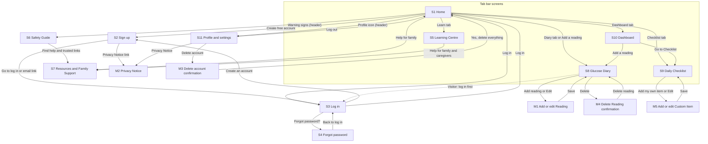

# Diabetes Companion SA — Product Requirements Document

Refilwe Segoe · Draft v0.4 · 27 Oct 2026 (last changed 03 Nov 2026)

> Transcribed from `Diabetes_Companion_SA_PRD_v0.4.pdf` (62 pages) into Markdown so the coding agent can quote exact wording. Where this file and the PDF differ, the PDF wins; report the difference.

**Draft status:** Sections 1–13 are drafted, which covers pages 1 to 20 of the template. Sections 14–16 (AI prompts, submission checklist and glossary) follow after the lecturer has taken the class through the template. Items still open are listed in 13.3.

## Document details

| Field | Your answer |
|-|-|
| Product name | Diabetes Companion SA |
| Author(s) | Refilwe Segoe (student number not yet provided) |
| Course code and cohort | AI Software Development, April 2026 cohort (course code to be confirmed) |
| Facilitator / reviewer | Mnelisi Maswanganyi |
| Link to original app idea | App Concept Document – Diabetes Companion SA (link to be added) |
| GitHub repository | https://github.com/Ref-DevSa/ (repository name to be added; this PRD will be saved as docs/PRD.md) |
| Version | v0.4 |
| Status | Draft |

## Change log

| Version | Date | Section(s) changed | What changed | Regenerated? |
|-|-|-|-|-|
| v0.4 | 03 Nov 2026 | 2.5, 4.4 (BR2, BR17, BR19, new BR21 to BR25), 8.2 (S1, S5, S6, M2), 8.3, 10, 11.3, 11.4, 12, 13 | Privacy, admin access, deletion, retention and consent decisions written in (BR24, BR25, 12.4); languages launch in English first and others only after human review (BR21); health content needs a recorded review before publishing (BR22); honest offline behaviour (BR23); disclaimer added to S5 and S6; review dates stored and shown; login attempts table simplified; database functions renamed (check_login_allowed, record_failed_login, clear_my_login_attempts, delete_my_account); Header hides Log in on S2 to S4; Phase numbers aligned with IMPLEMENTATION_PLAN.md | None |
| v0.3 | 03 Nov 2026 | 4.1, 4.4 (BR2, BR9), 11, 13 | Technology confirmed as Supabase (PostgreSQL, Auth, Row-Level Security) with no MongoDB; the Safety Guide (F6) is now a Must feature; test tools added to 11.1; clock-difference and daily-limit notes added to BR2 and BR9; the delete_my_account function named in 11.3 | None |
| v0.2 | 27 Oct 2026 | 4.1, 4.4 (BR19), 6, 7, 8, 10, 11, 12, 13 | Added Sections 6, 7, 8.2–8.4, 10, 11, 12 and 13; filled the story and screen columns in 4.1 and 8.1; BR19 now covers Safety Guide lists, tips and the built-in emergency box | None |
| v0.1 | 27 Oct 2026 | All | First draft of Sections 1–5, 8.1 and 9 | None |

## 1. Product overview

**1.1 Product name:** Diabetes Companion SA

**1.2 One-line pitch:** Diabetes Companion SA helps South African adults with diabetes to learn and track daily care so that they feel confident.

**1.3 Problem statement:** About 2.3 million South African adults aged 20 to 79 live with diabetes, and about 70% of cases are undiagnosed (IDF Diabetes Atlas, 11th edition, 2025). People who know they have diabetes must keep track of glucose readings, daily habits and clinic advice, but reliable information is spread across many websites, many popular tracking apps are built for other countries, and many people rely on memory or paper notes. Family members who want to help have no simple local source to learn from. This makes it harder to prepare for clinic visits and to recognise when a reading or symptom needs urgent attention.

**1.4 Solution:** Users can read short, plain-language Topics about diabetes in English, isiZulu or Setswana. They can check warning signs and urgent-help steps in the Safety Guide, save glucose Readings in mmol/L in a Diary, and tick a Checklist of daily care Items. A Dashboard shows their latest Readings and today's Checklist progress. Visitors and family members can use the learning content and trusted South African Resources without an account.

**1.5 Platform:** Web app (works in a browser). It is designed mobile-first for Android phones (360 px wide), and also works on tablets and computers.

**1.6 Vision:** In two years, Diabetes Companion SA could be a trusted, free starting point for diabetes education and self-care in all South African languages, with options for caregivers and clinic visits.

**1.7 Key terms**

| Term | Exact meaning in this app |
|-|-|
| Reading | One blood glucose measurement a User saves, in mmol/L, with a date, a time and a "When" choice |
| Diary | The list of all of a User's Readings (screen S8, "Glucose Diary") |
| Checklist | The daily list of care Items a User ticks (screen S9, "Daily Checklist") |
| Item | One line on the Checklist. A Standard Item is built in; a Custom Item is added by the User |
| Flag | The colour, icon and word ("Low" or "Very high") shown on a Reading outside the safety thresholds in BR5 |
| Topic | One short educational article in the Learning Centre |
| Safety Guide | The screen (S6) that explains warning signs and when to get urgent medical help |
| Resource | A link to a trusted South African health organisation, with a short description |

## 2. Users, personas and roles

**2.1 Primary user:** Adults aged 25 to 60 living with Type 2 diabetes in South Africa. They use an Android phone on prepaid data. Tech comfort: Medium.

**2.2 Secondary users:** Family members and caregivers, people worried they may have diabetes, and the general public. All of them use the app as Visitors, reading public content only. Content is managed by the admin (see 2.5).

**2.3 Personas**

| Field | Persona 1 | Persona 2 |
|-|-|-|
| Name and age | Thabo Mokoena, 46 | Lerato Dlamini, 29 |
| Role (from 2.4) | User | Visitor |
| Occupation / situation | Delivery driver, diagnosed with Type 2 diabetes 3 months ago | Office administrator whose father has Type 2 diabetes |
| Device and connectivity | Android phone, prepaid data | Android phone, shares data with her family |
| Tech comfort | Medium | High |
| Language(s) | Setswana, English | isiZulu, English |
| Goal | Build a daily routine and bring a record of his readings to clinic visits | Understand her father's condition and know when to get him urgent help |
| Frustrations today | Keeps readings on scraps of paper and forgets them; finds medical websites confusing | Gets conflicting advice online and cannot tell which sources to trust |
| How the app helps | Saves Readings and ticks a daily Checklist, then shows his Diary at the clinic | Reads plain-language Topics, the Safety Guide and trusted Resources without needing an account |
| Quote | "I want to show the nurse my numbers, not guess them." | "I just want to know what to do if he feels sick." |

**2.4 Roles and permissions**

| Role | How someone gets this role | Can do | Cannot do |
|-|-|-|-|
| Visitor | Anyone who is not logged in | Read Home, Learning Centre, Safety Guide and Resources; read the Privacy Notice; change language; sign up; log in; reset their password | Open the Diary, Checklist, Dashboard or Profile; see any User's data; change any content |
| User | Anyone who signs up, confirms they are 18 or older, and verifies their email | Everything a Visitor can do, plus: add, edit and delete their own Readings; tick Items and manage their own Custom Items; view their Dashboard; change their language; log out; delete their account | See or change another User's data; change Topics, Safety Guide text or Resources |

Every "Cannot do" is enforced by the database (Row-Level Security rules, Section 11.4), not only hidden on screen.

**2.5 Admin:** Admin work is done directly in the Supabase dashboard, with no admin screens in v1. The admin adds and edits Topics, Safety Guide text and Resources there. The admin opens a User's personal data only when strictly necessary to fix a fault and writes each time in an access log (BR24).

## 3. Goals, success metrics and non-goals

**3.1 Goals**

| # | Goal | Metric (what you count) | Target | How you will check it |
|-|-|-|-|-|
| G1 | Users build a diary habit | Share of new Users who save at least 3 Readings within 7 days of signing up | 60% | Count Reading rows per User in the database, within 7 days of the User's sign-up date |
| G2 | People can find urgent-help information quickly | Time for a test person to open the Safety Guide (S6) starting from Home | 8 of 10 test users in under 30 seconds | Timed test with 10 real people |
| G3 (proposed, needs approval) | The Learning Centre is easy to understand | Test users' rating of "easy to understand" | 7 of 10 rate it 4 out of 5 or higher | One rating question after the same 10-person test |

**3.2 Non-goals**

| # | Non-goal | Why |
|-|-|-|
| 1 | No diagnosis or treatment advice | The app informs and records only; advice must come from qualified health professionals |
| 2 | No medication dosing or reminders | A wrong dose or missed reminder could cause harm, and this is a clinic's job |
| 3 | No under-18 users | POPIA requires a parent's or guardian's consent for children's personal information |
| 4 | No caregiver accounts or shared diaries | They need extra roles and permissions that are too large for the MVP |
| 5 | No connection to glucose meters or doctors | Device and clinic integrations cost too much time, money and privacy risk for v1 |

## 4. Features, business rules and notifications

**4.1 Feature list**

| ID | Feature name | What the user can do | Priority | Goal | Stories (US#) | Screens (S#) |
|-|-|-|-|-|-|-|
| F1 | Account and sign-in | Sign up with email and password; confirm age 18+ and agree to the Privacy Notice; verify email; log in; reset password; log out; change language; delete account | Must | G1 | US1, US2, US3, US4, US5 | S2, S3, S4, S11, M2, M3 |
| F2 | Glucose Diary | Add a Reading (value, date, time, When, optional note); see Readings newest first with Flags; edit a Reading; delete a Reading | Must | G1 | US6, US7, US8 | S8, M1, M4 |
| F3 | Daily Care Checklist | Tick and untick Items; add, rename and delete Custom Items; see progress ("3 of 4 done") and a friendly message with every tick | Must | G1 | US9, US10 | S9, M5 |
| F4 | Learning Centre | Read Topics in English, isiZulu or Setswana | Must | G3 | US11 | S5 |
| F5 | Dashboard | See the last 7 Readings with Flags and today's Checklist progress | Should | G1 | US12 | S10 |
| F6 | Safety Guide | Read warning signs and when to get urgent help; open it from the red "Warning signs" button in the header of every screen | Must | G2 | US13 | S6 |
| F7 | Resources and Family Support | Open links to trusted organisations (Diabetes South Africa, SEMDSA, the national Department of Health); read tips for family and caregivers | Should | G3 | US14 | S7 |

**4.2 MVP definition:** A person can sign up, save glucose Readings and tick a daily Checklist, and read plain-language Topics about diabetes in English, isiZulu or Setswana.

**4.3 Future features**

* Personal target range for each User
* The other 8 official languages
* Caregiver accounts with a shared Diary
* "Did you know?" cards and Quick Check quizzes in the Learning Centre
* Export the Diary as a PDF to show at the clinic

**4.4 Business rules**

| ID | Rule (exact logic, numbers and limits) | Used by (F#, S#) |
|-|-|-|
| BR1 | A Reading value is in mmol/L with one decimal place, from 1.0 to 40.0 inclusive. Anything else is rejected. | F2, M1 |
| BR2 | A Reading's date and time default to now (SAST) and the User may change them. They cannot be in the future (the database allows up to 5 minutes of difference between the phone's clock and the server's clock) or more than 30 days in the past. | F2, M1 |
| BR3 | Every Reading has exactly one "When" value: Fasting, Before a meal, After a meal, Bedtime or Other. It is required, with no default. | F2, M1 |
| BR4 | A Reading's note is optional, plain text, up to 200 characters. | F2, M1 |
| BR5 | A Reading gets the Flag "Low" if its value is below 3.9. It gets the Flag "Very high" if its value is above 16.5, or if When is Fasting and its value is above 14.0. Otherwise it has no Flag. Values of exactly 3.9, 14.0 or 16.5 are not flagged. The Flag is recalculated when a Reading is edited. A Flag always shows a colour, an icon and a word, never colour alone. | F2, F5, S8, S10, M1 |
| BR6 | A Low Reading shows: "Your reading is low. Follow your care plan and talk to your clinic." A Very high Reading shows: "Your reading is very high. Talk to your clinic today." No playful message is ever shown with a Flag. | F2, M1, S8, S10 |
| BR7 | The Diary lists Readings newest first by date and time, 20 at a time, with a "Load more" button at the bottom. | F2, S8 |
| BR8 | A User can edit or delete their own Readings at any time. Deleting asks for confirmation first (M4). | F2, S8, M1, M4 |
| BR9 | A User can save at most 30 Readings per day (SAST). The day is the day the Reading is saved, not the day of its date field. At the limit the app shows: "You've reached today's limit of 30 readings. You can add more tomorrow." | F2, M1 |
| BR10 | The Checklist has 4 Standard Items, in this order, that cannot be renamed or deleted: "Take my medication as prescribed", "Check my glucose if my care plan says so", "Drink water", "Do suitable physical activity". | F3, S9 |
| BR11 | Each User can add up to 6 Custom Items. A Custom Item name is 1 to 60 characters and must be unique for that User, ignoring capital letters. A User can rename or delete their own Custom Items. Deleting an Item also deletes its ticks. | F3, S9, M5 |
| BR12 | A tick belongs to one calendar day (SAST). Every new day starts at 00:00 SAST with all Items unticked. Older ticks are kept but not shown in v1. | F3, S9, S10 |
| BR13 | Checklist progress is written "X of Y done", where X is the Items ticked today and Y is all Items on the Checklist today. When X equals Y the app shows "All done today. Nice work!" | F3, F5, S9, S10 |
| BR14 | When a Reading is saved without a Flag, the app shows one of these 5 messages at random, never the same one twice in a row: "High five! Reading saved.", "Nice one! Reading saved.", "Saved! Your clinic will love this.", "Got it! Reading saved.", "Done! That's one more for your Diary." | F2, M1 |
| BR15 | Humour and playful wording are used only for saved Readings, ticks and learning. They are never used for Flags, the Safety Guide, error messages or deleting anything. | All |
| BR16 | A Visitor can open S1, S2, S3, S4, S5, S6, S7 and M2. If a Visitor opens S8, S9, S10 or S11 they are sent to S3 with the message "Log in to use this part of the app." After logging in they go to the screen they wanted. | F1, S3, S8–S11 |
| BR17 | The app is available in English (default), isiZulu and Setswana. A User's choice is saved to their account; a Visitor's choice is saved on their device. If a translation is missing, the English text is shown. A language appears in the language menu only after its translation has been reviewed by a qualified person (BR21). | All |
| BR18 | A person must tick "I confirm I am 18 or older" to sign up. | F1, S2 |
| BR19 | Topics, Safety Guide items, family tips and Resources are edited only by the admin in the Supabase dashboard, and are reviewed by a qualified person before they are published. The emergency box on S6 is built into the app and changes only with an app update. Every row stores the date it was reviewed (BR22). | F4, F6, F7 |
| BR20 | Deleting an account immediately and permanently deletes the User's profile, Readings, Custom Items and all ticks. It cannot be undone. | F1, S11, M3 |
| BR21 | English is launched first. isiZulu and Setswana are switched on only after the screen text and the health content in that language have been translated and reviewed by a qualified person, and the review date is recorded. Until then the language menu shows English only, and any missing text shows in English. | All, S11 |
| BR22 | A Topic, Safety Guide item, family tip or Resource can be published only when the date of review and the reviewer (a qualified person) are recorded; the database refuses otherwise. The app shows "Content last reviewed: " with the date on S6 and on an open Topic. Content is reviewed again at least every 12 months. | F4, F6, F7, S5, S6 |
| BR23 | The app never shows that something is saved, ticked or deleted until the database has confirmed it. If there is no internet or the save fails, it shows the matching message from 12.2, keeps what the person typed, and lets them try again. | All |
| BR24 | Only the User can see their Readings and Checklist. There is no family or caregiver access in v1. The admin can open a User's personal data in the Supabase dashboard only when strictly necessary to fix a fault, and records each time (date, reason, what was done) in an access log. Personal data is never sold, never shared for adverts, and no advertising or tracking tools are used. | All, M2 |
| BR25 | Personal data is kept until the User deletes it or deletes the account. Failed log-in tries are removed after 24 hours. Accounts are not deleted automatically for inactivity in v1; this is reviewed 12 months after launch. A User can ask for a copy of their data by emailing the Information Officer. | F1, S11, M2 |

**4.5 Notifications:** None in v1 for reminders, push messages or SMS. The app sends only two system emails, needed for sign-in:

| Trigger | Who receives it | Channel | Exact text | Tapping it opens |
|-|-|-|-|-|
| A person signs up (S2) | The new User | Email | Subject: "Confirm your email for Diabetes Companion SA". Body: "Hi! Tap the button to confirm your email and finish signing up. The link works for 1 hour. If you didn't sign up, you can ignore this email." | S3 |
| A person asks to reset their password (S4) | That User | Email | Subject: "Reset your Diabetes Companion SA password". Body: "Tap the button to choose a new password. The link works for 1 hour. If you didn't ask for this, you can ignore this email." | S4 (new password step) |

## 5. Accounts and sign-in

| Decision | Your answer |
|-|-|
| Sign-up methods | Email and password only |
| Who may sign up | Anyone aged 18 or older |
| Minimum age | 18, confirmed by a tickbox at sign-up (BR18). Under-18s are not allowed in v1 |
| Email or phone verification | Required. Before verifying, a person can use only the Visitor screens |
| Password rules | At least 8 characters, including at least 1 number, with a show/hide toggle |
| Forgot password | Link sent by email (see 4.5), valid for 1 hour. The person sets a new password on S4 |
| Failed log-in attempts | After 5 wrong tries, the person must wait 15 minutes before trying again |
| Stay logged in | 30 days, then the User must log in again |
| Log out | On the Profile screen (S11), with no confirmation |
| Delete account | On S11, then a confirmation pop-up (M3). Deletes everything immediately (BR20) |
| Change email or phone | Not allowed in v1 |

## 6. User stories, acceptance criteria and edge cases

Every criterion is checked by hand on an Android phone unless Section 11.7 says it is automated. All exact text is written in English; the isiZulu and Setswana versions live in the language files (BR17).

### 6.1 Stories

| Story | Feature | User story | Acceptance criteria (with test IDs) |
|-|-|-|-|
| US1 | F1 | As a Visitor, I want to create an account with my email so that I can save my own Readings and Checklist. | **T-US1-1:** Given I am on S2, when I enter a valid email and a password of 8 or more characters with a number, tick both boxes and tap "Create account", then I see "Check your email to confirm your account." and I receive the email in 4.5. • **T-US1-2 (unhappy):** Given I am on S2, when I leave "I confirm I am 18 or older" unticked and tap "Create account", then I see "Please confirm you are 18 or older." under the box and no account is created. • **T-US1-3 (unhappy):** Given my email is already registered, when I tap "Create account", then I see "This email is already registered. Try logging in." under the email field. • **T-US1-4 (unhappy):** Given I type the password "abc", when I tap "Create account", then I see "Password must be at least 8 characters and include a number." and my typed text stays. |
| US2 | F1 | As a User, I want to log in so that I can use my own Diary and Checklist. | **T-US2-1:** Given I have a confirmed account, when I enter the correct email and password on S3 and tap "Log in", then I go to S1 and see "Welcome back!". • **T-US2-2 (unhappy):** Given I enter a wrong password, when I tap "Log in", then I see "Email or password is incorrect." and my email stays in the field. • **T-US2-3 (unhappy):** Given I have entered a wrong password 5 times, when I try a 6th time within 15 minutes, then I see "Too many tries. Please wait 15 minutes and try again." and the "Log in" button is disabled. • **T-US2-4 (unhappy):** Given I have not confirmed my email, when I tap "Log in", then I see "Please confirm your email first. Check your inbox." and a link "Send the email again" appears. |
| US3 | F1 | As a User, I want to reset my password so that I can get back into my account if I forget it. | **T-US3-1:** Given I am on S4, when I enter my registered email and tap "Send reset link", then I see "If this email is registered, we've sent a reset link." and I receive the email in 4.5. • **T-US3-2:** Given I open the reset link within 1 hour, when I enter the same new password twice and tap "Save new password", then I see "Password changed. Please log in." and go to S3. • **T-US3-3 (unhappy):** Given I open a reset link older than 1 hour, then I see "This link has expired. Ask for a new one." and a button "Send a new link". • **T-US3-4 (unhappy):** Given the two passwords differ, when I tap "Save new password", then I see "Passwords don't match." under the second field. |
| US4 | F1 | As a User, I want to choose English, isiZulu or Setswana so that I can read the app in my own language. | **T-US4-1:** Given I am on any screen, when I open the language selector in the header and choose "isiZulu", then all screen text changes to isiZulu and my choice is saved to my account. • **T-US4-2:** Given I chose Setswana, when I log in on another phone, then the app opens in Setswana. • **T-US4-3 (unhappy):** Given a Topic has no isiZulu text yet, when I open it, then I see the English text. |
| US5 | F1 | As a User, I want to log out and delete my account so that I stay in control of my data. | **T-US5-1:** Given I am on S11, when I tap "Log out", then I go to S1 as a Visitor. • **T-US5-2:** Given I am on S11, when I tap "Delete account" and then "Yes, delete everything" in M3, then my account, Readings and Items are deleted and I see "Your account and data have been deleted." on S1. • **T-US5-3 (unhappy):** Given M3 is open, when I tap "Cancel", then nothing is deleted and I stay on S11. • **T-US5-4 (unhappy):** Given I am offline, when I tap "Yes, delete everything", then I see "Couldn't delete your account. Check your connection and try again." and nothing is deleted. |
| US6 | F2 | As a User, I want to save a glucose Reading so that I have a record to show my clinic. | **T-US6-1:** Given I am on S8, when I tap "Add reading", enter 6.8, choose "Fasting", keep the date and time, and tap "Save", then M1 closes, the Reading appears at the top of the Diary, and I see one of the messages in BR14. • **T-US6-2 (unhappy):** Given M1 is open, when I enter 45 and tap "Save", then I see "Enter a number from 1.0 to 40.0." under the field and nothing is saved. • **T-US6-3 (unhappy):** Given M1 is open, when I do not choose "When" and tap "Save", then I see "Choose when you took this reading." • **T-US6-4 (unhappy):** Given M1 is open, when I set a time in the future and tap "Save", then I see "The date and time can't be in the future." |
| US7 | F2 | As a User, I want a clear warning on a low or very high Reading so that I know to talk to my clinic. | **T-US7-1:** Given I save 3.6 with "Bedtime", then the Reading shows an orange "Low" badge with an icon and the message "Your reading is low. Follow your care plan and talk to your clinic.", and no friendly message. • **T-US7-2:** Given I save 14.6 with "Fasting", then the Reading shows a red "Very high" badge and the message "Your reading is very high. Talk to your clinic today." • **T-US7-3 (unhappy):** Given I save 14.6 with "After a meal", then no badge appears, because the fasting limit does not apply. • **T-US7-4:** Given I edit a Reading from 3.6 to 5.2, then the badge disappears. |
| US8 | F2 | As a User, I want to see, edit and delete my Readings so that my Diary is correct. | **T-US8-1:** Given I have 25 Readings, when I open S8, then I see the newest 20 first and a "Load more" button that shows the rest. • **T-US8-2:** Given I tap "Edit" on a Reading, change the value and tap "Save", then the Diary shows the new value and I see "Reading updated." • **T-US8-3:** Given I tap "Delete" and then "Delete reading" in M4, then the Reading disappears and I see "Reading deleted." • **T-US8-4 (unhappy):** Given I have no Readings, when I open S8, then I see "No readings yet. Tap "Add reading" to save your first one." and the "Add reading" button. |
| US9 | F3 | As a User, I want to tick my daily care Items so that I can follow my routine. | **T-US9-1:** Given I open S9 and nothing is ticked, when I tick "Drink water", then the Item shows ticked, the ring fills and I see "1 of 4 done". • **T-US9-2:** Given 3 of 4 Items are ticked, when I tick the last one, then I see "All done today. Nice work!" • **T-US9-3 (unhappy):** Given I am offline, when I tick an Item, then the tick is undone and I see "You're offline. Reconnect to save your ticks." • **T-US9-4:** Given it is after 00:00 SAST on a new day, when I open S9, then every Item shows unticked. |
| US10 | F3 | As a User, I want to add my own Items so that my Checklist fits my routine. | **T-US10-1:** Given I am on S9, when I tap "Add my own item", type "Evening walk" and tap "Save", then it appears after the four Standard Items and the progress shows "0 of 5 done". • **T-US10-2 (unhappy):** Given I already have "Evening walk", when I add "evening walk", then I see "You already have an item with this name." • **T-US10-3 (unhappy):** Given I already have 6 Custom Items, when I tap "Add my own item", then I see "You can add up to 6 of your own items." and M5 does not open. • **T-US10-4:** Given a Custom Item, when I rename or delete it, then S9 shows the change and, after a delete, "Item deleted." |
| US11 | F4 | As a Visitor, I want to read short Topics about diabetes so that I understand the condition. | **T-US11-1:** Given I am on S5, when I tap the Topic "What is diabetes?", then the full Topic opens in place and "Close" closes it. • **T-US11-2:** Given my language is Setswana, when I open S5, then the Topic titles and text show in Setswana. • **T-US11-3 (unhappy):** Given I am offline and no Topics were loaded, when I open S5, then I see "You're offline. Reconnect to read Topics." • **T-US11-4 (unhappy):** Given the server fails, when I open S5, then I see "We couldn't load the Topics. Please try again." and a "Try again" button. |
| US12 | F5 | As a User, I want a Dashboard so that I can see my latest Readings and today's progress at a glance. | **T-US12-1:** Given I have 10 Readings and have ticked 3 of 4 Items, when I open S10, then I see my 7 newest Readings with their badges and "3 of 4 done". • **T-US12-2 (unhappy):** Given I have no Readings, when I open S10, then I see "No readings yet. Add your first one in the Diary." and a button "Add a reading". • **T-US12-3 (unhappy):** Given the server fails, when I open S10, then I see "We couldn't load your Dashboard. Please try again." and a "Try again" button. |
| US13 | F6 | As a Visitor, I want to find warning signs and urgent-help steps quickly so that I know what to do in a scary moment. | **T-US13-1:** Given I am on any screen, when I tap the red "Warning signs" button in the header, then S6 opens with the emergency box at the top. • **T-US13-2:** Given I am on S6, then I see "Call 112 from a cell phone or 10177 for an ambulance, or go to the nearest hospital. Do not wait for this app." • **T-US13-3 (unhappy):** Given I am offline, when I open S6, then the emergency box and the offline banner show, and any list not loaded earlier is replaced by "You're offline. The emergency numbers above still work." • **T-US13-4:** Given I am on S6, then I see "Symptoms alone cannot confirm diabetes. Only a test at a clinic can." |
| US14 | F7 | As a Visitor who supports someone with diabetes, I want trusted links and tips so that I can help them well. | **T-US14-1:** Given I am on S7, when I tap "Open website" on "Diabetes South Africa", then its website opens in a new tab. • **T-US14-2:** Given I am on S7, then I see 5 tips for family and caregivers. • **T-US14-3 (unhappy):** Given I am offline, when I tap "Open website", then I see "You're offline. Reconnect to open this link." |

### 6.2 Edge cases

| Situation | What the user sees (exact text) | What the app does |
|-|-|-|
| No internet while saving anything | "You're offline. Reconnect and try again." | Save buttons are disabled; typed text stays on screen |
| Server or unknown error | "Something went wrong on our side. Please try again." | Shows a "Try again" button; nothing is half-saved |
| Session older than 30 days, or ended | "Your session has ended. Please log in again." | Sends the User to S3; unsaved typing is lost |
| A Reading was deleted on another phone | "This reading no longer exists." | Closes M1 and refreshes the Diary |
| Phone clock is wrong, so the time is in the future | "The date and time can't be in the future." | Does not save; keeps the typed values |
| Reading older than 30 days | "You can only add readings from the last 30 days." | Does not save; keeps the typed values |
| Midnight (00:00 SAST) passes while S9 is open | "It's a new day! Your checklist has been reset." (toast) | Reloads the Checklist with every Item unticked |
| A Visitor opens S8, S9, S10 or S11 from a saved link | "Log in to use this part of the app." | Sends the Visitor to S3, then to the wanted screen after log-in (BR16) |
| The account is deleted on one phone while logged in on another | "Your session has ended. Please log in again." | The other phone is signed out; no data remains |
| A Topic has no text in the chosen language | None | Shows the English text (BR17) |

## 7. User flows and navigation map

### 7.1 Flows

**Flow 1: Sign up and log in (F1)**
Starts when: A Visitor on S1 Home wants an account.

1. S1 Home: the Visitor taps "Create free account" → S2 Sign up.
2. S2 Sign up: the Visitor enters email and password, ticks "I confirm I am 18 or older" and "I agree to the Privacy Notice" (the link "Privacy Notice" opens M2 Privacy Notice), and taps "Create account". If a field is wrong or a box is unticked → the error appears under it and the Visitor stays on S2; otherwise → S2 shows "Check your email to confirm your account."
3. Email: the Visitor taps the button in the email within 1 hour → S3 Log in. If the Visitor tries to log in before confirming → "Please confirm your email first. Check your inbox." and a link "Send the email again" appears.
4. S3 Log in: the Visitor enters email and password and taps "Log in". If wrong → "Email or password is incorrect."; after 5 wrong tries → a 15-minute wait; otherwise → S1 Home as a User.

Ends when: The User sees S1 Home with "Welcome back!" and the tab bar.

**Flow 2: Save a Reading (F2)**
Starts when: A User wants to save a glucose result.

1. S1 Home "Add a reading", S10 Dashboard "Add a reading" or the Diary tab → S8 Glucose Diary. (A Visitor is sent to S3 first, BR16.)
2. S8: the User taps "Add reading" → M1 Add or edit Reading.
3. M1: the User enters the value, chooses "When", keeps or changes the date and time, optionally adds a note, and taps "Save". If a rule fails (BR1–BR4, BR9) → the error appears under the field and the User stays in M1.
4. Otherwise M1 closes → S8 shows the new Reading at the top. If it has a Flag (BR5) → the badge and the BR6 message show; otherwise → one friendly message from BR14.
5. Optional: on any Reading the User taps "Edit" → M1, or "Delete" → M4 Delete Reading confirmation → "Delete reading" → S8 without that Reading.

Ends when: S8 shows the saved, edited or deleted result.

**Flow 3: Tick the Checklist (F3)**
Starts when: A User wants to record today's care.

1. Any tab-bar screen: the User taps the Checklist tab → S9 Daily Checklist. (A Visitor is sent to S3 first, BR16.)
2. S9: the User ticks an Item → the ring fills and "X of Y done" updates.
3. If every Item is ticked → "All done today. Nice work!"
4. Optional: the User taps "Add my own item" → M5 Add or edit Custom Item → "Save" → S9 shows the new Item. If the User already has 6 Custom Items → "You can add up to 6 of your own items."

Ends when: S9 shows the ticks the User made.

**Flow 4: Read a Topic (F4)**
Starts when: A Visitor or User wants to learn about diabetes.

1. S1 Home "Learn about diabetes" or the Learn tab → S5 Learning Centre.
2. S5: the person taps a Topic card → the Topic opens in place.
3. If they want another language → they open the language selector in the header and choose one → the text changes; if a translation is missing → English shows.
4. They tap "Close" or another Topic. Optionally they tap "Help for family and caregivers" → S7 Resources and Family Support.

Ends when: The person has read the Topic and closed it.

**Flow 5: Find the Safety Guide (F6)**
Starts when: Anyone, on any screen, wants warning signs or urgent-help steps.

1. Any screen: the person taps the red "Warning signs" button in the header → S6 Safety Guide.
2. S6 shows the emergency box first. The person reads it and the lists below it.
3. Optional: "Find help and trusted links" → S7 Resources and Family Support.

Ends when: The person has the information they need, or opens S7.

**Flow 6: Reset a forgotten password (F1)**
Starts when: A Visitor cannot remember their password.

1. S3 Log in: the Visitor taps "Forgot password?" → S4 Forgot password.
2. S4: the Visitor enters their email and taps "Send reset link" → "If this email is registered, we've sent a reset link."
3. Email: the Visitor taps the button within 1 hour → S4 (new password step). If the link is older than 1 hour → "This link has expired. Ask for a new one." and "Send a new link".
4. S4: the Visitor enters the new password twice and taps "Save new password". If the two differ → "Passwords don't match."; otherwise → "Password changed. Please log in." → S3.

Ends when: The Visitor is on S3 with a new password.

**Flow 7: See the Dashboard (F5)**
Starts when: A User wants a quick overview.

1. Any tab-bar screen: the User taps the Dashboard tab → S10 Dashboard.
2. S10 shows the last 7 Readings with badges and today's "X of Y done". If there are no Readings → "No readings yet. Add your first one in the Diary."
3. Optional: "Add a reading" → S8, "See all in my Diary" → S8, or "Go to Checklist" → S9.

Ends when: The User has seen the overview or moved to S8 or S9.

**Flow 8: Change language, log out or delete the account (F1)**
Starts when: A User wants to change settings or leave.

1. Any screen: the User taps the profile icon in the header → S11 Profile and settings.
2. S11: to change language, the User picks a language from the list; the app changes at once. To read the Privacy Notice, the User taps "Privacy Notice" → M2 Privacy Notice → "Close".
3. To log out, the User taps "Log out" → S1 Home as a Visitor.
4. To delete, the User taps "Delete account" → M3 Delete account confirmation. If "Cancel" → back to S11. If "Yes, delete everything" → everything is deleted → S1 Home with "Your account and data have been deleted."

Ends when: The setting is changed, or the User is logged out or deleted.

### 7.2 Navigation map

The Home, Learn, Diary, Checklist and Dashboard screens are tabs. From any tab-bar screen, the tab bar goes to any other tab. The red "Warning signs" button in the header opens S6 from every screen. Every "Cancel" and "Close" button returns to the screen that opened the pop-up.



## 8. Screens

### 8.1 Screen inventory

Navigation: on phones, a bottom tab bar with Home, Learn, Diary, Checklist and Dashboard. On tablets and computers it becomes a top menu. Every screen also has a header with a red "Warning signs" button that opens the Safety Guide (S6).

| ID | Screen name | Type | Who can open it | Purpose | Tab bar shown? | Stories (US#) |
|-|-|-|-|-|-|-|
| S1 | Home | Tab | Everyone | Introduce the app and link to the main features | Yes | US2, US4, US5, US13 |
| S2 | Sign up | Full screen | Logged out | Create an account | No | US1 |
| S3 | Log in | Full screen | Logged out | Log in to an existing account | No | US2 |
| S4 | Forgot password | Full screen | Logged out | Ask for a reset link and set a new password | No | US3 |
| S5 | Learning Centre | Tab | Everyone | Read Topics about diabetes | Yes | US11 |
| S6 | Safety Guide | Full screen | Everyone | Read warning signs and when to get urgent help | Yes | US13 |
| S7 | Resources and Family Support | Full screen | Everyone | Open trusted links and read family tips | Yes | US14 |
| S8 | Glucose Diary | Tab | Logged in: User | See, add, edit and delete Readings | Yes | US6, US7, US8 |
| S9 | Daily Checklist | Tab | Logged in: User | Tick Items and manage Custom Items | Yes | US9, US10 |
| S10 | Dashboard | Tab | Logged in: User | See the last 7 Readings and today's Checklist progress | Yes | US12 |
| S11 | Profile and settings | Full screen | Logged in: User | Change language, read the Privacy Notice, log out, delete account | Yes | US4, US5 |
| M1 | Add or edit Reading | Bottom sheet | Logged in: User | Enter or change a Reading | No | US6, US7, US8 |
| M2 | Privacy Notice | Modal | Everyone | Show what is collected, why, and how to delete it | No | US1 |
| M3 | Delete account confirmation | Modal | Logged in: User | Confirm permanent deletion | No | US5 |
| M4 | Delete Reading confirmation | Modal | Logged in: User | Confirm deleting one Reading | No | US8 |
| M5 | Add or edit Custom Item | Bottom sheet | Logged in: User | Enter or rename a Custom Item | No | US10 |

**Screens from the standard list that are not needed**

* Welcome: not needed because Home (S1) is public and already introduces the app.
* Onboarding or profile setup: not needed because v1 asks no profile questions; language is chosen from the header.
* Email verification: not a separate screen; S2 shows a "Check your email" message and the email link opens S3.

### 8.2 Screen specifications

All exact text is written in English; the isiZulu and Setswana versions live in the language files and are checked by a qualified translator before launch (13.1). Every screen has the header from 8.3, so it is not repeated in each layout except where it differs.

#### S1 Home

**Purpose:** Introduce the app and send people to the right place. **Who can open it:** Everyone. **Comes from / goes to:** Any screen → S1 → S2, S3, S5, S6, S7, S8, S11.

**Layout (top to bottom):**

1. Header: logo, language selector, red "Warning signs" button, and a "Log in" button for Visitors or the profile icon for Users
2. Hero card: flat illustration, title "Understand diabetes. Track your day.", text "Short, simple help for people living with diabetes in South Africa."
3. Visitor: primary button "Create free account" and secondary button "Log in". User: text "Welcome back!" and primary button "Add a reading"
4. Heading "What would you like to do?" and four feature cards
5. Notice card: "This app gives general information only. It does not diagnose or replace your clinic."
6. Tab bar (Home is active)

**Cards:** Each feature card has an icon, a title and one line of text: "Learn about diabetes" ("Short, plain-language Topics") → S5; "Check warning signs" ("Know when to get urgent help") → S6; "Help for family" ("Tips and trusted links") → S7; "Track my day" ("Diary and Checklist") → S8 (a Visitor goes to S3, BR16).

**Form fields:** None, because this screen has no form.

**Buttons and links:** "Create free account" → S2; "Log in" → S3; "Add a reading" → S8; "Warning signs" → S6; profile icon → S11.

**States:**

* Normal: as in the layout.
* Empty: Not needed because Home always shows fixed content.
* Loading: grey placeholders for the hero card and the four cards.
* Error: "Something went wrong on our side. Please try again." with a "Try again" button.
* Offline: banner "You're offline. Some things may not work until you reconnect."
* Success: Not needed because nothing is saved here.

**Sample content:** Visitor view as in the layout; User view shows "Welcome back!" and the button "Add a reading".

#### S2 Sign up

**Purpose:** Create an account. **Who can open it:** Logged out (Visitors). **Comes from / goes to:** S1, S3 → S2 → S3, M2.

**Layout:** 1. Header (no tab bar) 2. Title "Create your free account" 3. Email field 4. Password field 5. Two checkboxes 6. Primary button "Create account" 7. Link "Already have an account? Log in".

**Form fields:**

| Label | Type | Required? | Placeholder | Rule | Error text |
|-|-|-|-|-|-|
| Email | Email | Yes | you@example.co.za | A valid email address | "Enter a valid email address." or, if taken, "This email is already registered. Try logging in." |
| Password | Password with show/hide toggle | Yes | At least 8 characters and 1 number | 8 or more characters including 1 number | "Password must be at least 8 characters and include a number." |
| I confirm I am 18 or older | Checkbox, unticked | Yes | — | Must be ticked (BR18) | "Please confirm you are 18 or older." |
| I agree to the Privacy Notice | Checkbox, unticked | Yes | — | Must be ticked; "Privacy Notice" is a link to M2 | "Please agree to the Privacy Notice to continue." |

**Buttons and links:** "Create account" → success state; "Log in" → S3; "Privacy Notice" → M2.

**States:**

* Normal: the empty form.
* Empty: Not needed because this is a form.
* Loading: the button shows "Creating your account…" and is disabled.
* Error: the messages in the table under each field; for a server problem, "Something went wrong on our side. Please try again."
* Offline: banner "You're offline. Some things may not work until you reconnect." and the button is disabled.
* Success: the form is replaced by a card "Check your email to confirm your account." with a button "Go to log in" → S3.

**Sample content:** Email thabo.test@example.co.za; password shown as dots.

#### S3 Log in

**Purpose:** Log in to an existing account. **Who can open it:** Logged out. **Comes from / goes to:** S1, S2, S4, any protected screen (BR16) → S3 → S1, S2, S4.

**Layout:** 1. Header (no tab bar) 2. Info or error banner, when there is one 3. Title "Welcome back" 4. Email field 5. Password field 6. Primary button "Log in" 7. Links "Forgot password?" and "Create an account".

**Form fields:** Email (Email, required, error "Enter a valid email address.") and Password (Password with show/hide toggle, required, error "Enter your password.").

**Buttons and links:** "Log in" → S1, or the screen the Visitor wanted (BR16); "Forgot password?" → S4; "Create an account" → S2; "Send the email again", shown only after the unconfirmed-email message, shows the toast "We've sent a new email."

**States:**

* Normal: the empty form. When sent here by BR16, a banner says "Log in to use this part of the app."
* Empty: Not needed because this is a form.
* Loading: the button shows "Logging in…" and is disabled.
* Error: "Email or password is incorrect."; "Too many tries. Please wait 15 minutes and try again." (button disabled); "Please confirm your email first. Check your inbox."; after an ended session, a banner "Your session has ended. Please log in again."
* Offline: the offline banner and a disabled button.
* Success: goes to the next screen; no message is needed.

**Sample content:** Email thabo.test@example.co.za.

#### S4 Forgot password

**Purpose:** Ask for a reset link and set a new password. **Who can open it:** Logged out. **Comes from / goes to:** S3, the reset email → S4 → S3.

**Layout, step 1:** Header (no tab bar); title "Forgot your password?"; text "Enter your email and we'll send you a link to choose a new one."; Email field; primary button "Send reset link"; link "Back to log in" → S3. **Layout, step 2 (after the email link):** title "Choose a new password"; fields "New password" and "Confirm new password"; primary button "Save new password".

**Form fields:** Email (Email, required, "Enter a valid email address."); New password (Password, required, 8 or more characters including 1 number, "Password must be at least 8 characters and include a number."); Confirm new password (Password, required, must match, "Passwords don't match.").

**States:**

* Normal: step 1 or step 2 as above.
* Empty: Not needed because this is a form.
* Loading: buttons show "Sending…" or "Saving…" and are disabled.
* Error: "This link has expired. Ask for a new one." with a button "Send a new link"; server problem "Something went wrong on our side. Please try again."
* Offline: the offline banner and disabled buttons.
* Success: step 1 shows "If this email is registered, we've sent a reset link."; step 2 shows "Password changed. Please log in." and goes to S3.

**Sample content:** Email nomsa.test@example.co.za.

#### S5 Learning Centre

**Purpose:** Read short Topics about diabetes. **Who can open it:** Everyone. **Comes from / goes to:** S1, tab bar → S5 → S7.

**Layout:** 1. Header 2. Title "Learn" 3. Text "Short Topics in plain words. Tap one to read it." 4. Six Topic cards 5. Link card "Help for family and caregivers" → S7 6. Notice card: "This app gives general information only. It does not diagnose or replace your clinic." 7. Tab bar (Learn is active).

**Cards:** A Topic card has an icon, the title (20 px bold), a one-line summary and the reading time, e.g. "3 min read". Tapping it opens the full Topic text in place below the title, in 16 px text, with a "Close" button.

**States:**

* Normal: six Topic cards.
* Empty: "No topics yet. Please check back soon."
* Loading: three grey card placeholders.
* Error: "We couldn't load the Topics. Please try again." with a "Try again" button.
* Offline: the offline banner, and if nothing was loaded, "You're offline. Reconnect to read Topics."
* Success: Not needed because nothing is saved here.

**Sample content:** See the six Topics in 8.4.

#### S6 Safety Guide

**Purpose:** Show warning signs and when to get urgent medical help. **Who can open it:** Everyone. **Comes from / goes to:** The red "Warning signs" button on every screen → S6 → S7.

**Layout:** 1. Header 2. Emergency box (white card, red border, warning icon): title "In an emergency, get help now", text "Call 112 from a cell phone or 10177 for an ambulance, or go to the nearest hospital. Do not wait for this app." 3. Note card "Symptoms alone cannot confirm diabetes. Only a test at a clinic can." 4. List "Signs of low blood sugar": Shaking or feeling jittery; Sweating; Sudden hunger; Feeling dizzy or confused; A fast heartbeat 5. List "Signs of high blood sugar": Feeling very thirsty; Passing urine more often; Blurred eyesight; Feeling very tired; Feeling sick (nausea) 6. List "Get urgent medical help if…": The person is unconscious or cannot be woken; They are very confused or cannot speak clearly; They have a fit (seizure); They breathe fast and deeply, or keep vomiting; You are not sure. It is always safer to call 7. Primary button "Find help and trusted links" 8. Notice card: "This app gives general information only. It does not diagnose or replace your clinic." and, below the lists, "Content last reviewed: " followed by the latest review date (DD Mon YYYY) 9. Tab bar.

The lists are Safety Guide items kept in the database and reviewed by a qualified person before launch (BR19). The emergency box is built into the app so it shows even without internet.

**Buttons and links:** "Find help and trusted links" → S7.

**States:**

* Normal: as in the layout.
* Empty: if the lists are empty, "Safety information is being updated. If you are worried, call 112 or 10177." below the emergency box.
* Loading: grey placeholders for the three lists; the emergency box shows at once.
* Error: below the emergency box, "We couldn't load the lists. Please try again." with a "Try again" button.
* Offline: the offline banner; the emergency box shows; unloaded lists show "You're offline. The emergency numbers above still work."
* Success: Not needed because nothing is saved here.

#### S7 Resources and Family Support

**Purpose:** Open trusted South African health links and read tips for family. **Who can open it:** Everyone. **Comes from / goes to:** S1, S5, S6 → S7.

**Layout:** 1. Header 2. Title "Help and family support" 3. Heading "Trusted organisations" and three Resource cards 4. Heading "Tips for family and caregivers" and a list of five tips 5. Notice "Always follow the advice of your own doctor or clinic." 6. Tab bar.

**Cards:** A Resource card has the name, a one-line description and a secondary button "Open website" that opens the link in a new tab.

**States:**

* Normal: three Resource cards and five tips.
* Empty: "No resources yet. Please check back soon."
* Loading: grey placeholders for the cards and tips.
* Error: "We couldn't load this page. Please try again." with a "Try again" button.
* Offline: the offline banner; tapping "Open website" shows "You're offline. Reconnect to open this link."
* Success: Not needed because nothing is saved here.

**Sample content:** See the Resources and Family tips in 8.4.

#### S8 Glucose Diary

**Purpose:** See, add, edit and delete Readings. **Who can open it:** Logged in: User. **Comes from / goes to:** Tab bar, S1, S10 → S8 → M1, M4.

**Layout:** 1. Header 2. Title "My Diary" 3. Reading cards, newest first 4. Button "Load more" when there are more than 20 5. Sticky primary button "Add reading" above the tab bar 6. Tab bar (Diary is active).

**Cards:** A Reading card shows the value (e.g. "6.8 mmol/L", 20 px bold), the "When" label, the date and time (e.g. "27 Oct 2026, 07:10"), the Flag badge if any (BR5), the note if any, and the buttons "Edit" and "Delete".

**Buttons and links:** "Add reading" → M1; "Edit" → M1; "Delete" → M4; "Load more" shows the next 20.

**States:**

* Normal: the list of Reading cards.
* Empty: "No readings yet. Tap "Add reading" to save your first one." with the "Add reading" button.
* Loading: three grey card placeholders.
* Error: "We couldn't load your Diary. Please try again." with a "Try again" button.
* Offline: the offline banner; "Add reading", "Edit" and "Delete" are disabled.
* Success: toasts "Reading updated.", "Reading deleted.", or one of the BR14 messages after a save without a Flag.

**Sample content:** See the five Readings in 8.4.

#### S9 Daily Checklist

**Purpose:** Tick today's care Items and manage Custom Items. **Who can open it:** Logged in: User. **Comes from / goes to:** Tab bar, S1, S10 → S9 → M5.

**Layout:** 1. Header 2. Title "Today" and the date, e.g. "Tue 27 Oct 2026" 3. Progress card with the ring and "2 of 5 done" 4. Items: the four Standard Items, then any Custom Items 5. Secondary button "Add my own item" 6. Note "This is your own routine. Always follow the care plan from your clinic." 7. Tab bar (Checklist is active).

**Lists:** An Item row has a 44 px checkbox and the name. A Custom Item also has the buttons "Edit" and "Delete". Order: Standard Items first (BR10), then Custom Items oldest first.

**Buttons and links:** "Add my own item" → M5, or the message "You can add up to 6 of your own items." if the limit is reached; "Edit" → M5; "Delete" removes the Item with the toast "Item deleted."

**States:**

* Normal: the Items with their ticks.
* Empty: Not needed because the four Standard Items always exist.
* Loading: the ring and Items as grey placeholders.
* Error: "We couldn't load your Checklist. Please try again." with a "Try again" button.
* Offline: the offline banner; ticking shows "You're offline. Reconnect to save your ticks."
* Success: "X of Y done" updates at once; when all are ticked, "All done today. Nice work!"

**Sample content:** Items and ticks as in 8.4.

#### S10 Dashboard

**Purpose:** Show the last 7 Readings and today's progress. **Who can open it:** Logged in: User. **Comes from / goes to:** Tab bar, S1 → S10 → S8, S9.

**Layout:** 1. Header 2. Title "My Dashboard" 3. Card "Last 7 readings": one row each with the value, the "When" label, a short date and the Flag badge; link "See all in my Diary" 4. Card "Today's checklist": the ring and "3 of 4 done", button "Go to Checklist" 5. Tab bar (Dashboard is active).

**Buttons and links:** "See all in my Diary" → S8; "Go to Checklist" → S9; "Add a reading" (empty state) → S8.

**States:**

* Normal: both cards.
* Empty: "No readings yet. Add your first one in the Diary." with a button "Add a reading"; the checklist card still shows.
* Loading: grey placeholders for both cards.
* Error: "We couldn't load your Dashboard. Please try again." with a "Try again" button.
* Offline: the offline banner; the last loaded data stays visible.
* Success: Not needed because nothing is saved here.

#### S11 Profile and settings

**Purpose:** Change language, read the Privacy Notice, log out or delete the account. **Who can open it:** Logged in: User. **Comes from / goes to:** Profile icon in the header → S11 → M2, M3, S1.

**Layout:** 1. Header 2. Title "My profile" 3. Card with "Email" and the User's email address (read only) 4. "Language" list: English, isiZulu, Setswana 5. Row "Privacy Notice" 6. Secondary button "Log out" 7. Danger button "Delete account" 8. Tab bar.

**Buttons and links:** "Privacy Notice" → M2; "Log out" → S1; "Delete account" → M3. Choosing a language changes the app at once and shows the toast "Language changed."

**States:**

* Normal: as in the layout.
* Empty: Not needed because the profile always shows an email and language.
* Loading: grey placeholders for the card and list.
* Error: "We couldn't load your profile. Please try again." with a "Try again" button.
* Offline: the offline banner; the language list, "Delete account" and "Log out" still show, and saving a language shows "You're offline. Reconnect and try again."
* Success: "Language changed."

**Sample content:** Email thabo.test@example.co.za; language Setswana.

#### M1 Add or edit Reading

**Purpose:** Enter or change a Reading. **Who can open it:** Logged in: User. **Comes from / goes to:** S8 → M1 → S8. A bottom sheet.

**Layout:** Title "Add a reading" (or "Edit reading"); the five fields; buttons "Save" and "Cancel".

**Form fields:**

| Label | Type | Required? | Placeholder or default | Rule | Error text |
|-|-|-|-|-|-|
| Reading (mmol/L) | Number | Yes | e.g. 6.8 | 1.0 to 40.0, one decimal (BR1) | "Enter a number from 1.0 to 40.0." |
| When | Dropdown | Yes | Choose when | Fasting, Before a meal, After a meal, Bedtime or Other (BR3) | "Choose when you took this reading." |
| Date | Date | Yes | Today | Not in the future; at most 30 days back (BR2) | "The date and time can't be in the future." or "You can only add readings from the last 30 days." |
| Time | Time, 24-hour | Yes | Now | As for Date | As for Date |
| Note | Text area | No | Anything to remember? (optional) | Up to 200 characters, with a counter such as "0/200" (BR4) | "Notes can be up to 200 characters." |

**Buttons and links:** "Save" saves and closes M1; "Cancel" closes without saving.

**States:** Normal: empty fields with the defaults (or the Reading's values when editing). Loading: "Save" shows "Saving…" and is disabled. Error: the field messages above; at 30 Readings today, "You've reached today's limit of 30 readings. You can add more tomorrow."; if the Reading was deleted elsewhere, "This reading no longer exists." Offline: "You're offline. Reconnect and try again." and "Save" is disabled. Success: M1 closes and S8 shows the toast from BR14, BR6 or "Reading updated." Empty: Not needed because this is a form.

**Sample content:** Reading 6.8; When "Fasting"; Date 27 Oct 2026; Time 07:10; Note empty.

#### M2 Privacy Notice

**Purpose:** Explain what is collected and why. **Who can open it:** Everyone. **Comes from / goes to:** S2, S11 → M2 → back. A scrollable modal with a "Close" button.

**Text (exact):**

* What we collect: "Your email address, the glucose readings, notes and checklist items you save, your language choice, and the dates you agreed to this notice and confirmed you are 18 or older."
* Why we collect it: "To let you log in and keep your own diary and checklist. We do not sell your information or use it for adverts."
* Who can see it: "Only you. The app's administrator can see your information in the database only when strictly needed to fix a fault, and each time is recorded. Family members and caregivers cannot see your information in this version."
* Where it is stored: "In a database run by Supabase in Frankfurt, Germany, which is outside South Africa. Sign-up emails are sent through Brevo."
* How long we keep it: "Until you delete a reading or your account. The app keeps no backup copies, so deleted information is gone for good and cannot be brought back." (Changed 09 Nov 2026, IMPLEMENTATION_PLAN.md Section 18 question 40: the hosted project is on the Supabase Free plan, which keeps no backups. Notice version v0.5.)
* How to delete it: "Delete a reading in your Diary, or choose Delete account on your Profile screen to delete everything straight away. To ask for a copy of your information, email the contact below."
* Health information: "Glucose readings are health information. By ticking "I agree to the Privacy Notice" you agree that we may store it for the reasons above."
* Contact: "Refilwe Segoe, Information Officer. Email address to be confirmed (see Section 13.3)."

**States:** Normal: the text above. Loading, Empty, Error and Success: Not needed because the text is built into the app. Offline: works as normal.

#### M3 Delete account confirmation

**Purpose:** Confirm permanent deletion. **Who can open it:** Logged in: User. **Comes from / goes to:** S11 → M3 → S1 or S11. A centred pop-up.

**Text and buttons:** Title "Delete your account?"; text "This will permanently delete your account, all your readings and your checklist. This cannot be undone."; danger button "Yes, delete everything" → S1 with the toast "Your account and data have been deleted."; secondary button "Cancel" → S11.

**States:** Loading: the danger button shows "Deleting…" and is disabled. Error or offline: "Couldn't delete your account. Check your connection and try again." and nothing is deleted. Empty and Success: Not needed because this pop-up shows fixed text.

#### M4 Delete Reading confirmation

**Purpose:** Confirm deleting one Reading. **Who can open it:** Logged in: User. **Comes from / goes to:** S8 → M4 → S8. A centred pop-up.

**Text and buttons:** Title "Delete this reading?"; text showing the Reading, e.g. "26 Oct 2026, 21:30 · 3.6 mmol/L (Bedtime). This cannot be undone."; danger button "Delete reading" → S8 with the toast "Reading deleted."; secondary button "Cancel" → S8.

**States:** Loading: "Deleting…" on the button. Error or offline: "Couldn't delete this reading. Check your connection and try again." Empty and Success: Not needed because this pop-up shows fixed text.

#### M5 Add or edit Custom Item

**Purpose:** Enter or rename a Custom Item. **Who can open it:** Logged in: User. **Comes from / goes to:** S9 → M5 → S9. A bottom sheet.

**Form fields:** Item name (Text, required, placeholder "e.g. Evening walk", 1 to 60 characters, unique for this User ignoring capital letters (BR11); errors "Enter a name for your item.", "Item names can be up to 60 characters." and "You already have an item with this name.").

**Buttons and links:** "Save" saves and closes (toast "Item saved."); "Cancel" closes.

**States:** Normal: empty field, or the current name when editing. Loading: "Saving…". Error: the messages above. Offline: "You're offline. Reconnect and try again." and "Save" is disabled. Empty and Success: Not needed because this is a form; success closes the sheet.

### 8.3 Shared components

| Component | Used on | Contains | How it behaves |
|-|-|-|-|
| Header | Every screen | Logo icon (the wordmark is hidden below 400 px), language selector, red "Warning signs" button, and "Log in" (Visitor, hidden on S2, S3 and S4) or profile icon (User) | Fixed at the top, 56 px high |
| Language selector | Header | Globe icon and "EN", "ZU" or "TN" | Opens a small menu with English, isiZulu and Setswana; the choice applies at once (BR17) |
| Warning signs button | Header | Triangle-alert icon and the words "Warning signs", red #B91C1C with white text | At least 44 px high; opens S6 |
| Tab bar | S1, S5–S11 | Home, Learn, Diary, Checklist, Dashboard, each with icon and label | Bottom of the phone screen, 56 px high; the active tab is blue; a Visitor tapping Diary, Checklist or Dashboard goes to S3 (BR16); becomes a top menu on tablet and desktop |
| Primary button | Most screens | One action, blue #1A6BD1 with white 16 px semi-bold text | 48 px high, 12 px corners; darker #1565C0 when pressed; disabled is grey #D0D5DD with dark grey text |
| Secondary button | Most screens | White fill, 2 px blue border, blue #1565C0 text | Same size as the primary button |
| Danger button | M3, M4, S11 | Red #B91C1C fill, white text | Same size; always paired with a "Cancel" |
| Text field | Forms | Label above, input, message below | 48 px high; 2 px #1565C0 outline when focused; error shows a red border, an icon and a message |
| Card | Most screens | White block with 16 px padding | 12 px corners, soft shadow |
| Reading card | S8 | Value, "When", date and time, Flag badge, note, "Edit", "Delete" | Newest first (BR7) |
| Flag badge | S8, S10, M1 | Icon, word and colour: "Low" (down-arrow icon, orange) or "Very high" (up-arrow icon, red) | Only shown for a Flag (BR5); never colour alone |
| Progress ring | S9, S10 | A 64 px ring with "2 of 5" in the middle | Fills clockwise in 300 ms; skips the animation if the phone's reduce-motion setting is on |
| Toast | Most screens | One short message | Appears above the tab bar for 3 seconds, white text on #1C1E21; success toasts have a green tick |
| Bottom sheet | M1, M5 | Title, form, buttons | Slides up from the bottom; the page behind is dimmed; "Cancel" closes it |
| Confirmation pop-up | M3, M4 | Title, text, two buttons | Centred, up to 328 px wide; keyboard focus stays inside until closed |
| Empty-state block | S8, S10 and lists | Icon or flat illustration, one message, one button where useful | Replaces the list when it has no items |
| Loading placeholder | Every data screen | Grey #E4E6EB blocks the shape of the content | Shown while loading, up to 3 seconds, then the error state |
| Offline banner | Every screen | "You're offline. Some things may not work until you reconnect." on #1C1E21 with white text | Under the header while the phone has no internet |
| Topic card | S5 | Icon, title, summary, reading time | Opens the Topic in place |

### 8.4 Sample data set

These records are used for the screenshots, the tests (6.1) and the demo.

**Users**

| Email | Language | Created | Notes |
|-|-|-|-|
| thabo.test@example.co.za | Setswana | 3 Oct 2026 | Has the Readings and Checklist below |
| nomsa.test@example.co.za | isiZulu | 10 Oct 2026 | Has no Readings, to test empty states and permissions |
| sipho.test@example.co.za | English | 15 Oct 2026 | Has no Readings, for the sign-up and reset tests |

**Readings (all for Thabo)**

| Date and time | Value (mmol/L) | When | Flag | Note |
|-|-|-|-|-|
| 27 Oct 2026, 07:10 | 6.8 | Fasting | None | — |
| 26 Oct 2026, 21:30 | 3.6 | Bedtime | Low | Skipped supper |
| 26 Oct 2026, 19:45 | 9.4 | After a meal | None | — |
| 26 Oct 2026, 07:20 | 14.6 | Fasting | Very high | Felt very thirsty |
| 25 Oct 2026, 12:40 | 7.2 | Before a meal | None | — |

**Checklist (Thabo, 27 Oct 2026)**

| Item | Type | Ticked today? |
|-|-|-|
| Take my medication as prescribed | Standard | Yes |
| Check my glucose if my care plan says so | Standard | No |
| Drink water | Standard | Yes |
| Do suitable physical activity | Standard | No |
| Evening walk | Custom | No |

**Topics (S5)**

| Title | Summary | Reading time |
|-|-|-|
| What is diabetes? | The basics in plain words | 3 min read |
| Type 2 diabetes basics | What it is and how it is managed | 4 min read |
| Eating well | Simple ideas for everyday meals | 4 min read |
| Moving more | Gentle ways to be active | 3 min read |
| Check-ups and complications | Why clinic visits matter | 4 min read |
| Supporting someone with diabetes | How family and friends can help | 3 min read |

**Resources (S7)**

| Name | Description | Link |
|-|-|-|
| Diabetes South Africa | A non-profit that supports and speaks up for people with diabetes in South Africa | https://www.diabetessa.org.za |
| SEMDSA | The Society for Endocrinology, Metabolism and Diabetes of South Africa: guidelines and news | https://www.semdsa.org.za |
| National Department of Health | Public health services, clinic information and health campaigns | https://www.health.gov.za |

**Family tips (S7)**

1. Learn the signs of low and high blood sugar so you can spot them early.
2. Ask how you can help instead of taking over.
3. Offer to go to clinic visits if they would like company.
4. Plan meals together and keep healthy snacks at home.
5. Know the emergency numbers: 112 from a cell phone and 10177 for an ambulance.

## 9. Design direction

### 9.1 Look and brand

| Item | Your choice |
|-|-|
| Look and feel (3 words) | Calm, clear, reassuring |
| Primary colour | Blue #1A6BD1 (white text on it: 5.16:1) |
| Secondary / accent colour | Dark blue #1565C0 (headings, pressed buttons); light blue tint #E7F0FD (highlight panels) |
| Background colour | Page #F0F2F5; cards #FFFFFF |
| Main text colour | #1C1E21; secondary text #65676B |
| Error / success / warning colours | Error #B91C1C / success #15803D / warning (Low Flag) #B45309. Flag, error and success text always sits on a white card |
| Dark mode | No in v1 |
| Font | Inter (regular 400, semi-bold 600, bold 700). Works for English, isiZulu and Setswana |
| Text sizes | Title 24 px bold; heading 20 px bold; body 16 px regular; small 12 px regular |
| Spacing unit | 8 px, so gaps are 4, 8, 16, 24 or 32 px |
| Screen side margin | 16 px |
| Corner radius | 12 px for cards, inputs and buttons |
| Shadows | Soft, on cards only |
| Button height | 48 px |
| Icon set | Lucide, outline style |
| Logo | A rounded-square app icon in blue #1A6BD1 with a white water-drop in the centre and a small white tick inside the drop. Next to it, the wordmark "Diabetes Companion" in #1C1E21 with "SA" in blue, in Inter. It must not use a blue circle, which is the International Diabetes Federation's protected symbol |
| Images and illustrations | Simple flat illustrations on Home and the Learning Centre only; no photos of people; no profile pictures in v1 |
| Reference apps | Facebook (familiar, friendly layout and soft grey background); mySugr (playful tone); Beat Diabetes (beginner-friendly education). Style notes still to be checked by trying each app |

Contrast ratios, all measured against the background they sit on: #1C1E21 on #F0F2F5 is 14.9:1; #65676B on #F0F2F5 is 5.05:1; #1565C0 on white is 5.75:1; #B45309 on white is 5.02:1; #B91C1C on white is 6.47:1; #15803D on white is 5.02:1.

**9.2 Tone of voice:** Warm and plain, with no medical jargon, and a little humour on happy moments only (BR15). Example: "High five! Reading saved." instead of "Entry submitted successfully."

**Interactive touches (v1):** (1) Ticking an Item plays a short tick animation, fills a progress ring and shows "X of Y done" (BR13). (2) Saving a Reading without a Flag shows one of 5 rotating friendly messages (BR14).

### 9.3 Platform rules

* Design first for phones, 360 px wide. Keep content clear of the phone's top bar and bottom edge. Put main buttons at the bottom, within thumb reach.
* Phone (under 640 px): one column and a bottom tab bar. Tablet (640–1024 px): one centred column up to 720 px wide and a top menu. Desktop (over 1024 px): top menu and content up to 1200 px wide.
* Every clickable thing has a hover look (a darker shade) and a keyboard-focus look (a 2 px #1565C0 outline with a 2 px gap).

### 9.4 Accessibility

* Body text at least 16 px; small text at least 12 px.
* All text colours pass 4.5:1 contrast on their background (see the ratios above).
* Everything tappable is at least 44 × 44 px.
* Never use colour alone: a Flag shows an icon and a word, and an error shows a red border plus a message.
* Every icon-only button and every image has a text label for screen readers.

## 10. Data model

**10.1 Entities.** Field names are in English; the database stores plain codes for each Choice (for example en, zu and tn for the languages).

**User** (one row for each person with an account; the email and the scrambled password are held by Supabase Auth)

| Field | Type | Required? | Default | Unique? | Rules and notes |
|-|-|-|-|-|-|
| id | ID | Yes | Automatic | Yes | The same id as the Supabase Auth account |
| email | Email | Yes | None | Yes | Used to log in; held by Supabase Auth |
| language | Choice (English, isiZulu, Setswana) | Yes | English | No | BR17 |
| age_confirmed_at | Date-time | Yes | Now | No | Set at sign-up when "I confirm I am 18 or older" is ticked (BR18) |
| privacy_agreed_at | Date-time | Yes | Now | No | Set at sign-up when "I agree to the Privacy Notice" is ticked |
| created_at | Date-time | Yes | Now | No | The sign-up time |
| privacy_notice_version | Text (max 20) | Yes | None | No | The version of the Privacy Notice the User agreed to at sign-up; set with the consent times (BR18, 12.4) |

**Reading** (one glucose measurement; the Flag is not stored, it is worked out from value and reading_when under BR5)

| Field | Type | Required? | Default | Unique? | Rules and notes |
|-|-|-|-|-|-|
| id | ID | Yes | Automatic | Yes | — |
| user_id | Link to User | Yes | None | No | If the User is deleted, delete this too (BR20) |
| value | Decimal | Yes | None | No | 1.0 to 40.0, one decimal place (BR1) |
| taken_at | Date-time | Yes | Now | No | Not in the future; at most 30 days before it is saved (BR2) |
| reading_when | Choice (Fasting, Before a meal, After a meal, Bedtime, Other) | Yes | None | No | BR3 |
| note | Text (max 200) | No | Empty | No | BR4 |
| created_at | Date-time | Yes | Now | No | — |
| updated_at | Date-time | Yes | Now | No | Changes when the Reading is edited |

**ChecklistItem** (the four Standard Items belong to nobody; each Custom Item belongs to one User)

| Field | Type | Required? | Default | Unique? | Rules and notes |
|-|-|-|-|-|-|
| id | ID | Yes | Automatic | Yes | — |
| user_id | Link to User | No | Empty | No | Empty for Standard Items; for Custom Items, if the User is deleted, delete this too |
| is_standard | Yes/No | Yes | No | No | Yes for the four Standard Items (BR10) |
| standard_key | Choice (medication, glucose_check, water, activity) | No | Empty | Yes | Only for Standard Items; used to find the translated name |
| name | Text (max 60) | Yes | None | No | 1 to 60 characters; unique for each User ignoring capital letters (BR11) |
| sort_order | Whole number | Yes | Next number | No | Standard Items 1 to 4, then Custom Items in the order they were added |
| created_at | Date-time | Yes | Now | No | — |

**ChecklistTick** (one row means one Item was ticked on one day)

| Field | Type | Required? | Default | Unique? | Rules and notes |
|-|-|-|-|-|-|
| id | ID | Yes | Automatic | Yes | — |
| user_id | Link to User | Yes | None | No | If the User is deleted, delete this too |
| item_id | Link to ChecklistItem | Yes | None | No | If the Item is deleted, delete this too (BR11) |
| tick_date | Date | Yes | Today (SAST) | No | The same User, Item and date can exist only once (BR12) |
| created_at | Date-time | Yes | Now | No | — |

**Topic** (a Learning Centre article; each text field exists in English, isiZulu and Setswana, shown as _en, _zu and _tn)

| Field | Type | Required? | Default | Unique? | Rules and notes |
|-|-|-|-|-|-|
| id | ID | Yes | Automatic | Yes | — |
| slug | Text (max 60) | Yes | None | Yes | A short code such as what-is-diabetes |
| title_en, title_zu, title_tn | Text (max 100) | English: Yes; others: No | Empty | No | A missing translation shows the English text (BR17) |
| summary_en, summary_zu, summary_tn | Text (max 160) | English: Yes; others: No | Empty | No | Shown on the Topic card |
| body_en, body_zu, body_tn | Long text (max 5,000) | English: Yes; others: No | Empty | No | The full Topic |
| reading_minutes | Whole number | Yes | None | No | 1 to 15 |
| sort_order | Whole number | Yes | None | No | Lowest first |
| is_published | Yes/No | Yes | No | No | Only Yes rows are visible (BR19) |
| updated_at | Date-time | Yes | Now | No | — |
| reviewed_at, reviewed_by, review_due, zu_reviewed_at, tn_reviewed_at | Dates and text | No | Empty | No | Review record (BR22, BR21). A row cannot be published without reviewed_at and reviewed_by; isiZulu or Setswana text cannot be saved without zu_reviewed_at or tn_reviewed_at. reviewed_by is never shown in the app |

**SafetyItem** (one line in a Safety Guide list)

| Field | Type | Required? | Default | Unique? | Rules and notes |
|-|-|-|-|-|-|
| id | ID | Yes | Automatic | Yes | — |
| section | Choice (Low blood sugar, High blood sugar, Urgent help) | Yes | None | No | Which list on S6 it belongs to |
| text_en, text_zu, text_tn | Text (max 200) | English: Yes; others: No | Empty | No | One sign or step |
| sort_order | Whole number | Yes | None | No | Lowest first |
| is_published | Yes/No | Yes | No | No | BR19 |
| reviewed_at, reviewed_by, review_due, zu_reviewed_at, tn_reviewed_at | Dates and text | No | Empty | No | Review record (BR22, BR21), as for Topic |

**FamilyTip** (one tip for family and caregivers on S7)

| Field | Type | Required? | Default | Unique? | Rules and notes |
|-|-|-|-|-|-|
| id | ID | Yes | Automatic | Yes | — |
| text_en, text_zu, text_tn | Text (max 200) | English: Yes; others: No | Empty | No | One tip |
| sort_order | Whole number | Yes | None | No | Lowest first |
| is_published | Yes/No | Yes | No | No | BR19 |
| reviewed_at, reviewed_by, review_due, zu_reviewed_at, tn_reviewed_at | Dates and text | No | Empty | No | Review record (BR22, BR21), as for Topic |

**Resource** (a trusted organisation on S7)

| Field | Type | Required? | Default | Unique? | Rules and notes |
|-|-|-|-|-|-|
| id | ID | Yes | Automatic | Yes | — |
| name | Text (max 80) | Yes | None | Yes | For example "Diabetes South Africa" |
| description_en, description_zu, description_tn | Text (max 200) | English: Yes; others: No | Empty | No | One line shown on the card |
| url | Text (max 300) | Yes | None | No | Must start with https:// |
| sort_order | Whole number | Yes | None | No | Lowest first |
| is_published | Yes/No | Yes | No | No | BR19 |
| reviewed_at, reviewed_by, review_due, zu_reviewed_at, tn_reviewed_at | Dates and text | No | Empty | No | Review record (BR22, BR21), as for Topic |

**LoginAttempt** (supports the 15-minute wait after 5 wrong tries in Section 5)

| Field | Type | Required? | Default | Unique? | Rules and notes |
|-|-|-|-|-|-|
| id | ID | Yes | Automatic | Yes | — |
| email | Email | Yes | None | No | The email that was tried; not linked to a User so unknown emails behave the same |
| attempted_at | Date-time | Yes | Now | No | Only attempts in the last 15 minutes count |
| succeeded | Yes/No | Yes | None | No | Removed in v0.4: only failed tries are stored, and a successful log-in clears that email's rows |

**10.2 Relationships**

* One User has many Readings. A Reading belongs to exactly one User, and deleting the User deletes the Readings.
* One User has many Custom ChecklistItems. The four Standard ChecklistItems belong to no User and are the same for everyone.
* One ChecklistItem has many ChecklistTicks. A tick belongs to one User, one Item and one day, and deleting the Item or the User deletes its ticks.
* Topic, SafetyItem, FamilyTip and Resource are stand-alone content tables that belong to no User.
* LoginAttempt stands alone and is matched to a log-in only by email.

**10.3 Status values:** None in v1. No entity has a status that changes over time; is_published is changed only by the admin in the Supabase dashboard.

**10.4 Reference and seed data**

* Reference data that must exist before the first sign-up: the four Standard ChecklistItems, six published Topics, the Safety Guide lists, five FamilyTips and three Resources (see 8.4). The admin (Refilwe) keeps them in the Supabase dashboard, and each text is reviewed by a qualified person before is_published is set to Yes (BR19).
* Seed data for tests and the demo: the three test Users, five Readings and the Checklist ticks in 8.4, loaded by supabase/seed.sql into a test project only, never into the live project.
* Test accounts: User thabo.test@example.co.za with the test-only password (see `.env` → `TEST_USER_PASSWORD`; the value is written in the PRD PDF, section 10.4); User nomsa.test@example.co.za with the same test-only password. A Visitor needs no account; use a logged-out browser.

> Transcription note: the test-only password is deliberately not copied into this repository file so that the secret scan (`npm run scan:secrets`) stays clean. Read it from the PDF, page 50, and put it in your local `.env`.

## 11. Tech stack and architecture

Technology decision (3 Nov 2026): the app uses Supabase with PostgreSQL, Supabase Auth and Row-Level Security. The MongoDB, Express and Node.js server in the original concept document are not used. Exact version numbers are fixed in package-lock.json when the project is set up; this table names the major version.

### 11.1 Tech stack

| Layer | Choice | Why |
|-|-|-|
| Frontend | React 19 with TypeScript 5, built with Vite 7, routes with React Router 7 | The course's web starter stack; one codebase gives the phone, tablet and desktop layouts |
| Styling | Tailwind CSS 4 | The colours, sizes and spacing in Section 9 become theme settings used everywhere |
| Backend and API | Supabase (hosted) with the supabase-js 2 library | Login, database and permission rules in one place, with no server of my own to run |
| Database | PostgreSQL, run by Supabase | Relational data and Row-Level Security rules for permissions |
| Authentication | Supabase Auth, email and password | Passwords are never handled by my code (12.3) |
| File storage | None | No uploads in v1; the illustrations are SVG files bundled with the app |
| Scheduled jobs | None | The daily reset works because ticks are stored by date (BR12) |
| Hosting | Vercel (free plan) for the website; Supabase project in Central EU (Frankfurt) | Simple deploys from GitHub; South Africa is not on Supabase's region list, so the nearest region covered by European data-protection law is used (12.4) |
| Language and tools | Node.js 22 LTS and npm | The runtime Vite needs |
| Translations | react-i18next, latest stable at setup, with en, zu and tn JSON language files | Keeps all screen text out of the code (BR17) |
| Testing | Vitest with React Testing Library (unit, component and integration tests), pgTAP through the Supabase CLI (database and permission tests), Playwright with axe-core (end-to-end and accessibility tests); all latest stable at setup | One tool for each test level in the implementation plan; screens are also checked by hand (11.7) |
| Version control | GitHub, https://github.com/Ref-DevSa/ (repository name to be added) | Holds docs/PRD.md and MASTER.md |
| Email sending | Brevo free plan through custom SMTP | See 11.2 |

### 11.2 Third-party services

| Service | What it does | Free tier enough? | Needs a key? |
|-|-|-|-|
| Brevo (SMTP email) | Sends the two system emails in 4.5 to real addresses. Supabase's built-in email service only sends to the project's own team members and is limited to 2 emails an hour, so it cannot email real Users | Probably, for about 500 Users; to be confirmed when the account is created (13.1) | Yes, one SMTP key (11.5) |

Supabase and Vercel are part of the stack, not extra services. No payments, maps, analytics or AI services are used.

**11.3 How the parts connect.** The React app runs in the person's browser and is served by Vercel. It talks directly to Supabase over HTTPS using a public key. Supabase Auth handles sign-up, log-in and password reset. Every read or write of Readings, Items and ticks goes to the PostgreSQL database through Supabase, where Row-Level Security rules (11.4) decide what each User may touch. Four small database functions support the account rules: check_login_allowed, record_failed_login and clear_my_login_attempts (the 15-minute wait in Section 5) and delete_my_account (BR20). Emails leave Supabase Auth through Brevo.

### 11.4 Permissions in the database

| Entity | Who can read | Who can create | Who can update | Who can delete |
|-|-|-|-|-|
| User | That User only | Created automatically at sign-up | That User only, and only the language | That User only; deleting removes all their data (BR20) |
| Reading | The owner only | The owner only; value, time, When, note and the daily limit are checked again in the database (BR1–BR4, BR9) | The owner only | The owner only |
| ChecklistItem | A logged-in User sees the four Standard Items and their own Custom Items | The owner only, Custom Items only, up to 6 (BR11) | The owner only, own Custom Items only | The owner only, own Custom Items only |
| ChecklistTick | The owner only | The owner only, for an Item they can read | Not allowed (a tick is created or deleted) | The owner only |
| Topic, SafetyItem, FamilyTip, Resource | Everyone, including Visitors, but only rows where is_published is Yes | Admin only, in the Supabase dashboard | Admin only | Admin only |
| LoginAttempt | Nobody from the app | Only through the functions in 11.3 | Nobody from the app | Cleared by a successful log-in or account deletion |

Visitors have no access to any table that holds personal data. Standard Items cannot be changed by any User.

**11.5 Environment variables** (listed in .env.example; 3 variables for the app, 1 of them secret, plus TEST_USER_PASSWORD, a test-only value used only by the seed script and the tests, never by the app)

| Name | Public or secret | Where to get it | Used for |
|-|-|-|-|
| VITE_SUPABASE_URL | Public | Supabase dashboard, Project settings, API | The app's address for the database |
| VITE_SUPABASE_PUBLISHABLE_KEY | Public | Same place | Lets the app reach Supabase; safe in the app because the permission rules in 11.4 decide access |
| BREVO_SMTP_KEY | Secret | Brevo dashboard, SMTP keys | Typed only into Supabase's email settings; never put in the app's code, the repository or a screenshot |

### 11.6 Folder structure

```
/ (repository root)
  MASTER.md              build instructions for the AI coding tool
  .env.example           the three variables in 11.5, with fake values
  docs/PRD.md            this document
  supabase/migrations/   tables, permission rules, functions and triggers
  supabase/seed.sql      reference and test data (10.4)
  src/
    main.tsx, App.tsx    app start and routes (7.2)
    screens/             S1 to S11, one file each
    modals/              M1 to M5
    components/          shared components (8.3)
    lib/                 Supabase client, business rules BR1 to BR5, date helpers (SAST)
    i18n/                en.json, zu.json, tn.json
    styles/              Tailwind theme with the Section 9 settings
    assets/              logo and flat illustrations (SVG)
  tests/                 Vitest tests for the business rules
```

### 11.7 Testing and demo plan

* **By hand:** every criterion in 6.1 (T-US1-1 and so on) is checked on an Android phone in Chrome, following the checklist in MASTER.md.
* **Automated (Vitest):** BR1 and BR2 limits, BR3 values, BR5 at every edge (3.8, 3.9, 14.0, 14.1, 16.5 and 16.6, for Fasting and for other values), BR9, BR11, BR12 and BR13.
* **Permissions:** log in as thabo.test and as nomsa.test and confirm neither can read, change or delete the other's Readings, Items or ticks, and that a logged-out browser can read only Topics, Safety items, tips and Resources.
* **Five-minute demo script:**
  1. S1 as a Visitor: switch the language to isiZulu and back (20 seconds).
  2. Tap the red "Warning signs" button and show the emergency box on S6 (30 seconds).
  3. S5: open the Topic "What is diabetes?" (30 seconds).
  4. S7: tap "Open website" on "Diabetes South Africa" (20 seconds).
  5. Log in as thabo.test (40 seconds).
  6. S8: save 6.8 Fasting and show the friendly message (40 seconds).
  7. S8: save 3.6 Bedtime and show the "Low" badge and message (40 seconds).
  8. S9: tick the Items, add "Evening walk", and reach "All done today. Nice work!" (60 seconds).
  9. S10: show the last 7 Readings and the progress ring (20 seconds).
  10. S11: log out, and mention that "Delete account" removes all data (20 seconds).

## 12. Quality, errors, security and privacy

### 12.1 Quality requirements

| Area | Requirement |
|-|-|
| Speed | Every screen shows its content, or grey placeholders, within 3 seconds on a phone using mobile data. After 3 seconds of loading, the error state is shown |
| Data usage | No videos and no photos. Each flat illustration is an SVG file under 50 KB. The first page load transfers under 500 KB. Lists load 20 at a time (BR7) |
| Offline | No offline mode in v1. When the phone is offline, the banner "You're offline. Some things may not work until you reconnect." shows, save buttons are disabled, and the emergency box on S6 still shows |
| Devices and browsers | Android 10 or newer in Chrome and Samsung Internet, on screens from 360 px wide. Also the latest Chrome, Edge, Firefox and Safari on tablets and computers |
| Languages | English (South Africa), isiZulu and Setswana (BR17) |
| Dates and times | Written like 27 Oct 2026, with a 24-hour clock in South African Standard Time (SAST, UTC+2) |
| Numbers | Glucose in mmol/L with a full stop and one decimal, like 6.8. No money is used in the app, and no phone numbers are collected |
| Accessibility | As in 9.4: 16 px body text, 4.5:1 contrast, 44 px touch targets, no colour-only meaning, text labels for icons |
| Scale | Built for about 500 Users in the first semester, within the free plans of Supabase and Vercel |
| Abuse limits | At most 30 Readings a day (BR9); 6 Custom Items (BR11); notes up to 200 characters (BR4); 5 wrong log-in tries, then a 15-minute wait (Section 5) |

### 12.2 Error messages

| Situation | Exact text | What the app does |
|-|-|-|
| No internet | "You're offline. Reconnect and try again." | Disables save buttons and keeps typed text |
| Server or unknown error | "Something went wrong on our side. Please try again." | Shows a "Try again" button |
| Session ended | "Your session has ended. Please log in again." | Goes to S3 |
| Visitor opens a protected screen | "Log in to use this part of the app." | Goes to S3, then returns (BR16) |
| A form field is wrong | The message in 8.2 for that field | Shows a red border, an icon and the message under the field; keeps what was typed |
| Too many wrong log-ins | "Too many tries. Please wait 15 minutes and try again." | Disables "Log in" on S3 |

### 12.3 Security

* Passwords are handled only by Supabase Auth; the app never sees or stores them.
* Every "Cannot do" in 2.4 is enforced by the database rules in 11.4 and tested with two accounts (11.7).
* Only one secret exists, BREVO_SMTP_KEY. It is kept out of the app's code and out of GitHub, and .env files are listed in .gitignore. The app holds only the public key; no service-role key is used anywhere in the app.
* All traffic uses HTTPS, which Vercel and Supabase provide by default.
* Links to other websites open in a new tab with rel="noopener noreferrer".
* Glucose values and emails never appear in web addresses or in error messages.
* Input limits (BR1–BR4, BR9, BR11) are checked in the app and again in the database.
* The 15-minute wait lets a stranger delay another person's log-in by typing wrong passwords. This is accepted for v1 because the wait is short and no data is exposed.
* The admin's Supabase account uses a strong password and two-step sign-in.

### 12.4 Privacy and POPIA

| Personal information | Why it is needed | Who can see it | Where it is stored | How long | How the User deletes it |
|-|-|-|-|-|-|
| Email address | To create and secure the account, and to send the two system emails | The User; the admin in the Supabase dashboard if needed to fix a fault | Supabase Auth in Frankfurt, Germany; emails pass through Brevo | Until the account is deleted | S11, then M3 |
| Password | To log in | Nobody; only a scrambled version is held by Supabase Auth | Supabase Auth in Frankfurt | Until the account is deleted | S11, then M3 |
| Glucose Readings and notes (health information) | The User's own record to show their clinic | The User; the admin only if needed to fix a fault | Supabase in Frankfurt | Until the User deletes the Reading or the account | S8 for one Reading; S11, then M3 for everything |
| Checklist Items and ticks | The User's own routine | The User; the admin only if needed to fix a fault | Supabase in Frankfurt | Until the User deletes the Item or the account | S9 for one Item; S11, then M3 for everything |
| Language choice | To show the app in the right language | The User | Supabase in Frankfurt | Until the account is deleted | S11, then M3 |
| Dates of consent and age confirmation | Proof that the User agreed and is 18 or older | The admin | Supabase in Frankfurt | Until the account is deleted | S11, then M3 |

* **Consent:** At sign-up the person ticks "I agree to the Privacy Notice" and "I confirm I am 18 or older". Both boxes start unticked and the time of each is saved.
* **Privacy Notice:** Opens from S2 and S11 (M2) and explains what is collected, why, where it is stored and how to delete it.
* **Under 18:** Not allowed in v1 (BR18, non-goal 3).
* **Data outside South Africa:** South Africa is not on Supabase's list of regions (checked on 27 Oct 2026), so data is stored in Frankfurt, Germany. M2 says this in plain words.
* **Health information:** Under POPIA, health information is special personal information and needs the person's explicit consent. The tickbox records it. This reading of the law is to be checked with the facilitator (13.1).
* **Information Officer:** Refilwe Segoe. The contact email is to be confirmed (13.3).
* **Access by the admin:** Only strictly when needed to fix a fault; each time is written in an access log (date, reason, table, action). No family or caregiver access in v1 (BR24).
* **Sale and advertising:** Personal information is never sold or used for adverts (BR24).
* **Deletion and backups:** Deleting a reading or the account removes it from the live database at once (BR20). The hosted project is on the Supabase Free plan, which keeps no backups (checked 09 Nov 2026 at launch gate L6), so deleted data cannot be restored; M2 says so.
* **Retention:** Kept until the User deletes it or the account (BR25). Failed log-in tries are removed after 24 hours. No automatic deletion of inactive accounts in v1.
* **Access to your own information:** A User can ask for a copy by emailing the Information Officer; the admin exports it and records the access.
* **Consent record:** The times of both tickboxes and the Privacy Notice version are saved, and the database refuses an account without them.
* **Health content review:** A qualified healthcare professional reviews all health content before launch; the review date is stored and shown (BR22). A qualified translator reviews each language before it is switched on (BR21).

## 13. Assumptions, risks, open questions and milestones

### 13.1 Assumptions

| # | Assumption | How I will check it |
|-|-|-|
| A1 | People with Type 2 diabetes in South Africa often keep their readings in their head or on paper | Ask about 10 people like Thabo before the G2 test |
| A2 | A free web app in English, isiZulu and Setswana is something these people want | Ask the same 10 people |
| A3 | The Flag limits in BR5 (below 3.9; fasting above 14.0; any above 16.5) are acceptable general alerts | Have a qualified person, such as a doctor or diabetes educator, review them before launch; change BR5 if they disagree |
| A4 | All health content, the Safety Guide lists and the translations are correct and safe | A qualified reviewer for the English text and qualified translators for isiZulu and Setswana, before is_published is set to Yes |
| A5 | The free plans of Supabase and Vercel are enough for about 500 Users | Check the usage pages after the G2 test |
| A6 | The free Brevo plan is enough for the two system emails | Check its daily limit when creating the account |
| A7 | Supabase still has no South African region | Check the region list again when the project is created, and move to South Africa if one has been added |
| A8 | A tickbox gives enough consent for health information under POPIA, and Frankfurt hosting is acceptable | Ask the facilitator or a legal adviser, then update M2 |
| A9 | The website addresses for SEMDSA (semdsa.org.za) and the Department of Health (health.gov.za) are correct | Open each link before launch |
| A10 | The six Topics in 8.4 are the right ones for launch | Ask the 10 test people which Topics they would read first |

### 13.2 Risks

| # | Risk | Likelihood | Impact | What I will do |
|-|-|-|-|-|
| R1 | Health content or the Flag limits are wrong, or are read as medical advice | Medium | High | Qualified review (A3, A4); "talk to your clinic" wording only; the notice on S1; non-goal 1 |
| R2 | Translations of health text are inaccurate | Medium | High | Qualified translators; English fallback (BR17); launch fewer translated Topics rather than poor ones |
| R3 | Sign-up emails do not arrive or land in spam | Medium | High | Custom SMTP with Brevo (11.2); test with real addresses early; the "Send the email again" link |
| R4 | The free Supabase project pauses after a period of no use, or hits a limit before the demo | Medium | Medium | Open the app every week; check the Supabase dashboard the day before the demo; keep supabase/seed.sql to restore the data |
| R5 | The scope is too big for the time: 11 screens and 5 pop-ups in 3 languages | Medium | Medium | Build the Must features (F1–F4) first, then the Should features; translate fewer Topics before cutting features |
| R6 | The "Warning signs" button is in the header of every screen, so the Safety Guide (F6) must work from the first release | Low | High | F6 is now a Must feature, built in Phase 4 of the implementation plan, and its emergency box is fixed text built into the app |
| R7 | Storing health data outside South Africa worries users or the facilitator | Medium | Medium | Say it plainly in M2 (12.4); ask the facilitator (A8); move region if South Africa becomes available (A7) |

### 13.3 Open questions

* [ ] Q1: Your student number, to add to Document details.
* [ ] Q2: The exact course code, to add to Document details.
* [ ] Q3: The GitHub repository name, and a link to your original concept document.
* [ ] Q4: Approve or reject Goal G3 (7 of 10 test users rate the Learning Centre 4 out of 5 or higher).
* [ ] Q5: Answered on 3 Nov 2026. F6 Safety Guide is now a Must feature (5 Must and 2 Should features), so it is built before any Should feature.
* [ ] Q6: The email address for the Privacy Notice contact (Information Officer).
* [ ] Q7: Target dates for milestones M1 to M5 in 13.4.
* [ ] Q8: Who will review the health content, and who will translate into isiZulu and Setswana? Answered on 3 Nov 2026: a qualified healthcare professional must review all health content, and qualified translators must review each language, before launch. The names are still to be added (launch gates L1 and L2 in the implementation plan).
* [ ] Q9: Is Frankfurt, Germany acceptable as the data region, since South Africa is not available on Supabase? Answered on 3 Nov 2026: Frankfurt is the chosen region. A legal or facilitator review of the POPIA position is still to be done (launch gates L4 and L9).
* [ ] Q10: Confirm the rules I added that were not in your concept document: backdating up to 30 days (BR2), at most 30 Readings a day (BR9), and the English fallback for missing translations (BR17). Answered on 3 Nov 2026: confirmed.

### 13.4 Milestones

| # | Milestone | What is delivered | Target date | Done when | Link |
|-|-|-|-|-|-|
| M0 | Idea and concept | App Concept Document – Diabetes Companion SA | Done | The concept document is written | Link to be added (Q3) |
| M1 | PRD approved | This document, version 1.0 | To be set (Q7) | The facilitator approves it, a peer has explained the app back to me, and 13.3 is closed | docs/PRD.md in the GitHub repository |
| M2 | Design ready | Mockups of S1 to S11 and M1 to M5 that follow Section 9 | To be set (Q7) | Every screen in 8.1 has a mockup that matches 8.2 | To be added |
| M3 | MASTER.md ready | Build instructions for the AI coding tool, made from this PRD | To be set (Q7) | The facilitator or a peer has checked it against the PRD | MASTER.md in the repository |
| M4 | MVP built | F1 to F4 and F6 working on a live Vercel link, with F5 and F7 added after | To be set (Q7) | Every T- criterion for F1 to F4 and F6 passes on an Android phone | Vercel link to be added |
| M5 | Tested and demoed | All T- criteria pass, the 10-person G2 test is done, and the five-minute demo is given (11.7) | To be set (Q7) | G1 and G2 are measured and the demo is given | To be added |
